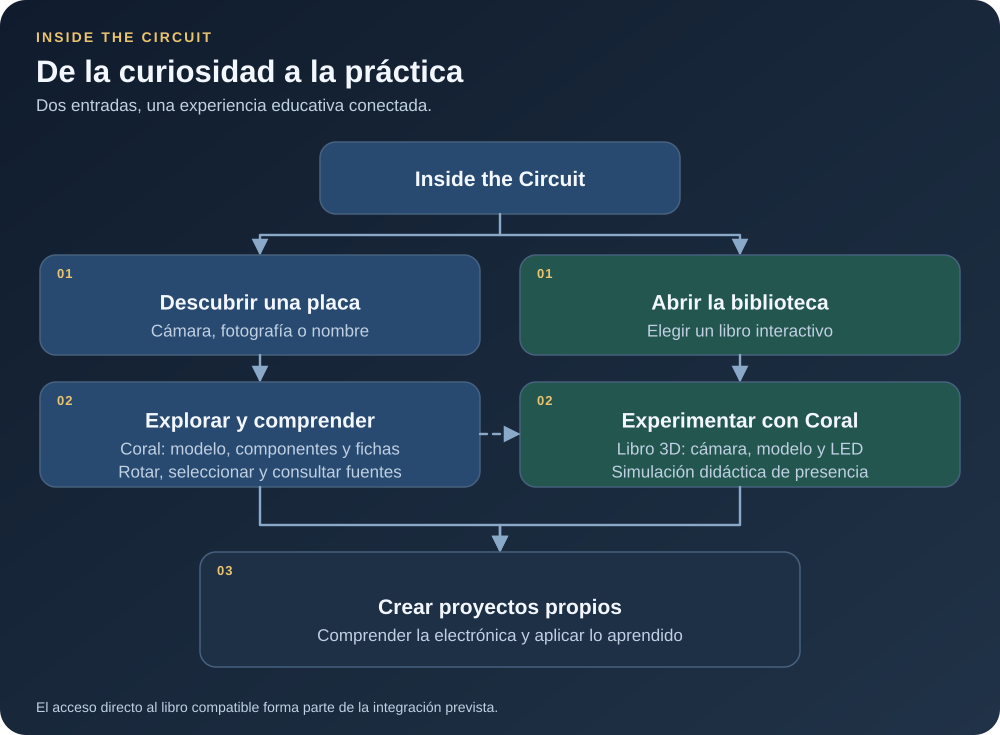
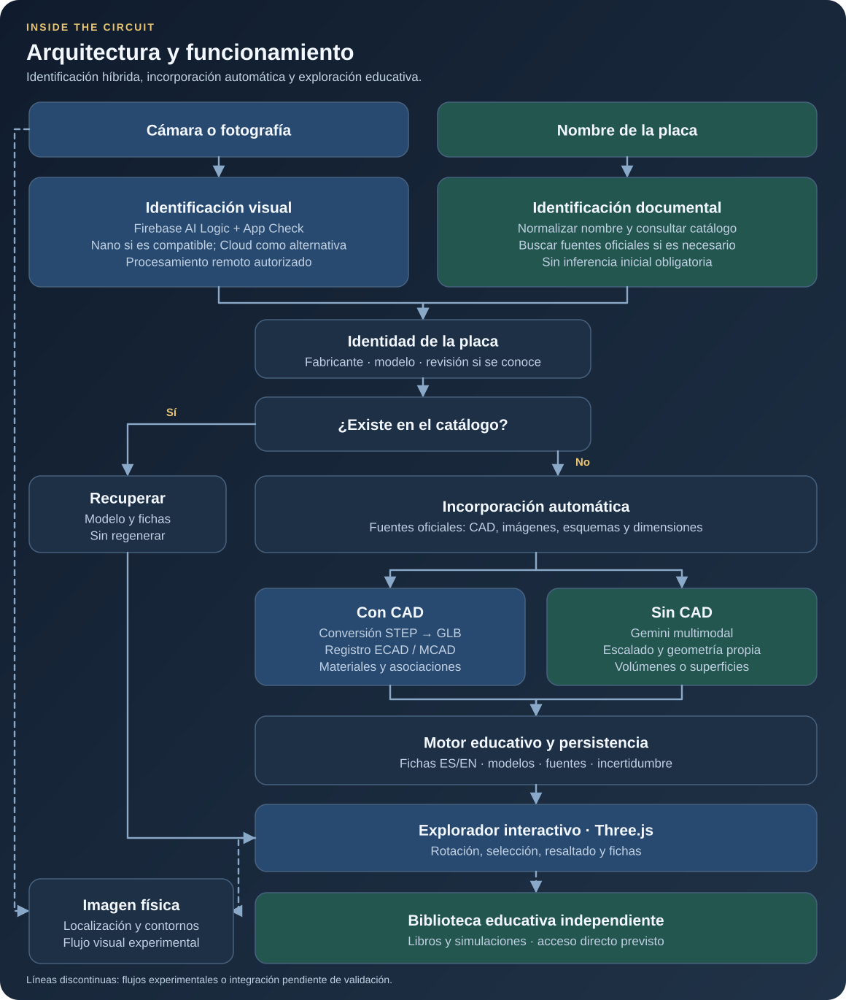
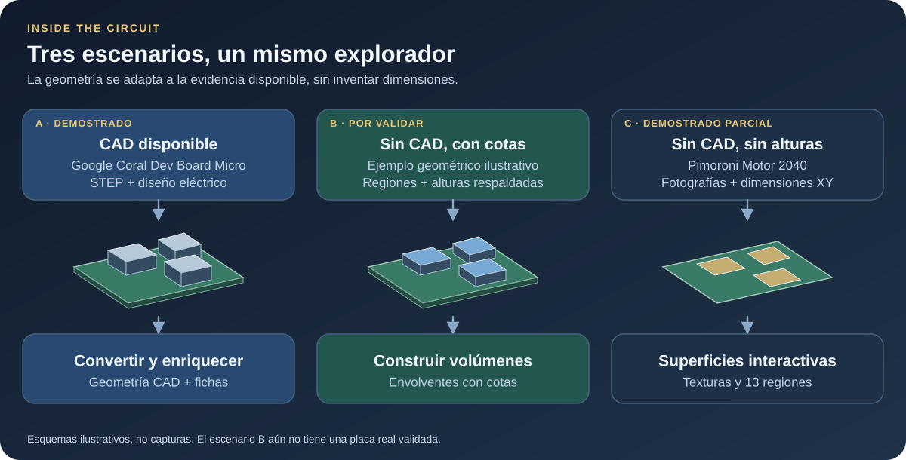
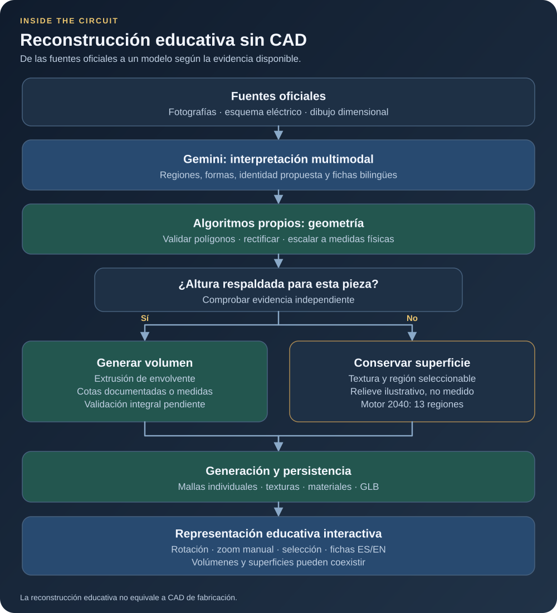
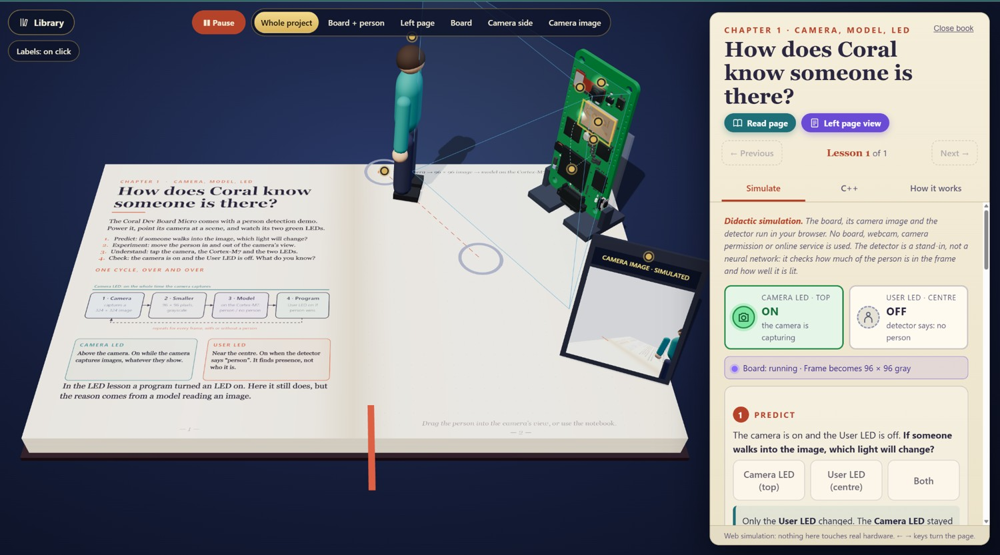
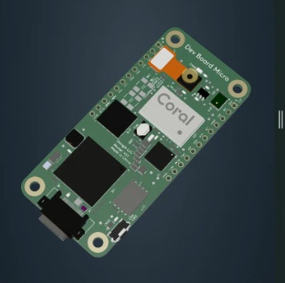
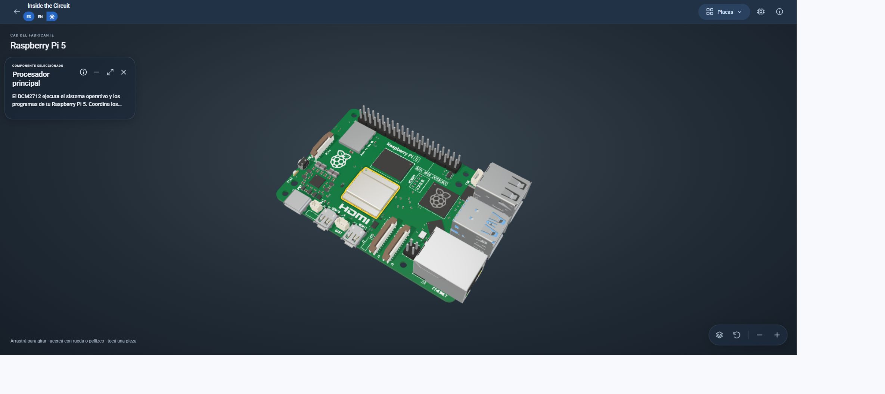
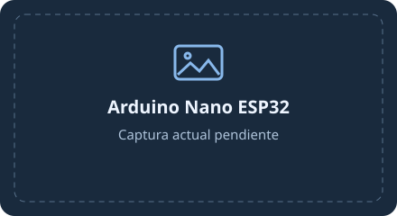
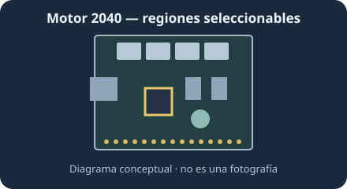

# Inside the Circuit

**Descubrir. Comprender. Experimentar.**

[English](README.md) · [Arquitectura técnica](docs/ARCHITECTURE.md)

Inside the Circuit es una aplicación educativa pensada para personas curiosas, prácticas y creativas, estudiantes y entusiastas de la electrónica. Transforma una placa en una experiencia interactiva de aprendizaje: descubrir sus componentes, comprender qué hacen, explorar su distribución física y experimentar con circuitos antes de crear proyectos propios.

El proyecto combina inteligencia artificial híbrida, algoritmos propios de procesamiento visual y geométrico, documentación técnica de fabricantes y libros interactivos en 3D. El objetivo no es simplemente reconocer una placa, sino comprender la electrónica que contiene.

> **#BuildHybridAI 2026 — integración en curso.** Los ejemplos y mediciones corresponden a resultados de desarrollo demostrados al 25 de noviembre de 2026. El despliegue móvil unificado, el recorrido completo desde cámara y la integración de la biblioteca aún no se han validado como una única versión.

## 1. De la curiosidad a la práctica



La **Google Coral Dev Board Micro** es nuestro ejemplo principal. Una persona puede explorar la placa, seleccionar un componente y consultar su función, y continuar aprendiendo con un libro sobre cómo Coral detecta la presencia de una persona. La incorporación de la placa y el explorador se han demostrado; el acceso directo al libro compatible forma parte de la integración prevista.

La biblioteca también es un punto de entrada independiente: no es necesario tener ni fotografiar una placa para abrir un libro.

## 2. Cómo funciona



### Dos formas diferentes de identificar una placa

| Cámara o fotografía | Nombre de la placa |
| --- | --- |
| Interpretar la imagen para proponer la identidad. | Normalizar el nombre y consultar el catálogo o la documentación oficial. |
| Preferir Gemini Nano local compatible; utilizar Gemini Cloud mediante Firebase AI Logic como alternativa autorizada. | No requiere inferencia inicial si el nombre y la evidencia documental son suficientes. |
| Conservar la imagen original para un flujo independiente de localización y contornos. | Continuar directamente con la recuperación o incorporación. |

Ambas rutas convergen en fabricante, modelo y revisión de hardware cuando se conoce. Si la placa ya está en el catálogo, se pueden reutilizar sus recursos sin reconstruir el modelo. Una identidad ambigua no debe convertirse silenciosamente en una coincidencia confirmada.

La selección de ruta visual está implementada, pero la prueba fotográfica de Coral quedó bloqueada por la falta de Nano y de configuración Cloud. Su incorporación demostrada comenzó, por tanto, con el nombre. La inferencia multimodal Cloud real se demostró por separado en la reconstrucción de Motor 2040.

### Inteligencia artificial híbrida y algoritmos propios

La IA interpreta imágenes e información técnica; los algoritmos deterministas realizan transformaciones de coordenadas, registro geométrico, generación de mallas, validación e interacción. Firebase AI Logic proporciona la integración de IA, con App Check y autorización explícita para el procesamiento remoto. La ruta Cloud es esencial en dispositivos sin Nano compatible.

La aplicación distingue identidad del modelo, asociación geométrica y evidencia educativa. Un resultado propuesto o incompleto no se convierte en un hecho verificado por el solo hecho de poder visualizarse.

## 3. Incorporación automática de una placa nueva

El proceso descubre recursos oficiales, registra su procedencia y situación de licencia, y elige una estrategia de representación según los recursos que realmente consigue obtener.



La decisión no es simplemente si existe CAD. Cuando no se encuentra un modelo utilizable, el sistema también distingue si dispone de dimensiones suficientes para construir volúmenes o si debe conservar superficies seleccionables. Una misma placa puede combinar piezas con volumen y piezas de altura desconocida.

### Escenario A — CAD disponible: Google Coral Dev Board Micro

A partir del nombre en un catálogo vacío, la aplicación encontró documentación oficial de Coral, un modelo mecánico STEP y archivos de diseño eléctrico Altium. Convirtió el STEP existente a GLB, registró las coordenadas eléctricas y mecánicas, asoció componentes y añadió detalles superficiales como contactos y serigrafía. Se trata de **conversión y enriquecimiento de CAD existente**, no de generación desde cero de la geometría de Coral.

El experimento documentado produjo 229 asociaciones entre diseño eléctrico y mallas, y ocho fichas educativas bilingües. Otras asociaciones y descripciones educativas permanecen incompletas. Las medidas de consistencia entre CAD y ECAD no certifican la precisión del reconocimiento fotográfico ni las tolerancias de fabricación.

- [Documentación oficial de Coral](https://gweb-coral-full.uc.r.appspot.com/docs/dev-board-micro/datasheet/)
- [Fuente del diseño mecánico](https://github.com/google-coral/mechanicals/tree/be47f619f5cb43b1fb19973abe988b733ed16560/dev_board_micro)
- [Fuente del diseño eléctrico](https://github.com/google-coral/electricals/tree/7250d49a08a296fb9aaabb2415b6c0e73355914a/dev_board_micro)

#### Enriquecimiento automático de CAD oficial (Automatic CAD Enrichment)

Coral demuestra que Inside the Circuit no se limita a visualizar el archivo del fabricante. En la prueba por nombre, la aplicación recuperó y combinó automáticamente el diseño mecánico (MCAD), el diseño eléctrico (ECAD) y una referencia fotográfica, sin un perfil específico de Coral preparado previamente y sin llamadas a Gemini en esa ejecución.

| Elemento | Qué aportó Inside the Circuit | Resultado y alcance comprobados |
| --- | --- | --- |
| Descubrimiento y adquisición | Localización de fuentes oficiales, descarga, registro de procedencia y reutilización de recursos. | 16 recursos descargados en la ejecución documentada. |
| Geometría mecánica | Teselación del STEP mediante OCCT y conversión a GLB para el navegador. | 333 mallas, 103.861 triángulos; dos de las 8.005 caras originales eran inválidas y se excluyeron con diagnóstico. No se reconstruyó el STEP desde cero. |
| Registro ECAD/MCAD | Extracción de cuerpos, capas y posiciones de Altium PcbDoc; transformación rígida entre los sistemas de coordenadas, sin deformar ni reescalar las piezas. | 119 cuerpos de ajuste y 110 reservados; discrepancia máxima de 0,0003501 mm en los reservados. Mide coherencia entre diseños digitales, no precisión física o fotográfica. |
| Identidad de componentes | Asociación por posición, dimensiones, lado, unicidad y margen frente a alternativas. | 229 asociaciones entre 333 mallas y 356 registros eléctricos; 104 mallas y 127 registros quedaron sin resolver. |
| Serigrafía | Recuperación y representación de los textos originales de ambas caras, alineados con el diseño. | 109 rótulos; 13 con fuentes TrueType incrustadas y 96 con sustitución de fuente de trazo declarada. |
| Contactos eléctricos | Extracción de pads y capas originales; generación de superficies alineadas con la geometría. | Cuatro capas de serigrafía/contactos en conjunto; no se añadieron pistas inventadas. |
| Taladros y recortes | Conservación de huecos del sustrato y comprobación de su alineación con el diseño eléctrico. | 32 centros de taladro localizados; 30/32 contornos validados. Dos contornos de conector quedaron pendientes. |
| Color y materiales | Muestreo del color de una fotografía oficial y aplicación de acabados visuales compartidos para sustrato, encapsulados y contactos. | Aproximación visual sin calibración fotométrica; no identifica composición química ni aleaciones. |
| Cara posterior | Aplicación de serigrafía y contactos procedentes del diseño eléctrico registrado. | Detalles visibles al rotar la placa; no se inventaron conexiones ocultas. |
| Interactividad | Vinculación de nodos con selección por raycasting o menú, resaltado y acceso a información, sin mover la cámara. | En la prueba posterior: 229/229 selecciones por menú y 222 centros distintos por clic directo en dos vistas de placa completa. |
| Contenido educativo | Generación de fichas ES/EN mediante reglas reutilizables y funciones explícitas en la documentación eléctrica. | 8 fichas bilingües documentadas; 221 asociaciones aún sin ficha educativa completa en esa prueba. |
| Persistencia | Almacenamiento del modelo, asociaciones, fichas y evidencia para reutilizarlos. | Incorporación fría por nombre: 60,87 s; verificación/reutilización de caché: 83,69 ms. No equivale al tiempo total de renderizado. |

El aporte técnico es la transformación de un modelo mecánico en una representación educativa que reúne **geometría, identidad eléctrica, apariencia, interactividad y conocimiento**. Las asociaciones no implican una verificación de todas las conexiones ni una reconstrucción universal de cualquier placa.

Evidencia de desarrollo: `docs/PHOTO_TO_EDUCATIONAL_BOARD.md` (commit `21e8aeea7479444afafa37ad480511f1334d5af6`) y `docs/SELECTION_FIXED_CAMERA.md` (commit `660c98183a7f3b2b5fcf3d4c33f2729b9d557670`). Las cifras corresponden a esas pruebas, no a nuevas mediciones de la versión de entrega.

### Escenario B — Sin CAD, con dimensiones suficientes

Cuando se dispone de cotas respaldadas por datasheets, dibujos dimensionales o mediciones reproducibles, el generador puede construir envolventes por extrusión a partir de las regiones rectificadas y escaladas. Las formas detalladas requieren evidencia y geometría adicional. Por ejemplo, una pieza rectangular con largo, ancho y altura documentados puede representarse como un volumen seleccionable sin importar un CAD de la placa.

Este es un **ejemplo ilustrativo de la capacidad del generador**, no una placa real reconstruida y validada. Todavía falta comprobar la obtención y vinculación automática de cotas individuales con una placa real. La representación sigue siendo educativa, no CAD de fabricación.

### Escenario C — Sin CAD y sin alturas individuales verificadas: Pimoroni Motor 2040



A partir únicamente del nombre, la aplicación descubrió fotografías oficiales, un esquema eléctrico y un dibujo dimensional. Gemini interpretó las imágenes y propuso regiones de componentes y descripciones bilingües. El generador geométrico rectificó la imagen de referencia, la escaló según las dimensiones documentadas de la placa, trianguló las superficies y creó mallas seleccionables individualmente con texturas fotográficas.

El resultado es una representación interactiva y visualmente reconocible con **13 regiones seleccionables y 13 fichas bilingües propuestas**. Se puede rotar y explorar sin que la selección de un componente modifique la cámara. No se utilizó ningún archivo CAD como entrada geométrica.

Es una reconstrucción educativa parcial, no CAD de fabricación. La prueba encontró las dimensiones generales (52 × 38 × 7,7 mm), pero no pudo establecer independientemente el espesor del PCB ni las alturas individuales. Se rechazaron las alturas sin respaldo. RC1 incorpora un sustrato ilustrativo de 1,6 mm y relieve de 0,6 mm en 13 regiones, además de la fotografía posterior oficial registrada. Son aproximaciones educativas, no alturas físicas verificadas de las piezas. La prueba incluyó correcciones y reanudaciones supervisadas; no fue una primera pasada totalmente desatendida.

[Documentación oficial de Motor 2040](https://shop.pimoroni.com/products/motor-2040)

## 4. Explorar, comprender y experimentar

El explorador Three.js permite rotación y zoom manuales, selección individual de componentes, contornos y resaltado, fichas educativas bilingües e información de procedencia. La selección no reposiciona automáticamente la cámara. El menú de proximidad ayuda a elegir entre componentes muy cercanos.

El proyecto independiente de libros interactivos amplía la exploración de componentes hacia el aprendizaje práctico. Su capítulo de Coral, **How does Coral know someone is there?**, ilustra la relación entre la entrada de cámara, el modelo y el comportamiento de los LED.



*Libro interactivo de Coral, captura de desarrollo proporcionada por la autora del proyecto. El detector es una simulación didáctica, no una red neuronal real ni una cámara física.*

El motor de libros y las simulaciones se mantienen en su propio proyecto. Inside the Circuit consume la publicación `3b77d06dcb899d922be0afa0cfad8d95557bd87a` mediante `npm run library:sync`: verifica sus 36 archivos de ejecución contra hashes Git fijados. No mantiene una copia manual divergente. La [biblioteca publicada](https://cafka.github.io/interactive-electronics-books/) se mantiene por separado; todavía no se ha confirmado el capítulo de Coral mostrado en su registro público.

## 5. Cuatro placas, distintas condiciones de partida

El catálogo es pequeño deliberadamente: estos casos permiten probar distintas fuentes, formatos, estrategias de asociación y niveles de información, sin depender de un único fabricante. No constituyen todavía una evaluación estadística de robustez universal.

| Captura del explorador | Placa y origen del modelo | Qué demuestra el caso |
| --- | --- | --- |
|  | **Google Coral Dev Board Micro** — CAD STEP y Altium oficiales, descubiertos automáticamente. | Incorporación por nombre en catálogo vacío, registro ECAD/MCAD, enriquecimiento de superficies, 229 asociaciones y 8 fichas bilingües. Es el ejemplo principal, sin perfil previo específico. |
|  | **Raspberry Pi 5** — STEP mecánico oficial sin gráficos, con perfil y activo preparados previamente. | Conversión CAD, materiales y detalles visuales; selección del BCM2712. Sirve también como caso histórico de procesamiento de fotografías físicas. No demuestra incorporación automática desde cero. |
|  | **Arduino Nano ESP32 (ABX00083)** — STEP oficial y diseño eléctrico; perfil preparado. | Enriquecimiento de un CAD visualmente incompleto: sustrato azul, 30 contactos, taladros y serigrafía de ambas caras. Cuatro componentes documentados; selección USB-C verificada. |
|  | **Pimoroni Motor 2040** — fotografías y documentación, sin CAD utilizable. | Descubrimiento por nombre, Gemini Cloud real, generación de superficies texturizadas y 13 regiones seleccionables con fichas propuestas; sin alturas individuales verificadas. |

*La captura real de Motor 2040 se conserva en el paquete de revisión, fuera de los recursos previstos para publicación, porque incluye texturas derivadas de una fotografía del fabricante sin licencia de redistribución confirmada. La imagen de la tabla es un esquema conceptual, no un resultado renderizado. Las capturas actuales de Pi y Nano se incorporarán tras su revisión de derechos.*

### Cobertura de las pruebas

| Condición | Evidencia |
| --- | --- |
| Reutilización de modelos preparados | Raspberry Pi 5 y Nano ESP32; regresiones focalizadas tras incorporar otras placas. |
| CAD con detalles gráficos incompletos | Nano ESP32: reconstrucción de detalles superficiales a partir del diseño eléctrico. |
| Placa nueva con CAD y ECAD disponibles | Coral: descubrimiento, conversión, registro y persistencia sin perfil específico previo. |
| Placa nueva sin CAD ni alturas individuales verificadas | Motor 2040: representación parcial seleccionable, con inferencia Cloud real. |
| Sin CAD con cotas individuales verificadas | Extrusión de envolventes implementada; todavía sin validación integral sobre una placa nueva real. |
| Fuentes insuficientes o no correlacionadas | Arduino UNO R4 Minima: prueba anterior devolvió documentación sin modelo; no se fabricó una geometría. No forma parte del catálogo de cuatro placas. |

La evidencia muestra adaptación a distintas condiciones y conservación de funcionalidades existentes, no una garantía de reconocimiento universal. Coral y Motor 2040 comenzaron por nombre; el flujo completo cámara → identificación → incorporación → contornos sigue pendiente de validación integral.

## 6. Qué hace y qué no hace

| Capacidad | Alcance demostrado o límite actual |
| --- | --- |
| Identificar una placa | Ruta documental demostrada; selección automática Nano/Cloud implementada. El recorrido fotográfico completo en la versión integrada aún requiere prueba real. |
| Incorporar placas desconocidas | Descubre fuentes y prepara recursos cuando encuentra evidencia suficiente; puede devolver un resultado parcial o solo documentación. |
| Generar representaciones interactivas | Convierte CAD oficial o genera mallas propias desde imágenes y documentación. No produce necesariamente volúmenes completos ni CAD apto para fabricación. |
| Localizar componentes | Asocia regiones de imagen o mallas con fichas; no garantiza la identidad de cada pieza, la exactitud de todos los contornos ni la detección de componentes ocultos. |
| Explicar electrónica | Fichas ES/EN con procedencia y estado de evidencia; algunas son propuestas pendientes de revisión. No verifica automáticamente todas las conexiones eléctricas. |
| Experimentar | Libros y simulaciones educativas independientes; no controla hardware real ni ejecuta necesariamente el modelo neuronal que explica. La navegación integrada sigue en validación. |
| Gestionar incertidumbre | Rechaza alturas sin evidencia, conserva asociaciones no resueltas y distingue hechos de estimaciones; no ofrece probabilidades de precisión calibradas. |

## 7. Resultados y rendimiento

Se han demostrado cuatro placas en distintos catálogos de desarrollo: Raspberry Pi 5, Arduino Nano ESP32, Google Coral Dev Board Micro y Pimoroni Motor 2040. Las cuatro ya se restauran en un catálogo local persistente con hashes de modelo verificados.

| Operación medida | Resultado | Contexto |
| --- | ---: | --- |
| Incorporación de Coral | 60,87 s | Ejecución local en frío, por nombre, CAD existente; sin Gemini |
| Consulta de caché de Coral | 83,69 ms | Verificación y reutilización local, no render completo |
| Reproducción de incorporación Motor 2040 | 22,30 s | Reconstrucción local con respuestas Gemini en caché |
| Inferencia Gemini Pro para Motor 2040 | 72,56 s | Consulta Cloud nueva que propuso 13 regiones |
| Primer cuadro Motor 2040 | 608,6 ms | Navegador de escritorio local, GLB preparado |
| Consulta de caché Motor 2040 | 43,36 ms | Mismo hash de modelo; sin nueva inferencia |

La prueba de Motor 2040 registró un gasto conocido estimado de US$0,275 por inferencias. La facturación demorada y una petición fallida impiden considerarlo un importe final. El informe registra 26 pruebas Node aprobadas y regresiones focalizadas de las otras tres placas. No demuestra precisión independiente de localización visual ni rendimiento en un teléfono real.

## 8. Próximas mejoras

Las prioridades inmediatas son **los tiempos de generación y los tiempos de presentación**: reducir la espera al incorporar una placa desconocida y mostrar contenido útil antes, mientras se termina de preparar el modelo. La reutilización de caché, la presentación progresiva y la eliminación de consultas redundantes son líneas de mejora a evaluar, no funcionalidades que se declaren implementadas.

También queda medir el rendimiento integral en un teléfono real y una VM de Google Cloud, validar la alternativa Cloud en vivo, validar todos los controles de lectura de la biblioteca fijada, y refinar el espesor, la cara posterior y la geometría de componentes cuando exista evidencia. Las asociaciones educativas y los contornos sobre fotografías requieren mayor validación independiente.

## 9. Instalación y documentación técnica

La implementación de desarrollo utiliza Node.js (24.12 o posterior), módulos ES de JavaScript, Three.js, Firebase AI Logic, Python, NumPy, OpenCV, Pillow y herramientas de conversión CAD basadas en OCCT. Algunas dependencias y recursos se preparan por separado en el entorno de desarrollo.

### Tecnologías y responsabilidades

| Capa | Tecnología | Función concreta |
| --- | --- | --- |
| Interfaz | HTML, CSS, JavaScript ES modules, esbuild 0.28.2 | Interfaz bilingüe, captura/carga, catálogo, navegación y empaquetado de módulos. |
| Visualización | Three.js 0.187.0, WebGL, glTF/GLB | Render de mallas, materiales, órbita manual, raycasting y selección por proximidad. La biblioteca usa su propio motor Three.js r170. |
| Servidor | Node.js ≥ 24.12, HTTP, sistema de archivos | API de catálogo e incorporación, orquestación de trabajos, persistencia JSON y activos GLB; el servidor de desarrollo escucha en localhost. No es todavía un backend HTTPS público. |
| IA híbrida | Firebase JS SDK 13.4.0, Firebase AI Logic, Gemini Nano / Gemini Cloud, App Check | Identidad visual estructurada, interpretación multimodal y propuestas educativas. Selección de ruta según disponibilidad y autorización. Motor 2040 utilizó Gemini 3.1 Pro Preview; Flash Lite produjo una respuesta rechazada. |
| Procesamiento visual | Python, OpenCV, NumPy, Pillow; Sharp en herramientas de imagen | Homografía y rectificación, escala en milímetros, máscaras, triangulación y texturas; las regiones propuestas por IA no son mediciones independientes. |
| CAD y registro | STEP, OCCT 7.9.3 / cadquery-ocp, Altium PcbDoc, scripts Python/JS | Teselación de CAD, extracción de cuerpos y capas eléctricas, transformación rígida ECAD/MCAD y asociación por posición, dimensiones, lado y unicidad. |
| Evidencia y pruebas | JSON, SHA-256, Node test runner, Playwright/Chrome | Contratos de datos, trazabilidad, caché, regresiones y pruebas de interacción; validación de contrato no equivale a precisión física. |
| Infraestructura objetivo | Google Cloud VM, HTTPS, Firebase/App Check | Medición del backend y acceso móvil; despliegue integrado, costos y rendimiento real pendientes de verificación. |

Versiones verificadas en los manifiestos e informes de desarrollo del 25/11/2026; actualizar contra el commit de entrega. La arquitectura no presupone que la VM ejecute Gemini Nano: la inferencia local depende del dispositivo compatible, mientras que Cloud utiliza el servicio remoto.

Los comandos documentados del explorador local, desde la raíz del repositorio, son:

```sh
git clone https://github.com/cafka/inside-the-circuit-demo.git
cd inside-the-circuit-demo
npm ci
npm run build
npm run library:sync
# Para los cuatro modelos: instalar antes Python; ver INSTALLATION.md.
npm run catalog:restore
npm start
```

Abrir `http://127.0.0.1:4188/`. Consultar la [instalación](docs/INSTALLATION.md), la [verificación de publicación](docs/PUBLICATION_V4.md) y la [arquitectura](docs/ARCHITECTURE.md) para conocer el alcance probado, la configuración del backend y los límites pendientes. Dependencias y entradas externas están fijadas por versión/hash. Una inferencia Cloud nueva requiere aplicación Firebase, App Check obligatorio y consentimiento; no incluir credenciales privadas ni tokens de depuración en Git.

La distribución pública incluye frontend, backend Node, generadores CAD/ECAD y sin CAD, adaptador Firebase y pruebas. No contiene la historia de investigación. La vista HTTPS temporal autenticada se distingue del alojamiento público persistente; el informe de verificación registra la dirección realmente desplegada y su disponibilidad.

## 10. Licencia y atribuciones

Código propio: MIT (ver `LICENSE` del repositorio). Los CAD, fotografías, documentación, fuentes, bibliotecas y demás recursos externos conservan sus respectivas licencias; la licencia del proyecto no concede derechos de redistribución de material de terceros. El motor de libros se mantiene de forma independiente. No se implica afiliación ni respaldo de los fabricantes.

Evidencias de desarrollo: `docs/PHOTO_TO_EDUCATIONAL_BOARD.md`, `docs/SELECTION_FIXED_CAMERA.md` y `docs/NO_CAD_BOARD_RECONSTRUCTION.md` en el repositorio de desarrollo. La distribución pública debe incluir un subconjunto de evidencias revisado en cuanto a derechos, adquisición reproducible de fuentes y atribuciones correspondientes.
