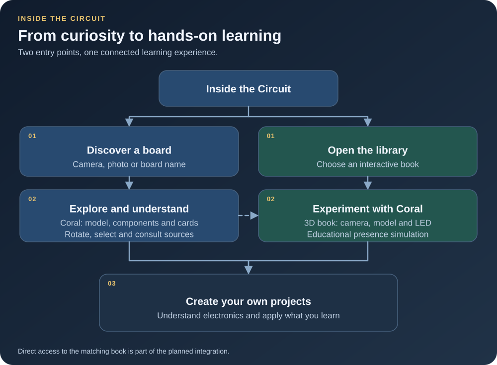
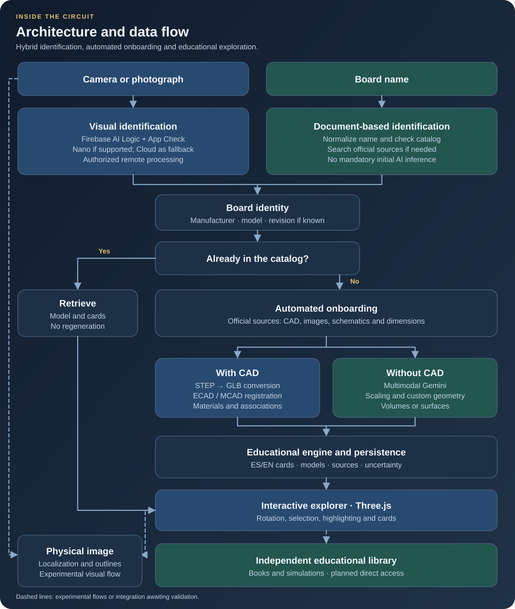
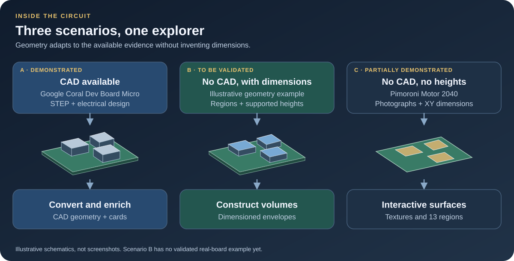
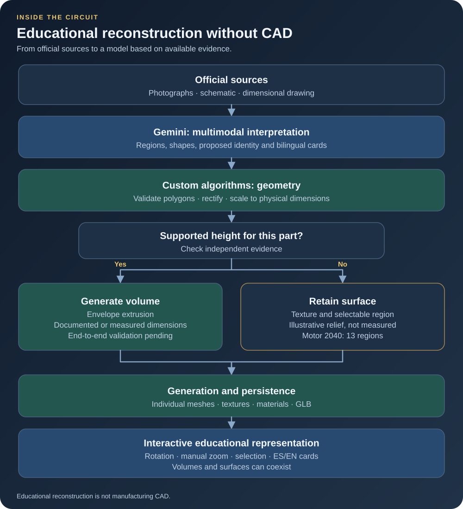
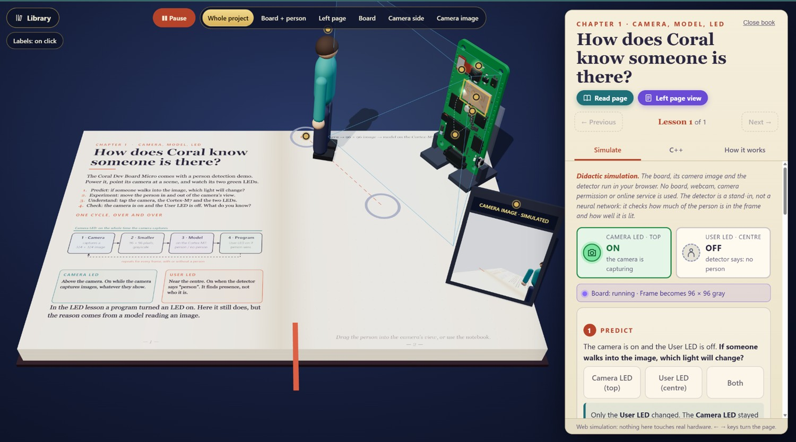
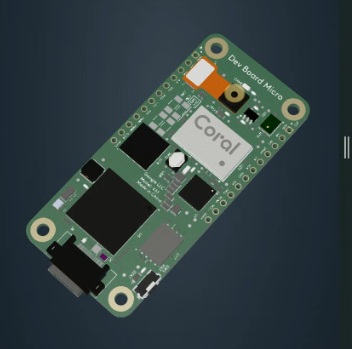
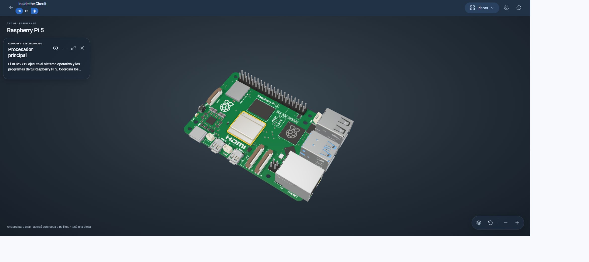
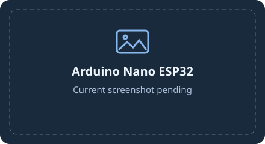
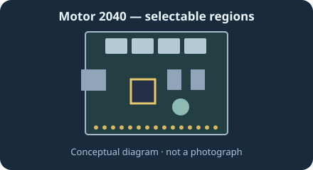

# Inside the Circuit

**Discover. Understand. Experiment.**

[Español](README.es.md) · [Technical architecture](docs/ARCHITECTURE.md)

Inside the Circuit is an educational application for curious, practical and creative people, students and electronics enthusiasts. It turns a circuit board into an interactive learning experience: discover its components, understand what they do, explore their physical arrangement and experiment with circuits before building your own projects.

The project combines hybrid AI, custom visual and geometric algorithms, manufacturers' technical documentation and interactive 3D books. The aim is not simply to recognize a board, but to make the electronics inside it understandable.

> **#BuildHybridAI 2026 — integration in progress.** The examples and measurements below describe demonstrated development results as of 25 November 2026. The unified mobile deployment, full camera-to-model workflow and library integration are not yet validated as a single release.

## 1. From curiosity to hands-on learning



**Google Coral Dev Board Micro** is our main example. A learner can explore the board, select a component and read its function, then continue learning with a book about how Coral detects the presence of a person. The board onboarding and explorer have been demonstrated; the direct transition to the matching book is part of the planned integration.

The library is also an independent entry point: learners can open a book without owning or photographing a board.

## 2. How it works



### Two different ways to identify a board

| Camera or photograph | Board name |
| --- | --- |
| Interpret the image to propose a board identity. | Normalize the name and consult the catalog or official documentation. |
| Prefer compatible on-device Gemini Nano; fall back to Gemini Cloud through Firebase AI Logic with authorization. | No initial AI inference is required when the name and documentary evidence are sufficient. |
| Retain the original image for a separate visual localization and outline pipeline. | Continue directly to catalog retrieval or onboarding. |

Both routes converge on the manufacturer, model and hardware revision when known. An existing catalog entry can be reused instead of rebuilding the model. An ambiguous identity must not silently become a confirmed match.

The visual identification routing has been implemented, but the Coral photo trial was blocked by unavailable Nano and missing Cloud configuration. The demonstrated Coral onboarding therefore began with its name. Real Cloud multimodal inference was demonstrated separately in the Motor 2040 reconstruction trial.

### Hybrid AI and custom algorithms

AI interprets images and technical information; deterministic algorithms handle coordinate transforms, geometric registration, mesh construction, validation and interaction. Firebase AI Logic provides the AI integration, with App Check and explicit authorization for remote processing. The Cloud route is essential on devices without compatible Nano support.

The application keeps model identity, geometric association and educational evidence separate. Proposed or incomplete results are not promoted to verified facts simply because they can be rendered.

## 3. Automatically onboarding a new board

The onboarding pipeline discovers official resources, records their origin and licensing status, and chooses a representation strategy based on the resources it can actually obtain.



The decision is not simply whether CAD exists. When no usable model is found, the system also distinguishes whether sufficient dimensions support volumes or whether selectable surfaces must be retained. A single board may combine volumetric parts and parts of unknown height.

### Scenario A — CAD available: Google Coral Dev Board Micro

Starting with the name in an empty catalog, the application located official Coral documentation, a STEP mechanical model and Altium electrical design files. It converted the existing STEP to GLB, registered electrical and mechanical coordinates, associated components and added surface details such as contacts and silkscreen. This is **conversion and enrichment of existing CAD**, not generation of Coral's geometry from scratch.

The documented experiment produced 229 electrical-to-mesh associations and eight bilingual educational cards. Other associations and educational descriptions remain incomplete. The CAD-to-ECAD consistency measurements do not establish photographic recognition accuracy or manufacturing tolerances.

- [Official Coral documentation](https://gweb-coral-full.uc.r.appspot.com/docs/dev-board-micro/datasheet/)
- [Mechanical design source](https://github.com/google-coral/mechanicals/tree/be47f619f5cb43b1fb19973abe988b733ed16560/dev_board_micro)
- [Electrical design source](https://github.com/google-coral/electricals/tree/7250d49a08a296fb9aaabb2415b6c0e73355914a/dev_board_micro)

#### Automatic CAD enrichment

Coral demonstrates that Inside the Circuit does more than display a manufacturer's file. In the name-driven trial, the application automatically acquired and combined mechanical design (MCAD), electrical design (ECAD) and a photographic reference, without a preconfigured Coral-specific profile or Gemini calls in that run.

| Element | What Inside the Circuit added | Demonstrated result and scope |
| --- | --- | --- |
| Discovery and acquisition | Official-source discovery, download, provenance tracking and resource reuse. | 16 resources downloaded in the documented run. |
| Mechanical geometry | STEP tessellation with OCCT and conversion to browser-ready GLB. | 333 meshes, 103,861 triangles; two of 8,005 original faces were invalid and excluded with a diagnostic. The STEP was not reconstructed from scratch. |
| ECAD/MCAD registration | Extracted Altium PcbDoc bodies, layers and positions; rigid transformation between coordinate systems without deforming or rescaling parts. | 119 fitting bodies and 110 held-out bodies; maximum held-out discrepancy of 0.0003501 mm. This measures digital-design consistency, not physical or photographic accuracy. |
| Component identity | Matching by position, dimensions, side, uniqueness and margin against alternatives. | 229 associations across 333 meshes and 356 electrical records; 104 meshes and 127 records remained unresolved. |
| Silkscreen | Recovered and rendered original labels on both sides, aligned with the design. | 109 labels; 13 used embedded TrueType fonts and 96 used a declared stroke-font substitution. |
| Electrical contacts | Extracted original pads and layers and generated aligned surfaces. | Four combined silkscreen/contact layers; no invented traces were added. |
| Drills and cutouts | Preserved substrate openings and checked alignment with the electrical design. | 32 drill centers located; 30/32 contours validated. Two connector contours remained unresolved. |
| Color and materials | Sampled color from an official photograph and applied shared visual finishes for substrate, packages and contacts. | Uncalibrated visual approximation, not identification of chemical composition or alloys. |
| Rear side | Applied silkscreen and contacts from the registered electrical design. | Details visible when rotating the board; no hidden connections were invented. |
| Interactivity | Linked nodes to raycast/menu selection, highlighting and information without moving the camera. | Later test: 229/229 menu selections and 222 distinct direct center clicks across two whole-board views. |
| Educational content | Generated ES/EN cards using reusable rules and explicit functions from electrical documentation. | 8 documented bilingual cards; 221 associations still lacked a complete educational card in that trial. |
| Persistence | Stored the model, associations, cards and evidence for reuse. | Cold name-driven onboarding: 60.87 s; cache verification/reuse: 83.69 ms. Not total rendering time. |

The technical contribution is transforming a mechanical model into an educational representation combining **geometry, electrical identity, appearance, interactivity and knowledge**. These associations do not establish every electrical connection or universal reconstruction of arbitrary boards.

Development evidence: `docs/PHOTO_TO_EDUCATIONAL_BOARD.md` (commit `21e8aeea7479444afafa37ad480511f1334d5af6`) and `docs/SELECTION_FIXED_CAMERA.md` (commit `660c98183a7f3b2b5fcf3d4c33f2729b9d557670`). Figures refer to those trials, not new measurements of the release.

### Scenario B — No CAD, sufficient dimensional evidence

When dimensions are supported by datasheets, dimensional drawings or reproducible measurements, the generator can extrude envelopes from rectified and scaled regions. Detailed shapes require additional evidence and geometry. For example, a rectangular part with documented length, width and height can be represented as a selectable volume without importing board CAD.

This is an **illustrative example of generator capability**, not a real reconstructed and validated board. Automatic extraction and binding of individual dimensions to a real board still need validation. The representation remains educational, not manufacturing CAD.

### Scenario C — No CAD and no verified individual heights: Pimoroni Motor 2040



Starting with the name alone, the application discovered official photographs, a schematic and a dimensional drawing. Gemini interpreted the images and proposed component regions and bilingual descriptions. The geometric generator rectified the reference image, scaled it using documented board dimensions, triangulated surfaces and created individually selectable meshes with photographic textures.

The result is an interactive, visually recognizable representation with **13 selectable regions and 13 proposed bilingual cards**. It can be rotated and explored without changing the camera when a component is selected. No CAD file was used as geometric input.

This is a partial educational reconstruction, not manufacturing CAD. The experiment found the overall dimensions (52 × 38 × 7.7 mm), but could not independently establish the PCB thickness or individual component heights. Unsupported height proposals were rejected. RC1 now uses an explicitly illustrative 1.6 mm substrate and 0.6 mm relief for 13 regions, plus a registered official rear photograph. These values are educational approximations, not verified physical component heights. The trial involved supervised corrections and replays; it was not a fully unattended first pass.

[Official Motor 2040 product documentation](https://shop.pimoroni.com/products/motor-2040)

## 4. Explore, understand and experiment

The Three.js explorer supports manual rotation and zoom, individual component selection, outlines and highlights, bilingual educational cards and source information. Selecting a component does not automatically reposition the camera. Nearby alternatives help users choose between closely spaced components.

The independent interactive-book project extends this experience from component exploration to practical learning. Its Coral chapter, **How does Coral know someone is there?**, illustrates the relationship between camera input, a model and LED behavior.



*Coral interactive book, development screenshot supplied by the project owner. The detector shown is a didactic stand-in, not a real neural network or physical camera feed.*

The book engine and simulations remain in their own project. Inside the Circuit consumes publication `3b77d06dcb899d922be0afa0cfad8d95557bd87a` through `npm run library:sync`; its 36 runtime files are verified against a committed Git-blob lock. No manually diverging copy is maintained. The [published library](https://cafka.github.io/interactive-electronics-books/) is maintained separately; the Coral chapter shown above has not been confirmed in its public registry.

## 5. Four boards, different starting conditions

The catalog is deliberately small: these cases exercise different sources, formats, association strategies and levels of available evidence rather than relying on one manufacturer. They are not yet a statistical evaluation of universal robustness.

| Explorer image | Board and model origin | What this case demonstrates |
| --- | --- | --- |
|  | **Google Coral Dev Board Micro** — official STEP and Altium files, discovered automatically. | Name-based onboarding in an empty catalog, ECAD/MCAD registration, surface enrichment, 229 associations and 8 bilingual cards. Main example, without a preconfigured board-specific profile. |
|  | **Raspberry Pi 5** — official mechanical STEP without graphics, with a previously prepared profile and asset. | CAD conversion, materials and visual detail; BCM2712 selection. Also the historical physical-photo processing case. Not evidence of automatic onboarding from scratch. |
|  | **Arduino Nano ESP32 (ABX00083)** — official STEP and electrical design; prepared profile. | Enrichment of visually incomplete CAD: blue substrate, 30 contacts, holes and silkscreen on both sides. Four documented components; USB-C selection verified. |
|  | **Pimoroni Motor 2040** — photographs and documentation, no usable CAD. | Name-based discovery, real Gemini Cloud inference, textured surfaces and 13 selectable regions with proposed cards; no verified individual heights. |

*The actual Motor 2040 screenshot is retained in the review package, outside the intended publication assets, because it contains textures derived from a manufacturer photograph with unconfirmed redistribution rights. The table uses a conceptual diagram, not a rendered result. The Pi screenshot was captured from the current release. Nano remains withheld from public screenshots: its separate STEP archive has no explicit redistribution notice. Its CC BY-SA electrical artwork is attributed separately.*

### Test coverage

| Condition | Evidence |
| --- | --- |
| Reuse of prepared models | Raspberry Pi 5 and Nano ESP32; focused regression checks after onboarding other boards. |
| CAD with incomplete graphical detail | Nano ESP32: surface detail reconstructed from the electrical design. |
| New board with CAD and ECAD | Coral: discovery, conversion, registration and persistence without a preconfigured board-specific profile. |
| New board without CAD or verified individual heights | Motor 2040: partial selectable representation with real Cloud inference. |
| No CAD, supported individual dimensions | Envelope extrusion implemented; end-to-end validation on a real new board remains pending. |
| Insufficient or uncorrelated sources | Arduino UNO R4 Minima: an earlier trial returned documentation only; no geometry was fabricated. Not part of the four-board catalog. |

The evidence demonstrates adaptation to different conditions and preservation of existing features, not universal recognition. Coral and Motor 2040 started from a name; the full camera → identity → onboarding → outlines workflow still needs end-to-end validation.

## 6. What it does and does not do

| Capability | Demonstrated scope or current limit |
| --- | --- |
| Identify a board | Documentary route demonstrated; automatic Nano/Cloud routing implemented. The integrated photographic workflow still needs real testing. |
| Onboard unfamiliar boards | Discovers sources and prepares resources when evidence is sufficient; may return a partial or documentation-only result. |
| Generate interactive representations | Converts official CAD or generates meshes from images and documents. Does not necessarily produce complete volumes or manufacturing-ready CAD. |
| Locate components | Associates image regions or meshes with cards; does not guarantee every identity, outline or hidden-component detection. |
| Explain electronics | EN/ES cards with provenance and evidence status; some are proposals awaiting review. Does not automatically verify every electrical connection. |
| Experiment | Independent educational books and simulations; they do not control real hardware or necessarily run the neural model they explain. Integrated navigation is pending validation. |
| Handle uncertainty | Rejects unsupported heights, retains unresolved associations and separates facts from estimates; does not provide calibrated accuracy probabilities. |

## 7. Results and performance

Four boards have been demonstrated across development catalogs: Raspberry Pi 5, Arduino Nano ESP32, Google Coral Dev Board Micro and Pimoroni Motor 2040. All four are now restored into one persistent local catalog with verified model hashes.

| Measured operation | Result | Context |
| --- | ---: | --- |
| Coral onboarding | 60.87 s | Cold local run, name input, existing CAD; no Gemini calls |
| Coral cache lookup | 83.69 ms | Local verification/reuse, not full render |
| Motor 2040 onboarding replay | 22.30 s | Local reconstruction using cached Gemini responses |
| Motor 2040 Gemini Pro inference | 72.56 s | Fresh Cloud request producing 13 proposed regions |
| Motor 2040 first frame | 608.6 ms | Local desktop browser, prepared GLB |
| Motor 2040 cache lookup | 43.36 ms | Same model hash; no new inference |

The Motor 2040 trial recorded an estimated US$0.275 in known inference usage; delayed billing and an unsuccessful request mean this is not a final invoice. The report records 26 passing Node tests and focused regressions on the other three boards. It does not establish independent visual localization accuracy or real-phone performance.

## 8. Next improvements

The immediate priorities are **generation time and presentation time**: reduce the wait when onboarding an unfamiliar board, and show useful content sooner while the rest of the model is being prepared. Cache reuse, progressive presentation and avoiding redundant requests are directions to evaluate, not claimed implemented features.

Additional work includes measuring end-to-end performance on a real phone and Google Cloud VM, validating the live Cloud fallback, validating all pinned-library reading controls, and refining component geometry where evidence permits. Educational associations and camera overlays require further independent validation.

## 9. Installation and technical documentation

The current development implementation uses Node.js (24.12 or later), JavaScript ES modules, Three.js, Firebase AI Logic, Python, NumPy, OpenCV, Pillow and an OCCT-based CAD conversion toolchain. Some dependencies and source assets are provisioned separately in the development environment.

### Technologies and responsibilities

| Layer | Technology | Concrete role |
| --- | --- | --- |
| Interface | HTML, CSS, JavaScript ES modules, esbuild 0.28.2 | Bilingual interface, capture/upload, catalog, navigation and module bundling. |
| Visualization | Three.js 0.187.0, WebGL, glTF/GLB | Mesh rendering, materials, manual orbit, raycasting and proximity selection. The book library has its own Three.js r170 engine. |
| Server | Node.js ≥ 24.12, HTTP, filesystem | Catalog and onboarding API, job orchestration, JSON records and GLB assets; development server binds to localhost. Not yet a public HTTPS backend. |
| Hybrid AI | Firebase JS SDK 13.4.0, Firebase AI Logic, Gemini Nano / Gemini Cloud, App Check | Structured visual identity, multimodal interpretation and educational proposals. Routing depends on availability and authorization. Motor 2040 used Gemini 3.1 Pro Preview; a Flash Lite response was rejected. |
| Visual processing | Python, OpenCV, NumPy, Pillow; Sharp for image tooling | Homography and rectification, millimeter scale, masks, triangulation and textures; AI-proposed regions are not independent measurements. |
| CAD and registration | STEP, OCCT 7.9.3 / cadquery-ocp, Altium PcbDoc, Python/JS scripts | CAD tessellation, electrical body/layer extraction, rigid ECAD/MCAD transform and matching by position, dimensions, side and uniqueness. |
| Evidence and tests | JSON, SHA-256, Node test runner, Playwright/Chrome | Data contracts, traceability, cache, regressions and interaction checks; contract validation is not physical accuracy. |
| Target infrastructure | Google Cloud VM, HTTPS, Firebase/App Check | Backend benchmarking and mobile access; integrated deployment, costs and real performance remain to be verified. |

Versions checked against development manifests and reports dated 25 November 2026; update against the release commit. The architecture does not assume the VM runs Gemini Nano: local inference depends on a compatible client device, while Cloud uses the remote service.

The documented local explorer commands, from the repository root, are:

```sh
git clone https://github.com/cafka/inside-the-circuit-demo.git
cd inside-the-circuit-demo
npm ci
npm run build
npm run library:sync
# For all four models: install Python dependencies first; see INSTALLATION.md.
npm run catalog:restore
npm start
```

Open `http://127.0.0.1:4188/`. See [installation](docs/INSTALLATION.md), [publication verification](docs/PUBLICATION_V4.md) and [technical architecture](docs/ARCHITECTURE.md) for the exact tested scope, backend setup and remaining limitations. Dependencies and external model inputs are pinned. Fresh Cloud inference needs a configured Firebase web app, enforced App Check and user consent; no debug tokens or private credentials belong in Git.

The public source distribution contains the frontend, Node backend, CAD/ECAD and no-CAD generators, Firebase adapter and tests. The research history is not included. Temporary authenticated HTTPS preview is separate from persistent public hosting; the verification report records the actual deployed URL and availability.

## 10. License and attribution

Project code: MIT (see the repository's `LICENSE`). External CAD, photographs, documentation, fonts, libraries and other assets retain their respective licenses; the project license does not grant redistribution rights to third-party material. The book engine is maintained independently. No affiliation or endorsement by the board manufacturers is implied.

Development evidence: `docs/PHOTO_TO_EDUCATIONAL_BOARD.md`, `docs/SELECTION_FIXED_CAMERA.md` and `docs/NO_CAD_BOARD_RECONSTRUCTION.md` in the development repository. A public release should include a rights-reviewed subset of the evidence, reproducible source acquisition and appropriate third-party notices.
