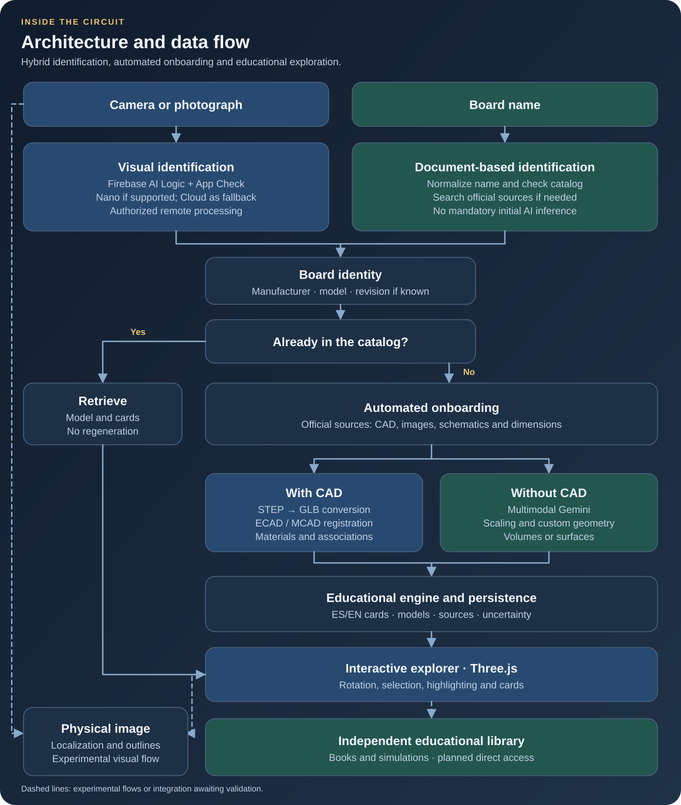
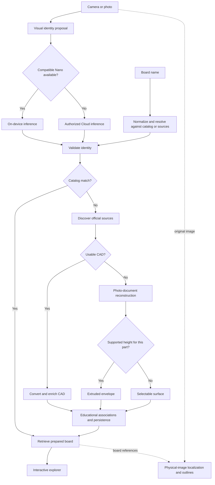
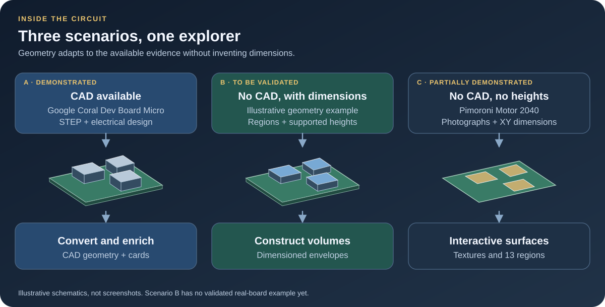
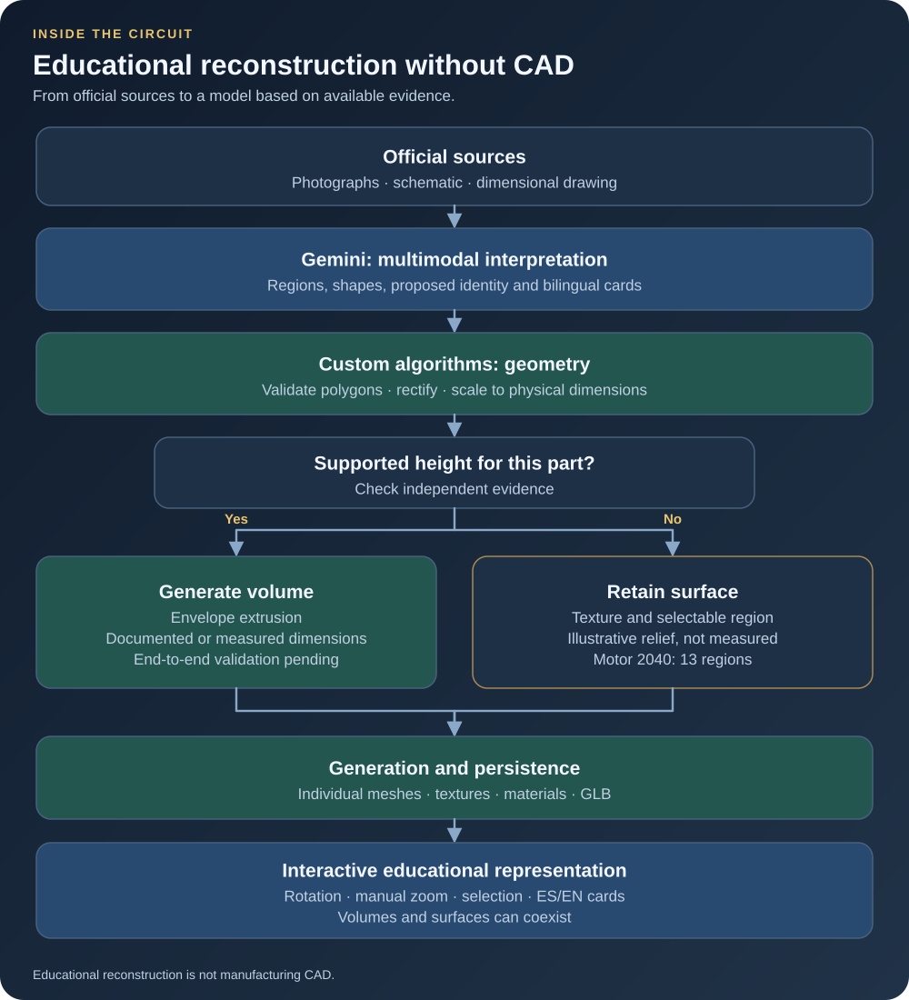
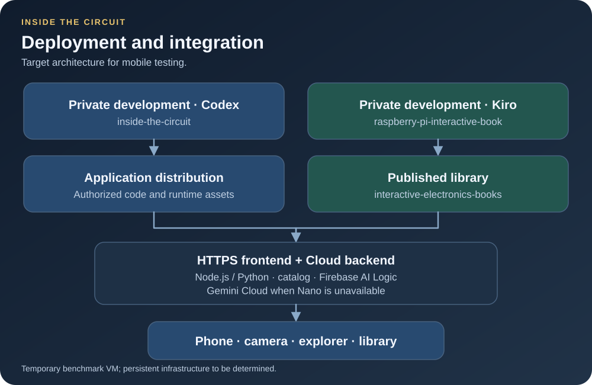

# Inside the Circuit — Technical architecture

[README](../README.md) · [Español](../README.es.md)

**Status:** architecture companion for the integration release. This document distinguishes the demonstrated implementation from planned deployment and integration. Update it against the actual release commit before public submission.

## 1. Logical architecture

The browser provides two identification entry points, an interactive explorer and a pinned independent-library integration. A board name can be resolved without an initial AI inference; an image requires visual interpretation. The original image remains a separate input to the physical-image localization pipeline. Identity resolution, catalog retrieval, physical-image localization and ECAD/MCAD association are distinct operations.

### Responsibilities and implementation references

| Module | Responsibility | Development implementation |
| --- | --- | --- |
| Web interface | Entry, catalog, cards, selection and navigation | `experiments/board-library/app.mjs`, `index.html`, `experience.css` |
| Photo routing | Choose compatible Nano or authorized Cloud, validate proposed identity | `experiments/board-library/photo-onboarding.mjs`, `src/identity/` |
| Documentary discovery | Resolve name, discover and acquire official sources | `experiments/board-library/discovery.mjs`, `onboard-name.mjs` |
| CAD and ECAD registration | Convert mechanical model, extract electrical geometry, associate compatible bodies | `ecad-geometry.py`, `register-ecad.py`, `physical-binding.mjs`, `prepare-board-surfaces.py` |
| No-CAD reconstruction | Source manifest, multimodal observations, validation, mesh generation | `reconstruct-photo.mjs`, `reconstruction-gemini.mjs`, `reconstruction-schema.mjs`, `reconstruction-height-evidence.mjs`, `generate-photo-model.py` |
| Catalog and server | Store prepared board records, assets and evidence; serve application | `experiments/board-library/catalog.mjs`, `server.mjs` |
| Book engine | Separate Three.js simulations and chapter registry | `cafka/raspberry-pi-interactive-book` → `cafka/interactive-electronics-books` |

Python and JavaScript file names without a path refer to the board-library implementation area. Confirm paths and interfaces against the integrated release; this is not an exhaustive API reference.

## 2. Identification and onboarding

The flow represents the intended integration; photo identification and physical-image localization have not been validated end to end in the integrated product. Ambiguous or unsupported identity proposals must be rejected or clarified. A failed or unauthorized Cloud request must not silently become a successful recognition.

## 3. Geometric processing and evidence

### CAD route

The Coral experiment used an existing STEP and Altium design. OCCT converted the mechanical geometry; electrical records provided positions, body dimensions, layers, pads, holes and text. The registration algorithm enumerated physically consistent axis permutations and signs, checked dimensions and sides, and used reserved bodies to evaluate the transformation. The result was 229 associations; remaining mesh nodes and electrical records were left unresolved. The two invalid CAD faces were excluded with a documented warning. Digital-design agreement is not independent physical or photographic accuracy.

The [English README](../README.md#automatic-cad-enrichment) and [Spanish README](../README.es.md#enriquecimiento-automático-de-cad-oficial-automatic-cad-enrichment) contain the complete Coral enrichment table, including geometry, registration, unresolved associations, silkscreen, contacts, drill checks, visual materials, rear-side layers, selection, education and persistence. The table separates the contribution of the application from the manufacturer's original design and preserves the limits of the measured evidence.

### No-CAD route: supported volumes or selectable surfaces

The Motor 2040 generator consumes images, observations and visual policies, not an existing CAD model. The multimodal response proposes polygons, identities, shapes and educational content. Local validation checks the response contract, not the truth of every observation. Rectification and scale use the board's documented planar dimensions. Triangulated surfaces, textures and individually addressable nodes are exported to GLB. The generator supports extrusion envelopes when independent height evidence is supplied; the automatic extraction and verification of such evidence is still incomplete. The dimensional example is illustrative, not an independently validated board. Unknown physical heights remain unknown. RC1 applies explicitly illustrative 0.6 mm relief to 13 regions and a 1.6 mm substrate, using the versioned presentation policy. Neither is a measured component height. The registered official rear image is retained locally with its redistribution limitation.

### Evidence and interaction

Persist source URLs, hashes, licensing status, model identity, proposed component identities, association evidence and uncertainty. Do not treat model-generated confidence as calibrated probability. Distinguish source-backed facts from interpretations. The explorer uses raycasting and explicit nearby alternatives, highlights selected geometry and opens the relevant card without moving the camera.

## 4. Deployment and library integration — planned

Keep the research and book-development repositories independent. Publish a rights-reviewed, reproducible application distribution separately. The public hackathon submission must include the source code needed to reproduce the application, license and setup instructions; a deployment URL alone is not a substitute. Private research history and discarded experiments need not be copied into the public distribution.

The phone requires an HTTPS frontend for camera access. Node/Python processing and persistent catalog operations need an appropriate backend, not static GitHub Pages alone. Firebase AI Logic and App Check must be configured and tested against the deployed origin. Protect paid operations with authorization and usage controls. A temporary Google Cloud VM is intended for benchmarking; long-running hosting and costs remain to be decided.

`npm run library:sync` downloads the pinned independent publication and verifies all 36 runtime files against `config/library-lock.json`; the server exposes only those verified assets. Updates require an explicit full commit SHA and reviewed lock diff. The book source remains unchanged in its own repository. Preserve a reproducible update path and avoid a manually maintained fork. The direct board-to-book transition, shared theme and language, and return navigation require integration tests.

## 5. Measurement plan

Record cold and warm runs separately. Split discovery, acquisition, inference, geometry, association, persistence, transfer, first frame and selection response. Separate VM processing from network and phone rendering. Record hardware, model, cache state, source sizes, resource consumption and estimated costs. Do not report replay times as fresh inference or desktop emulation as real-phone measurements.

## 6. Development evidence

- Coral: `docs/PHOTO_TO_EDUCATIONAL_BOARD.md`, commit `21e8aeea7479444afafa37ad480511f1334d5af6`.
- Fixed-camera selection: `docs/SELECTION_FIXED_CAMERA.md`, commit `660c98183a7f3b2b5fcf3d4c33f2729b9d557670`.
- Motor 2040: `docs/NO_CAD_BOARD_RECONSTRUCTION.md`, commit `c745e1ef5852439292b07f6a67b0e249d69f6d0a`.

These are references to the development repository. Include only authorized reports and assets in the public release. The diagrams in this documentation package are reproducible with `python docs/readme-assets/generate_diagrams.py` (Python standard library).

## 7. Implementation boundaries and case coverage

See the README comparison for the four board cases and the technology/version matrix. Pi 5 and Nano ESP32 use previously prepared official STEP-based models; Nano adds electrical-design-derived surface details. Coral demonstrates name-driven CAD/ECAD discovery and preparation without a preconfigured Coral profile. Motor 2040 demonstrates real Cloud multimodal analysis and generated selectable surfaces without CAD. The no-CAD extrusion branch is implemented but lacks an end-to-end validated real-board case. The UNO R4 Minima documentation-only result is a negative discovery case, not a fifth catalog model.

The current server binds to `127.0.0.1` and uses filesystem-backed records/assets. The browser bundle uses esbuild, Three.js 0.187.0 and Firebase SDK 13.4.0; the independent book engine uses Three.js r170. The no-CAD generator uses OpenCV perspective warping, NumPy geometry and Pillow textures, and writes GLB. The reconstruction Cloud adapter uses Firebase AI Logic `GoogleAIBackend` with `ONLY_IN_CLOUD` and App Check; the photo router selects compatible Nano or authorized Cloud. The tested local App Check debug configuration is not production configuration. Public HTTPS hosting, real-phone measurements, and a clean Linux VM setup are pending.

## Release v4 integration verification

See [PUBLICATION_V4.md](PUBLICATION_V4.md) for the actual public revision, HTTPS setup, clean-install results, App Check and measurement status. `server-origin.mjs` permits one explicit HTTPS origin behind an authenticated proxy, while the server still binds only to loopback. `start-cloudshell-preview.mjs` limits a preview session to two hours; Cloud Shell is not the historical Compute Engine VM and its timings must not be relabelled.
