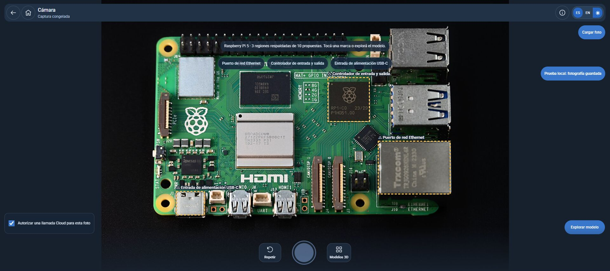
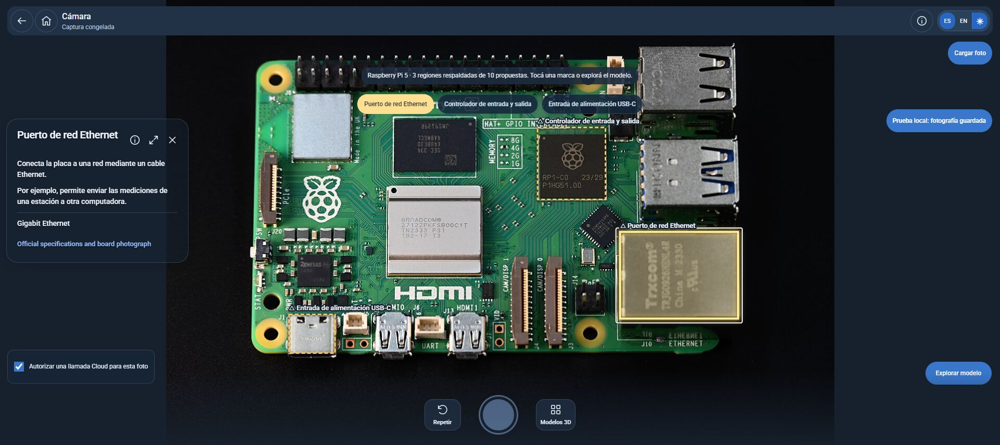
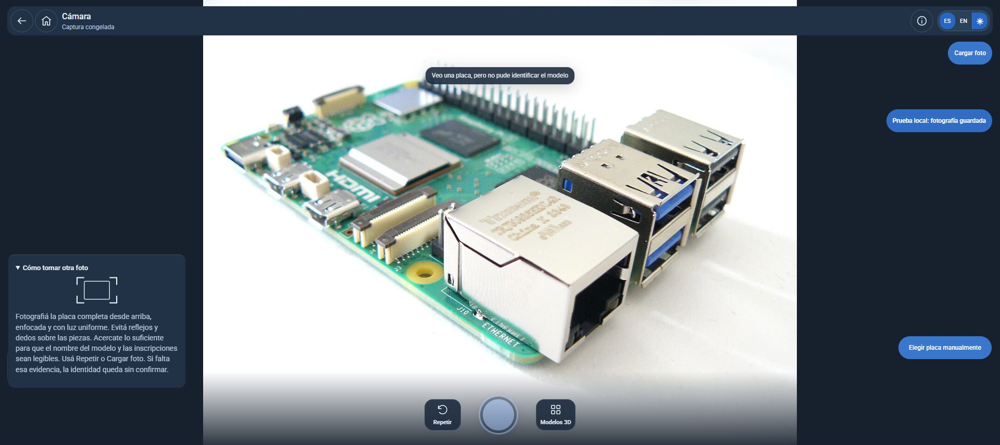

# Reconocimiento fotográfico: recuperación de evidencia y límite actual

26 de noviembre de 2026 (Uruguay). Rama `experiment/generic-photo-evidence-v2`, base privada `963a0a068880e90bb79397275840337450417279`. No se fusiona `main` ni se despliega esta rama.

## Resultado que se puede afirmar

**Todavía no se recuperó una cobertura fotográfica equivalente a las 16 fichas del CAD.** Se hicieron cinco inferencias Cloud nuevas sobre dos fotografías reales públicas, desde la app en Chrome. En la foto nítida se abrieron realmente tres fichas: Ethernet, RP1 y alimentación USB-C. En la oblicua, Gemini dio dos identidades de placa incorrectas en corridas distintas. El control añadido rechazó la segunda y pidió otra foto, sin incorporar esa identidad al catálogo.

Hay una mejora acotada, reproducible y genérica del enlace documental: normalizar espacios en identificadores alfanuméricos recupera un enlace adicional en dos replays. El replay histórico pasa de cuatro a cinco ubicaciones con ficha; una respuesta nueva conservada pasa de tres a cuatro. **No son nuevas detecciones, ni se abrieron esas fichas adicionales en una nueva inferencia.** No se cambiaron cajas ni controles de píxeles para obtenerlas.

La prueba de siluetas propuestas por Gemini no mejoró la localización. En una corrida devolvió las mismas cajas como polígonos; en otra agrupó dos conjuntos USB. Su uso como semilla queda **desactivado en el flujo normal**, disponible exclusivamente en el A/B offline mediante `experimentalVisibleShapeSeeds`. Los campos y las respuestas quedan conservados como evidencia experimental. No se recomienda promover el experimento completo a producción por un aumento de conteos.

No se iniciaron las cinco placas nuevas: el requisito previo de una mejora end-to-end demostrada en Pi 5 no se cumplió. Tampoco se afirma generalización por no contener nombres de placas en el motor.

## 1. Cómo se construyeron realmente las 16 asociaciones

### Conversión y primera pieza

En `095c124c619cee6cc740fbc1e36eec87c7415159` se convirtió el STEP oficial con OCP/CadQuery, después de que el intento WASM no completara la conversión. El informe anterior es `CAD_VIEWER_SINGLE_COMPONENT.md` (repositorio de desarrollo; evidencia numérica exportada en `historical-16.json`).

1. Se descargó el [STEP oficial sin gráficos](https://pip-assets.raspberrypi.com/categories/892-raspberry-pi-5/documents/RP-010083-CA-1-rpi-5%203D%20STEP%20-%20No%20Graphics%20small%20file.zip).
2. El conversor recorrió productos/sólidos y conservó nombre, jerarquía, límites en mm y procedencia de triángulos. Es una operación algorítmica, no reconocimiento visual.
3. La teselación nativa conservó 45.689 caras, sin caras omitidas en este modelo; 2.728 mallas se organizaron en 28 lotes de dibujo, con 1.639.318 triángulos. El verificador comparó los triángulos antes/después. Esto prueba conservación geométrica, no identidad semántica.
4. Codex seleccionó visualmente el producto anónimo `OBJ1927`, representación STEP `#234896`, como BCM2712. La evidencia guardada cita el encapsulado de 17 × 17 mm, centro CAD `(33,15;22,75)` mm, foto oficial y disposición de la placa. Sus límites guardados son `[24,65;14,25;1,336]` a `[41,65;31,25;3,654]` mm. **Esas coordenadas son evidencia histórica, no entradas del detector nuevo.**
5. `experiments/cad-viewer/components.json` fijó ese vínculo. La selección por raycasting y la ficha se probaron sobre esa geometría. El nombre `OBJ1927` por sí solo no dice BCM2712.

Hashes: ZIP `6841637b4cfa97637bf34b529bfe896f24d9634b2c40b57a156781f55d88f06f`; STEP `78164070c1cc7ab854382950d2e85926c6e35432f1e5a146b733397a7c6afb44`; GLB `5495fdcdddbe90459c0423d3c80407e51c6d42ed390cdca852318f02849f0ce7`.

### Las otras quince: decisiones guardadas, no un detector oculto

El commit `521d2e04b9869c7f865f376198d6af5278dc6ae3` añadió quince fichas. Se recuperó el script local exacto `build-reviewed-data.py`; su hash está en el [manifiesto](../experiments/photo-evidence-v2/results/manifest.json). Lee la procedencia CAD y ejecuta llamadas explícitas `addpi(id, nombresOBJ, textoES, textoEN, referencia)`.

El procedimiento fue:

1. Inspeccionar la foto/disposición oficial y los sólidos convertidos.
2. Elegir los nombres OBJ que representaban cada pieza o conjunto. Esta elección estaba escrita explícitamente en el script; **no fue calculada por IA dentro de la app ni por un asociador geométrico**.
3. Recuperar automáticamente de `provenance.json` los rangos de triángulos de esos sólidos y sus límites.
4. Generar `geometryRanges` y `sourceParts`, ligados al hash exacto del modelo. La partición conserva vértices, normales, UV, transformaciones y materiales, y rechaza propietarios duplicados de triángulos.
5. Escribir nombres, función y ejemplos bilingües basándose en las especificaciones/foto oficiales. El contenido de las lecciones también fue redactado en esa sesión, no extraído automáticamente por un modelo de esquemas.
6. Aplicar el registro mediante `catalog-enrichment.mjs` y `geometry-partitions.mjs`; al tocar la malla, recuperar la ficha asociada.
7. Ejecutar comprobaciones de rangos, conservación y una muestra de clics (RAM, Ethernet y USB, además del BCM inicial). No hay un ensayo independiente documentado de identidad visual de las dieciséis piezas.

**No se encontró un registro de revisión humana independiente ni un razonamiento contemporáneo por cada sólido.** “Reviewed” en el registro histórico describe la curación visual de la sesión de Codex; no autoriza atribuirla a una persona. El script conserva la decisión y la justificación declarada, no demuestra por sí mismo que cada decisión sea correcta. No se reconstruye un razonamiento ausente como si fuese evidencia.

| Ficha histórica | Sólidos elegidos | Evidencia y límite del vínculo |
|---|---|---|
| BCM2712 | OBJ1927 | Encapsulado, dimensiones CAD y posición en foto/disposición oficial; selección visual inicial |
| RAM | OBJ11 | Encapsulado y posición; capacidad depende de variante, no deducida del sólido |
| RP1 | OBJ4365, OBJ4369 | Chip/disposición en foto y función oficial; elección visual de sólidos |
| Ethernet | OBJ4351, 4353, 4355, 4357 | Carcasa/conjunto y disposición oficial; no lectura semántica del STEP |
| USB 3.0 | OBJ3725_1…3 | Conjunto de dos puertos; la versión requiere evidencia documental/visual adicional a la forma |
| USB 2.0 | OBJ3733_1…3 | Otro conjunto, misma precaución frente a identidad intercambiada |
| micro-HDMI 0 | OBJ5085_1…3 | Conector y número según disposición oficial; no número inferido solo por similitud |
| micro-HDMI 1 | OBJ5053_1…3 | Segundo conector; mismo límite |
| Alimentación USB-C | OBJ5141, OBJ5143 | Forma y función documentada de ese puerto en la placa |
| GPIO | OBJ3741 y OBJ3745…3823, paso 2 | Carcasa y 40 contactos seleccionados en el script; no regla del motor |
| Sección inalámbrica | OBJ3957 | Se selecciona el blindaje visible, no se declara visible el chip cubierto |
| microSD | OBJ8531, OBJ8533, OBJ8535 | Conector de la cara inferior; no observable en cualquier foto frontal |
| CAM/DISP0 | OBJ3633, OBJ3639 | Conector y designación según foto/disposición |
| CAM/DISP1 | OBJ3525, OBJ3531 | Segundo conector; la cercanía por sí sola no distingue identidad |
| PCIe | OBJ5005, OBJ5009 | Conector y función oficial; asociación visual curada |
| Botón de encendido | OBJ5147_1…3 | Pulsador y disposición oficial; no una detección por cámara |

El [inventario de las 16 asociaciones](../experiments/photo-evidence-v2/results/historical-16.json) incluye fuentes, commits, piezas, límites, triángulos, verificaciones disponibles y capacidades todavía no demostradas. Solo el script de evaluación lo lee; no se entrega esta lista a Gemini como objetivos de detección.

### Qué razonamiento ya se puede automatizar y qué falta

Ya es automático extraer sólidos, conservar su procedencia, medir límites, separar rangos, verificar propiedad, localizar un designador CAD/ECAD cuando existe y recuperar una ficha documentada. El alta anterior de Coral aporta registro ECAD/MCAD; el CAD de Nano aporta designadores. Esos mecanismos se conservaron y pasaron regresión.

El salto pendiente de Pi 5 es **atribuir semántica a sólidos anónimos a partir de una foto/documentación y verificarla independientemente**. Un nombre propuesto por IA, el lugar aproximado o una ficha existente no son tres evidencias independientes. El script histórico suplía ese salto mediante la elección visual de Codex.

Una automatización reproducible tendría que generar hipótesis de sólido/identidad, contrastar designadores o marcaciones con documentos, registrar la referencia con los sólidos mediante correspondencias verificadas y reservar otras evidencias para comprobar la asociación. Si falta un enlace documental o una referencia registrable, debe solicitar la marca/otra vista o dejar el vínculo pendiente. **Ese asociador foto→sólido anónimo no quedó implementado ni validado en esta iteración.**

## 2. Por qué dieciséis fichas no son dieciséis detecciones

El camino actual es foto completa → Firebase AI Logic → JSON de identidad/regiones → control de identidad → catálogo → segmentación/comprobación de píxeles → enlace textual conservador → ficha. No calcula una homografía foto/CAD.

Las etapas y sus significados quedan separados en `photo-evidence-trace.mjs`:

| Etapa | Evidencia que aporta | Lo que no demuestra |
|---|---|---|
| Región propuesta por Gemini | Caja/nombre/observación originales | Que haya un componente correcto dentro |
| Píxeles aceptados | Segmentación estable y borde compatible según la política existente | Identidad, numeración de puerto, plano PCB o altura |
| Enlace documental | Correspondencia textual única con datos del catálogo | Verificación semántica independiente de la foto |
| Asociación CAD existente | La ficha tiene mallas del modelo guardado | Registro fotográfico nuevo contra esas mallas |
| Ficha mostrada | Región aceptada y contenido enlazado | Que la usuaria la haya abierto |
| Ficha abierta | Evento real de selección registrado | Precisión estadística o generalización |

Los conteos de cada etapa son independientes; no forman necesariamente una secuencia decreciente. Por ejemplo, un nombre puede enlazarse aunque su región sea rechazada. `displayed` sí requiere ambas condiciones. `independentlyConfirmedIdentities` queda `null`, no se sustituye por el número de fichas.

Las capturas anteriores de muchos recuadros mostraban **propuestas**. El catálogo de 16 incluye componentes de ambas caras, estructuras ocultas y piezas pequeñas. No es un denominador válido de recall para una sola fotografía superior.

Replays anteriores, sin nuevas llamadas y sin volver a evaluar píxeles:

| Respuesta conservada | Propuestas | Píxeles aceptados | Fichas enlazables con política v1 | Con normalización v2 |
|---|---:|---:|---:|---:|
| pi5-final-response | 9 | 7 | 4 | 4 |
| pi5-public-response | 8 | 6 | 4 | 5 |
| pi5-verified-response | 12 | 7 | 2 | 2 |
| pi5-first-response | 6 | No ejecutado | 0 mostrables | 0 mostrables |

La fila nueva recuperada es `CAM/DISP 1` frente a `CAM/DISP1`. Los dos conectores rechazados por solapamiento en otra respuesta siguen rechazados. El registro de replay no conoce cuántas fichas se abrieron históricamente: su contador de aperturas cero no es una medición histórica. Datos [v1](../experiments/photo-evidence-v2/results/historical-losses-term1.json) y [v2](../experiments/photo-evidence-v2/results/historical-losses.json).

## 3. Fuentes oficiales y registro geométrico

Se consultaron la [página oficial](https://www.raspberrypi.com/products/raspberry-pi-5/), el [product brief](https://pip-assets.raspberrypi.com/categories/892-raspberry-pi-5/documents/RP-008348-DS-10-raspberry-pi-5-product-brief.pdf), el [dibujo mecánico](https://pip-assets.raspberrypi.com/categories/892-raspberry-pi-5/documents/RP-008347-DS-1-raspberry-pi-5-mechanical-drawing.pdf) y la procedencia guardada del STEP. Las especificaciones justifican funciones e interfaces. El dibujo mecánico declara su carácter aproximado/de referencia; **no es automáticamente un mapa preciso de los centros de todos los componentes**.

Las anclas grandes pueden reducir ambigüedad, pero dos conectores parecidos no se identifican por tamaño solamente. Una cara elevada tiene paralaje; su centro no es una correspondencia del plano PCB. Una similitud requiere sus supuestos y dos puntos distintos; un afín, tres no colineales; una homografía, cuatro o más distribuidos y evidencia independiente adicional. Cumplir el mínimo matemático no valida el plano. El perímetro proyectado desde la misma transformación no es evidencia independiente.

No se recuperó una transformación histórica generalizable que resolviera esto: R+GV de Kiro recibe observaciones previas; no descubre por sí mismo la identidad de todas las piezas. La recuperación documentada obtuvo soporte local de textura en algunos componentes, no una certificación completa de PCB. El refinamiento rígido conservado empeoró el error reservado de 3,054 a 5,482 px aunque mejorara el ajuste usado para estimar. No se reejecutaron NCC, SIFT, AKAZE ni Gaussian del perímetro.

El descarte histórico de AKAZE se trata con precisión: hubo resultados de Codex sin poses válidas (0/11) y dispersión en resultados de Kiro, pero no se encontró una decisión documental de Kiro que demostrara su inutilidad universal. Véanse `RECUPERACION_RGV_KIRO.md`, `RIGID_GLOBAL_REFINEMENT.md` del repositorio de desarrollo y los hashes de sus experimentos. El ensayo `video3_t006825ms` identificado como simulado no se cuenta como inferencia real.

Los materiales satinados, el contraste y las texturas del CAD son mejoras de presentación. No fueron entradas del detector fotográfico. La extracción de serigrafía y la validación del reverso conservadas tampoco convierten automáticamente una marca del render en evidencia sobre una foto nueva.

## 4. Cambios ejecutables y límites

- **Trazabilidad:** ledger por propuesta, con primer bloqueo y razones completas; distingue catálogo, píxeles y apertura real.
- **Identificadores:** normalización genérica de espacios entre letras/números. No incorpora listas Pi 5 ni borra los números que distinguen puertos. Se conserva el rechazo a coincidencias ambiguas y duplicadas.
- **Identidad exacta:** para el alta fotográfica experimental se exige que Gemini declare el texto literal del modelo y una región válida. “Raspberry Pi” no respalda “Pi 4 Model B”. Esto es consistencia de la respuesta, **no OCR independiente**; el modelo aún puede inventar una inscripción. Puede abstenerse de más si la placa no lleva su nombre. La entrada por nombre sigue separada.
- **Reintento:** mensaje de identidad no determinada y guía ES/EN para foto cenital, placa completa, enfoque, luz uniforme, sin reflejos/oclusiones. Botones de repetir y cargar foto. Se probó la guía en navegador.
- **Siluetas opcionales:** parser con objetos `{x,y}`, cuarentena de polígonos inválidos sin modificar el texto original. La primera respuesta intercambió ejes y abortó; el parser corregido conserva cajas válidas y registra el fallo opcional. Después del A/B se retiró el uso de esas siluetas del verificador normal. Solo el script offline puede pedirlo; el endpoint no reenvía esa opción.
- **Reproducción:** el servidor de diagnóstico aislado puede guardar bytes exactos de entrada y resultado. No se habilita archivo automático de fotos en el servidor normal. Se respeta MIME JPEG/PNG.

Permanecen intactos `src/component-parallax/engine.py`, su política y `photo-verification-policy.json`: mismo presupuesto histórico de análisis de 640 px, estabilidad entre semillas, soporte de borde, límites de área, recorte y rechazo de solapamientos. No se achicó la foto para Gemini ni se hizo búsqueda por ventanas nuevas. La fotografía pública utilizada ya era una representación de 1280 px; el original de Wikimedia es mayor.

## 5. Cinco llamadas nuevas: resultados reales

Chrome de escritorio, viewport 1920 × 855, Windows; app servida desde Cloud Shell autenticado, Firebase AI Logic 13.4.0 y App Check vigente. No es cámara física, teléfono, navegación anónima ni Nano. `inferenceSource=in_cloud`, modelo solicitado `gemini-3.5-flash-lite`, `modelVersion=null`. El intento local fue bloqueado por App Check antes de inferir; no se contabiliza como una llamada al modelo.

El cliente no envió nombres de archivo, catálogo, lista de 16 identidades, coordenadas CAD ni anotaciones de evaluación. El catálogo se consultó después de la identidad. Se utilizó un catálogo aislado con copia de Pi 5; ninguna escritura se hizo en los originales.

| Corrida | Propuestas originales | Píxeles aceptados | Enlaces CAD heredados | Fichas abiertas realmente | Inferencia | Verificación HTTP | Captura→marcas |
|---|---:|---:|---:|---:|---:|---:|---:|
| Nítida, primer formato | 12 | No ejecutado: polígonos inválidos | 0 en flujo | 0 | 7,204 s | — | No alcanzó |
| Nítida, formato corregido | 10 | 9 | 3 | 3 | 7,673 s | 3,470 s | 13,321 s |
| Oblicua, antes del control de identidad | 6 | 3 | 0 | 0 | 5,571 s | 7,725 s | 18,514 s, sin marcas útiles |
| Oblicua, control de identidad | 5 | No ejecutado: identidad rechazada | 0 en flujo | 0 | 4,865 s | — | No alcanzó; pidió foto |
| Nítida, control de identidad | 5 | 4 | 3 | 3 | 4,619 s | 2,317 s | 10,126 s |

Inicialización por corrida: 2,096; 1,464; 1,529; 1,675; 1,254 s. No se suman ni comparan estos tiempos con NCC histórico, generación CAD, otros tamaños o pruebas simuladas. La variación entre llamadas no demuestra una optimización: cambiaron respuestas y trabajo realizado.

Versiones efectivamente ejecutadas: primera `b49caed` (pública `dc5e57f`); segunda/tercera `4678768` (`cb6a7f4`); cuarta `b0f6129` (`89992cc`); quinta mismo frontend y servidor de archivo `20da504` (`688d24f`). Después se aisló la semilla de silueta del flujo normal y se ejecutó el A/B offline; no se afirma una sexta inferencia con esa versión final.

### Dónde se pierden los diez candidatos de la segunda corrida

| Propuesta | Píxeles | Enlace/ficha | Causa |
|---|---|---|---|
| Ethernet | Aceptados | Abierta | Nombre documental único, asociación CAD anterior |
| USB superior | Aceptados | Sin ficha | “USB Port” no distingue USB 2/3 |
| USB inferior | Aceptados | Sin ficha | Misma ambigüedad, no se resuelve por orden de respuesta |
| SoC | Aceptados | Sin ficha | Marking propuesto `2712ZPK…` no tiene vínculo documental validado con BCM2712 en el asociador |
| RP1 | Aceptados | Abierta | Nombre/marca compatibles con referencia existente |
| SDRAM | Aceptados | Sin ficha | La propuesta y el código de pieza no se resolvieron contra la referencia RAM del catálogo |
| USB-C | Aceptados | Abierta | Referencia única en ese catálogo |
| PMIC | Aceptados | Sin ficha | No hay asociación CAD/ficha correspondiente entre las 16 |
| CAM/DISP 0 | Aceptados | No abierta en vivo; enlazable en replay v2 | Espacio en identificador; corrección genérica sin alterar coordenadas |
| CAM/DISP 1 | Rechazados | No mostrada | `unstable_with_seed_change`; la normalización no evita ese rechazo |

En la última nítida: SoC sigue sin enlace, los dos conjuntos USB quedaron agrupados y fallaron `segmentation_reaches_search_limit`; Ethernet, USB-C y RP1 abrieron su ficha correspondiente. También se abrió el modelo CAD guardado desde esa captura. Eso comprueba navegación y reutilización, no registro nuevo foto/CAD.





### Errores, regiones reales y precisión no acreditada

La [revisión visual posterior](../experiments/photo-evidence-v2/results/visual-review.json) está identificada como inspección de Codex, no evaluación humana ciega. En las propuestas nítidas se observaron 12 y 10 regiones sobre piezas reales; en la última, cuatro piezas individuales y una región que agrupa dos conjuntos USB. Esto no mide exactitud del contorno ni identidades verificadas independientemente.

Hay errores concretos conservados: la primera respuesta intercambia USB 2.0/3.0; la oblicua primera llama a la placa “Compute Module 4 IO Board”, atribuye USB 3.0 a ambos conjuntos y propone una marcación Ethernet que no corresponde a la visible. La segunda oblicua dice “Pi 4 Model B” pero solo transcribe “Raspberry Pi”; se rechaza antes de incorporar. No se observaron fichas incorrectas abiertas en estas cinco corridas; **no equivale a una tasa de falsos positivos validada**, dado el muestreo y la falta de verdad independiente.

No hay anotaciones independientes de máscaras para calcular IoU ni prueba de identidad ciega. Precisión, recall completo y número de identidades confirmadas independientemente quedan **no determinados**, no 100 %. Las 16 asociaciones curadas tampoco llenan ese vacío.



## 6. A/B local de semillas: resultado negativo conservado

Se ejecutó el mismo verificador y hardware sobre el JPEG público nítido, con las mismas propuestas congeladas, primero caja y luego silueta. La semilla no cambia los umbrales. Este JPEG no es byte-idéntico a la recodificación canvas usada en vivo; los hashes de ambos están publicados. Por tanto es un A/B controlado del archivo fuente, no reproducción exacta de los píxeles del navegador.

- Diez propuestas: 9 aceptadas en ambos modos. Los diez polígonos de Gemini son exactamente sus cajas, sin información adicional.
- Cinco propuestas: 4 aceptadas con cajas; 5 con siluetas. La nueva aceptación es la región USB combinada, **no una mejora**. En vivo esa misma propuesta con otra codificación JPEG había sido rechazada. Esto muestra sensibilidad y que un contorno estable no certifica un objeto individual.

Por ese fallo se desactivó la silueta como semilla del flujo normal. [Resultados y tiempos completos](../experiments/photo-evidence-v2/results/seed-replay.json). La ejecución con `mode=box` conserva el polígono en el JSON y comprueba que el verificador normal lo ignore. No se ajustaron tolerancias para recuperar ese quinto resultado.

## 7. Preservación, coste y pruebas

- 35 pruebas de release, 12 de fotografía y 27 de enriquecimiento/conservación pasaron; build correcto. El control negativo sintético uniforme fue rechazado. Son pruebas de software, no ensayos de precisión con placas reales.
- [334 archivos originales](../experiments/photo-evidence-v2/results/catalogue-preservation.json) cotejados por SHA-256: cero cambios. Catálogos y modelos de Nano, Coral, Motor y Pi 5 conservados; motores, umbrales y proyecto de Kiro intactos. No se repitió una batería de clics físicos en las otras placas.
- Cinco llamadas: 9.181 tokens de entrada y 8.019 de salida. Estimación de **US$0,0228018** con la [tarifa consultada](https://ai.google.dev/gemini-api/docs/pricing), US$0,30/M entrada y US$2,50/M salida. No es lectura de factura y no reinicia el presupuesto acumulado de US$20. El gasto facturado actualizado no se consultó en esta ejecución.
- No se creó VM, GPU, servicio ni despliegue. El servidor temporal de Cloud Shell se detuvo y se verificó la ausencia de su PID. La demo pública no se modificó. Los servicios previamente existentes no se apagaron ni se alteraron.
- No se publican fotos privadas, credenciales, runtime local ni tokens. Las fotografías reproducidas son públicas con licencia y atribución en [CREDITS.md](photo-evidence-v2/CREDITS.md). Las capturas contienen marcas de la app, no detecciones dibujadas a mano.

## 8. Reproducir y revisar

En la rama publicada, con Node 24.12+ y Python con numpy 2.5.5, opencv-python-headless 4.13.0.92 y Pillow 12.3.0 (un entorno virtual local es suficiente; no se requiere nube para los replays):

```powershell
npm ci
npm run test:release
node --test tests/photo*.test.mjs
node --test tests/catalogue-enrichment.test.mjs tests/recovered-methods.test.mjs tests/automatic-backside.test.mjs tests/preserved-enrichment.test.mjs tests/general-enrichment.test.mjs
npm run build
node experiments/photo-evidence-v2/audit.mjs
node experiments/photo-evidence-v2/compare.mjs
python tests/photo-verification-negative.py
python experiments/photo-evidence-v2/replay-seeds.py RUTA_AL_JPEG_PUBLICO_VERIFICADO
```

El JPEG del último comando es la representación pública de 1280 × 853 con hash `29c5e99fe2d9cc29b137301f5540bcbb23a5954ceef7c8e100988d4e0d4da688`; no sustituirlo sin registrar el nuevo hash. El manifiesto enlaza su página de origen. El A/B no llama a Gemini. La comparación de respuestas conservadas tampoco.

Para otra prueba en la app: usar **un directorio nuevo** de catálogo, restaurar allí una copia mediante `scripts/restore-release-catalog.mjs`, configurar `ITC_BOARD_STORE`, `ITC_RUNTIME_CONFIG`, puerto independiente y, solo en diagnóstico local/autenticado, `ITC_TEST_PHOTO` con archivo neutral. `npm start`, Explorar placas → Cargar foto (o botón diagnóstico que pasa por el mismo manejador), consentimiento Cloud y apertura de cada marca. La configuración Firebase/App Check debe ser la autorizada para ese origen; no copiar credenciales al repo ni desactivar App Check para el ensayo. El fallo local de App Check se conserva como limitación, no se presume una demo fotográfica local operativa.

Los resultados originales completos están en [results/live](../experiments/photo-evidence-v2/results/live); [comparison.json](../experiments/photo-evidence-v2/results/comparison.json) enlaza hashes, tiempos, pérdidas y replay. La captura recodificada exacta nítida quedó archivada en el Cloud Shell autenticado; la transferencia reportó éxito, pero no se verificó su ruta local, por lo que no se incluye como archivo reproducido localmente. Las capturas de pantalla y respuestas sí están exportadas y verificadas.

## 9. Decisión técnica y siguiente evidencia necesaria

Se conserva la normalización documental y la trazabilidad; se retiene el control de identidad y la guía como protección experimental, con su limitación de texto auto-reportado. Se descarta como mejora demostrada el uso de polígonos Gemini como semillas. No se pasa a cinco placas ni se anuncia recuperación de las dieciséis detecciones.

El bloqueo principal es doble: **propuestas semánticas incompletas/inestables y ausencia de registro independiente foto→CAD**. La teselación y las fichas no son el cuello de botella. Para automatizar el razonamiento histórico sin Codex por placa hace falta una fuente con designadores o una referencia visual registrable con correspondencias independientes; para piezas repetidas, evidencia discriminante y vecindad global, no una coincidencia textual más permisiva. Para validar el plano, referencias coplanarias y controles reservados. Para medir precisión, anotación independiente posterior a congelar el detector.

La siguiente alternativa técnica justificable es un expediente automático de hipótesis documental/geométrica con asociaciones uno-a-uno y evidencias reservadas, reutilizando CAD/ECAD cuando existan. No se implementó aquí una nueva búsqueda global ni se declara resuelto ese registro. Si las fotos no permiten leer modelo/marcas o separar piezas, la app debe pedir otra vista; si la documentación no identifica sólidos anónimos, debe mantenerlos pendientes. Estas limitaciones explican exactamente por qué la aplicación todavía no reproduce por sí sola la curación histórica.
