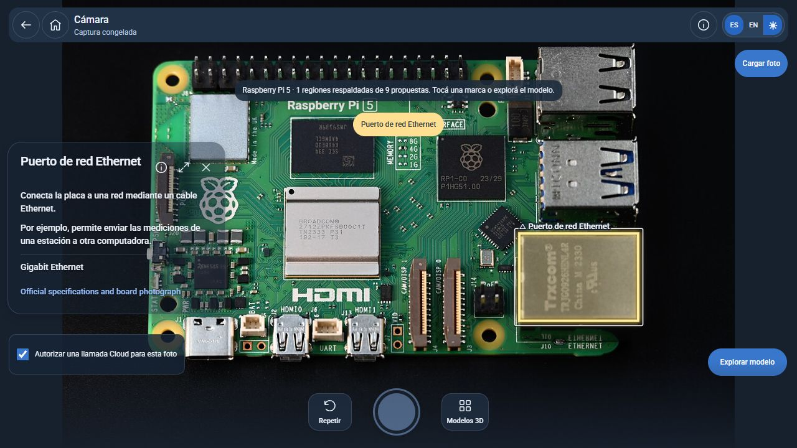

# Demo HTTPS y pruebas reales — 26/11/2026

**URL estable:** https://itc-nano-lab-20261121.web.app/

Frontend Firebase Hosting + verificador Cloud Run; no dependen de la computadora,
Cloud Shell ni una cuenta personal abierta. Código público en la rama
`integration/jury-https-flow` de `cafka/inside-the-circuit-demo`. Frontend probado:
`0e2ff03448fee5f5e32b921b0ab2c97ff6ddaf9c`; contenedor: `d8acd53`.
El commit que incorpora este informe puede ser posterior al código desplegado.

## Foto → ficha

Abrir **Explorar placas → Cargar foto**, seleccionar una fotografía y autorizar
el envío Cloud. No indicar el modelo ni seleccionarlo previamente. El navegador
elige la ruta disponible. En este equipo la visión Nano informó `unavailable`;
se ejecutó Firebase AI Logic 13.4.0 con App Check Enterprise, `in_cloud`, modelo
solicitado `gemini-3.5-flash-lite`. El SDK no devolvió `modelVersion`; no se atribuye
esta prueba a Nano 4.

| Foto / ejecución | Resultado visible y real | Inferencia | Hasta el resultado |
|---|---|---:|---:|
| Mesa, imagen pública | «No detecté una placa en esta foto». Sin componentes ni modelo | 3,552 s | 5,947 s |
| Placa casera, imagen pública | «Veo una placa, pero no pude identificar el modelo». Fabricante/modelo nulos; no abre un modelo parecido | 3,904 s | 6,322 s |
| Pi 5 oblicua, RetroEditor | **Fallo:** Gemini respondió Pi 4 Model B. El catálogo no abrió otro modelo | 5,227 s | 6,991 s de identificación; flujo interrumpido |
| Pi 5 oficial promocional, cliente anterior | Identidad correcta; verificación bloqueada por App Check ausente en el cliente en caché | 6,497 s | No hubo rectángulos |
| Mismo control oficial tras versionar el bundle | 12 propuestas, 2 marcas con ficha: Ethernet y PCIe. Ambas fichas abiertas; modelo 3D cargado | 4,978 s | 15,724 s hasta marcas |
| Pi 5 pública nítida, antes de corregir asociación | 8 propuestas, 2 marcas. **Fallo de software:** RAM enlazada a ficha microSD | Conservada en JSON | No se considera éxito |
| Misma foto nítida, cliente corregido, llamada nueva | Identidad Pi 5, 9 propuestas, 7 contornos pasan controles de píxeles, **1 marca con asociación y ficha: Ethernet**. Clic real abre función, ejemplo y fuente correctos | 4,856 s | **17,328 s** hasta marca |

En el último caso: preparación 27 ms; inicialización Firebase/App Check 2,149 s;
consulta de catálogo 275 ms; verificación completa con transporte/atestación
9,700 s, de los cuales Python informó 5,796 s. Las sumas y etapas originales
están en [summary.json](jury-evidence/summary.json). No confundir los siete
contornos aceptados con siete identidades confirmadas o siete fichas.

La placa casera produjo seis propuestas de componentes; el flujo de placa
desconocida no dispone todavía de asociación educativa/verificación semántica
independiente. No las mostró como piezas confirmadas. Ese alcance queda pendiente.
La verificación de contorno tampoco prueba la identidad electrónica: las marcas
del flujo conocido se presentan como **Probable**, no con una probabilidad inventada.



## Fallos corregidos

- El bundle conservaba `/app.js` con caché de una hora mientras la configuración
  ya activaba el backend. Se añadió versión por hash al script. La petición real
  posterior pasó App Check; no se deshabilitó su validación.
- El asociador eliminaba espacios antes de buscar subcadenas: `RAM IC` podía
  coincidir dentro de `Ranura microSD`. Ahora compara frases con límites de palabra.
  [Repetición exacta sin inferencia nueva](jury-evidence/binding-regression.json):
  la RAM queda sin ficha asignada; Ethernet conserva su asociación. La prueba
  unitaria evita regresión. No se cambió el detector, sus cajas ni sus umbrales.
- Se diferencian ausencia de placa, placa desconocida y fallo de transporte.
  Los errores de red no se convierten en rechazos visuales.

## Reverso de Motor 2040

Una llamada real desde el navegador mediante Firebase AI Logic y App Check,
en un preview autenticado temporal de Cloud Shell. Se descargaron de nuevo seis
fotografías oficiales y se verificaron los hashes originales/decodificados. La
solicitud coincide exactamente con `ac852e95cca91e52717ae1f8c8a13aea338b43bec4f10979e381bd0c9793d28a`.
No se proporcionó la elección manual del reverso.

Gemini propuso **source-4, giro 0°, sin espejo**, pero también incluyó
`source-2` y `source-8` como alternativas. Se conservó íntegra esa contradicción.
El alta normal, regenerada en carpeta nueva con esa respuesta auténtica, dejó
el reverso **pendiente: backside_ambiguous_or_unsupported_choice**. No se
convirtió la propuesta en revisión humana ni se aplicó la textura.

Se ejecutó además el verificador existente en un directorio **solo diagnóstico**
sobre la propuesta original, sin cambiar sus coordenadas: error de proporción
0,6255 %, errores de cuatro taladros 0,3183 / 0,1731 / 0,3479 / 0,2773 mm;
1,562 s. La geometría candidata pasa, pero no elimina la ambigüedad de selección.
El resultado diagnóstico nunca se usa como modelo del catálogo.

Inferencia 18,731 s; total 20,551 s; 7.763 tokens de entrada y 211 de salida.
[Respuesta real](jury-evidence/gemini-backside.json),
[decisión del alta](jury-evidence/motor-production-decision.json),
[alineación diagnóstica](jury-evidence/motor-geometric-diagnostic.json).
Las observaciones del frente son históricas; no es una nueva identificación
completa de Motor ni una medición física independiente de sus cotas.

## Acceso público y App Check

GET anónimo sin cookies: portada, configuración y salud del backend HTTP 200.
POST sin token App Check: HTTP 401. El flujo con token válido sí ejecutó Python.
No se publicaron credenciales, tokens de depuración ni claves de servicio. El
contenedor usa identidad de servicio, sin sesión personal copiada.

**Pendiente: prueba completa en navegador realmente sin sesión Google.** Los
navegadores disponibles para automatización comparten una sesión Google. No se
presenta un GET anónimo ni una nueva pestaña como prueba de navegador limpio.
Para cerrarla: abrir la URL en incógnito sin iniciar sesión, cargar la foto nítida
de Pi 5, consentir Cloud y tocar Ethernet cuando aparezca. La cámara física del
teléfono queda a cargo de la usuaria, como fue acordado. Todas las pruebas de
fotografías documentadas se hicieron en navegador de escritorio, no con cámara física.

## Gasto, aislamiento y límites de entrega

Consola filtrada al laboratorio: **USD 0,52**, tanto antes como después del ensayo;
demora de facturación todavía pendiente. Ocho inferencias registradas, incluida
la mesa de la sesión previa: estimación por tokens **USD 0,020554**. Build:
77,34 s, aproximadamente USD 0,00387 antes de franquicias. Run, transferencia y
almacenamiento se añaden; reserva conservadora para esta ejecución: **USD 0,10**,
no un cargo observado ni un nuevo presupuesto. El total autorizado sigue siendo USD 20.

Spend caps de USD 2 Gemini y USD 2 Run configurados con margen; son mensuales,
pueden demorar y no constituyen un límite acumulado duro. Run mínimo 0/máximo 1,
1 vCPU/1 GiB. No hubo VM nueva. El proceso temporal de Motor se detuvo. Se conservan
Hosting, el servicio a demanda y una imagen del contenedor para que la demo funcione.
Ver [despliegue, precios y procedimiento de suspensión](../deployment/verification/DEPLOYMENT.md).

334 archivos de los catálogos originales comprobados, **0 cambios**.
10/10 pruebas pertinentes y build pasan. `main`, reconocimiento histórico y
repositorio de Kiro intactos. Solo se publican código y evidencias redistribuibles.
Las fotos promocionales y fotos de Motor no se incluyen sin licencia confirmada.

La demo pública contiene Pi 5 y Coral. La incorporación persistente de nuevas
placas todavía no está desplegada: la sesión antigua de reconstrucción no sirve
como credencial de producción. La llamada real de reverso evitó esa sesión,
pero no demuestra que el alta pública completa esté resuelta. Nano/Motor y la
biblioteca integrada requieren completar su paquete redistribuible; no se
presentan como verificados en este despliegue.

## Reproducción

```sh
npm ci
npm run build
node --test tests/photo-delivery.test.mjs tests/photo-presence.test.mjs tests/photo-binding-boundaries.test.mjs tests/release-deployment.test.mjs
node scripts/prepare-official-backside-test.mjs deployment/fixtures/official-backside-motor.json NEW_OPERATOR_WORK
ITC_OPERATOR_ORIGIN=https://YOUR_ALLOWED_PREVIEW.cloudshell.dev node scripts/test-backside-firebase.mjs NEW_OPERATOR_WORK/reconstruction PUBLIC_RUNTIME_CONFIG 8080
```

El último comando prepara una solicitud, no la ejecuta automáticamente: el botón
del navegador hace una sola llamada. Requiere origen registrado y consentimiento
vigente. No repetir la llamada para reproducir métricas: usar los JSON conservados.
El diagnóstico se reproduce con `scripts/diagnose-backside-candidate.mjs` sobre
un dossier local y la respuesta registrada; exige una carpeta nueva.
