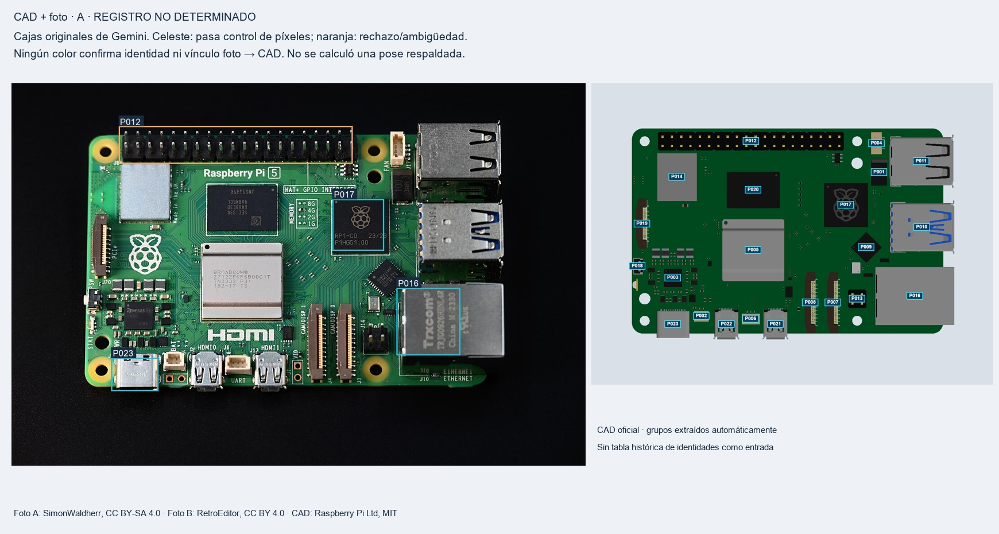
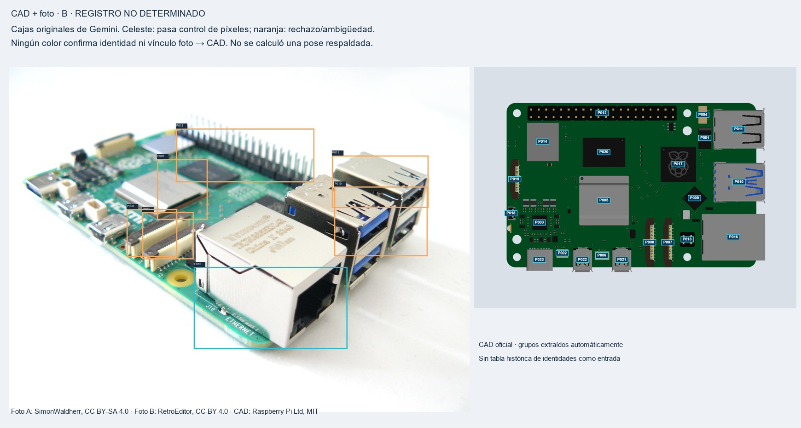

# Las 16 asociaciones históricas y la prueba automática CAD → fotografía

Fecha de revisión: 26/11/2026, Uruguay. Rama: `experiment/multimodal-cad-association`, creada desde `3fcd94e3b32a721e4f35afafe16abf27d97763b7`. Protocolo y extracción en `61bc25b`; cliente de navegador y entradas congeladas en `6d0eed7`. No se modificaron main, Kiro, los catálogos guardados ni la demo pública.

**Resultado: no se demostró una mejora fotográfica.** Se ejecutaron tres inferencias reales. La nueva línea base sobre la foto nítida conserva tres vínculos elegibles a fichas. El experimento CAD + documento + foto termina con cero vínculos foto→CAD verificados en ambas fotografías. No se incorpora a la aplicación ni se inicia una batería sobre placas nuevas.

El hallazgo histórico es más preciso que «se hizo manualmente»: una sesión de Codex recibió fotografías oficiales e inventarios de sólidos CAD, y escribió asociaciones explícitas en un script. Hubo visión asistida por IA y herramientas geométricas, pero no quedó un detector semántico autónomo capaz de repetir esas decisiones. El registro no contiene una justificación individual verificable de cada identidad.

## 1. Qué evidencia se revisó y qué permite afirmar

- Git: `095c124c619cee6cc740fbc1e36eec87c7415159` — primer BCM2712; `521d2e04b9869c7f865f376198d6af5278dc6ae3` — otras quince fichas y particiones.
- Código original: `experiments/physical-volume/source-binding.json`, `experiments/cad-viewer/{components.json,convert-native.py,convert.mjs,verify-model.mjs}`, `experiments/board-library/{geometry-partitions.mjs,catalog-enrichment.mjs,catalog-enrichment.json}`.
- Script local conservado: `.local/catalog-visibility-review/build-reviewed-data.py`. Se publica una copia **solo para lectura**, con SHA256, en [evaluation-only](../experiments/multimodal-cad/evaluation-only/README.md). Contiene las llamadas `addpi` con las decisiones OBJ→identidad y los textos bilingües. No debe ejecutarse: escribía el catálogo anterior.
- Llamadas de herramientas y metadatos de la sesión conservada: [34 eventos](../experiments/multimodal-cad/results/history-events.json), con UTC, línea, call ID y hash de argumentos. Se inspeccionaron llamadas y resultados observables; no se reconstruyeron pensamientos no registrados ni se publica el historial privado.
- Evidencia previa: [auditoría de las 16](../experiments/photo-evidence-v2/results/historical-16.json), [informe fotográfico anterior](GENERIC_PHOTO_EVIDENCE_V2.md), documentos CAD/volumen y capturas de selección conservadas.

**Modelo histórico acreditable:** el contexto de la sesión declara `gpt-6-astra`. Eso identifica la configuración de Codex registrada, no una certificación independiente de pesos servidos. En las ventanas inspeccionadas no aparece una llamada a Gemini para crear esas dieciséis asociaciones. No puede extrapolarse esa ausencia a todos los experimentos del proyecto.

**Sí consta** que se entregaron imágenes a `view_image`, datos CAD a herramientas de lectura y que después se escribió la tabla semántica. **Es una inferencia razonable** que Codex interpretó conjuntamente su apariencia y distribución. **No consta** qué píxel o razonamiento concreto justificó cada identidad, ni una revisión humana independiente de las 16. El antiguo estado `reviewed` no debe traducirse retrospectivamente a «revisado por una persona».

## 2. Recorrido histórico: entradas, operaciones, decisiones y pruebas

Las horas siguientes son UTC, tal como están en el registro; Uruguay es UTC−3.

| Paso | Entrada y herramienta comprobable | Transformación / decisión | Salida y alcance de la prueba |
|---|---|---|---|
| 23/11 22:55:43 | `view_image(mechanical.png)`, documentación y diagrama oficial | Codex recibe evidencia visual y dimensiones | Prueba de acceso a imagen; no demuestra por sí sola interpretación correcta |
| 22:58:42–23:00:20 | Inventarios STEP, productos, representaciones y coordenadas | Consultas numéricas de tamaños/posición; escritura de `source-binding.json` | Elecciones explícitas de referencias; no detección en foto |
| 23:26:32–23:36:44 | Entidad STEP `#234896`, producto anónimo `OBJ1927` | Se elige el cuerpo de 17×17 mm, centro CAD (33,15;22,75) mm, como BCM2712 | `components.json` y selección de OBJ1927. No hay una justificación independiente adicional registrada por componente |
| Conversión CAD | STEP oficial; Python, cadquery-ocp 7.9.3.1.1 / OpenCascade 7.9.3 | `STEPCAFControl_Reader`, colores/nombres; triangulación absoluta 0,05 mm, angular 0,3; mm→m; Z-up→Y-up | 45.689 caras, cero caras sin triangular; 2.728 mallas, 1.639.318 triángulos. La conversión no identifica funciones eléctricas |
| Agrupación para visor | GLB nativo y asociación BCM existente | Agrupación por material, rangos de triángulos y componente | 28 grupos para render. `verify-model.mjs` contrasta hashes de triángulos y pertenencia. Esto verifica conservación geométrica, no identidad semántica |
| 26/11 09:59:05–10:05:35 | Procedencia CAD, página oficial, inventarios con áreas/extensiones | Listados de piezas grandes y consultas por nombres OBJ ya elegidos | Reduce candidatos a inspeccionar. No hay un clasificador que devuelva nombres de componentes |
| 10:06:26 | Consulta espacial de piezas en una franja CAD | Selección de sólidos relacionados con el conector largo | Fue una consulta específica del caso durante la curación, no una regla genérica recuperable tal cual |
| 10:06:56 | `view_image(official-reference.png)` | La fotografía oficial entra en el contexto visual de Codex | Consta la recepción de la imagen, no un registro individual de decisiones |
| 10:07:04–10:07:55 | Otro inventario numérico; `build-reviewed-data.py` | Codex escribe quince `addpi(id, OBJ…, textos ES/EN, fuentes)` | Tabla explícita de asociaciones; no salida de Gemini ni resultado de un detector de foto |
| Partición y fichas | Lista explícita de OBJ y rangos de triángulos del CAD | `geometry-partitions.mjs` asigna propiedad; `enrichCatalog` une ficha y geometría | Hash del modelo, rangos válidos, ausencia de propietarios duplicados; raycasting y menú comparten identificación |
| 10:11:24–10:11:48 | Visor con la tabla ya aplicada | Capturas y clics de Ethernet, USB y RAM; BCM tenía evidencia anterior | Pruebas funcionales después de la asociación. No son evidencia de detección fotográfica ni prueba visual individual de las 16 |

El intento anterior `occt-import-js 0.0.23` se interrumpió después de más de 12 minutos, alrededor de 2,3 GB, sin malla entregada; la geometría conservada proviene del conversor nativo. Antes de escribir la ampliación de quince fichas, las capturas de navegador inmediatamente anteriores eran de Motor 2040. No hay evidencia conservada de una comparación visual **render Pi 5 ↔ foto** previa a cada una de esas decisiones; sí hay foto oficial y números CAD, y comprobaciones del visor posteriores.

### Registro individual recuperado

La tabla completa, sólidos, límites, fuentes y evidencia funcional por asociación se encuentran en [historical-16.json](../experiments/photo-evidence-v2/results/historical-16.json). Todas citan la página/producto oficial. Esa página respalda funciones y apariencia de la placa; no contiene una tabla fabricante `OBJ anónimo → componente`.

| Asociación histórica | Sólidos originales elegidos | Registro de la decisión |
|---|---|---|
| BCM2712 | OBJ1927 | BCM inicial, 23/11; components.json |
| Memoria RAM | OBJ11 | addpi explícito, 26/11; sin razonamiento individual conservado |
| Controlador de entrada y salida | OBJ4365, OBJ4369 | addpi explícito, 26/11; sin razonamiento individual conservado |
| Puerto de red Ethernet | OBJ4351, OBJ4353, OBJ4355, OBJ4357 | addpi explícito, 26/11; sin razonamiento individual conservado |
| Puertos USB 3.0 | OBJ3725_1, OBJ3725_2, OBJ3725_3 | addpi explícito, 26/11; sin razonamiento individual conservado |
| Puertos USB 2.0 | OBJ3733_1, OBJ3733_2, OBJ3733_3 | addpi explícito, 26/11; sin razonamiento individual conservado |
| Salida micro-HDMI 0 | OBJ5085_1, OBJ5085_2, OBJ5085_3 | addpi explícito, 26/11; sin razonamiento individual conservado |
| Salida micro-HDMI 1 | OBJ5053_1, OBJ5053_2, OBJ5053_3 | addpi explícito, 26/11; sin razonamiento individual conservado |
| Entrada de alimentación USB-C | OBJ5141, OBJ5143 | addpi explícito, 26/11; sin razonamiento individual conservado |
| Conector GPIO | OBJ3741 y 40 contactos enumerados en el JSON | addpi explícito, 26/11; sin razonamiento individual conservado |
| Radio Wi-Fi y Bluetooth | OBJ3957 | addpi explícito, 26/11; sin razonamiento individual conservado |
| Ranura microSD | OBJ8531, OBJ8533, OBJ8535 | addpi explícito, 26/11; sin razonamiento individual conservado |
| Conector de cámara o pantalla 0 | OBJ3633, OBJ3639 | addpi explícito, 26/11; sin razonamiento individual conservado |
| Conector de cámara o pantalla 1 | OBJ3525, OBJ3531 | addpi explícito, 26/11; sin razonamiento individual conservado |
| Conector PCI Express | OBJ5005, OBJ5009 | addpi explícito, 26/11; sin razonamiento individual conservado |
| Botón de encendido | OBJ5147_1, OBJ5147_2, OBJ5147_3 | addpi explícito, 26/11; sin razonamiento individual conservado |

Para las quince adiciones, la prueba individual conservada es la lista explícita escrita por Codex y su vínculo a los rangos del CAD. Los registros no explican por separado por qué cada sólido se eligió. En particular, el ordinal de conectores repetidos requiere corroboración de mapa/serigrafía: una forma coincidente no demuestra cuál es el 0 y cuál el 1. Las 16 se conservan como referencia de evaluación, no como verdad independiente perfecta ni lista de respuestas para la nueva inferencia.

## 3. Diferencia entre 16 fichas CAD y tres fichas fotográficas

El visor histórico conoce de antemano la pertenencia de cada triángulo y su `componentId`. Un clic consulta esa pertenencia y abre una ficha ya redactada. No necesita localizar la placa en una imagen, distinguir dos conectores parecidos, verificar una caja ni estimar perspectiva.

El recorrido fotográfico debe resolver esas etapas. Una región puede pasar la comprobación de píxeles y continuar sin identidad inequívoca para la ficha. Un texto de Gemini puede nombrar correctamente una clase pero recortar una subregión o señalar otro objeto. No son conteos intercambiables.

En el control nuevo de este ensayo, Gemini propone ocho regiones; siete pasan el verificador existente; solo tres se vinculan inequívocamente con fichas existentes: Ethernet, alimentación USB-C y RP1. El cálculo de elegibilidad se hizo **después** de la inferencia con el binder actual, cargando en memoria el enriquecimiento real del catálogo. No se reescribió el catálogo. Esta ejecución no midió nuevos clics en esas tres fichas; la apertura real de tres fichas está en la prueba histórica enlazada arriba.

## 4. Equivalente automático implementado y aislamiento

Código: [experiments/multimodal-cad](../experiments/multimodal-cad). Se separaron:

1. **Extracción (`prepare.mjs`)**. Entrada: GLB nativo, previo al agrupado curado, y recibo de conversión. Usa jerarquía, extensión relativa y soporte plano del CAD; no consulta nombres semánticos ni tabla histórica. Produce 25 grupos anónimos y conserva las 2.728 mallas en las vistas. Requiere explícitamente un sustrato aproximadamente alineado a ejes; si no existe, se abstiene. Esa limitación queda pendiente para otros CAD.
2. **Vistas (`render.mjs`)**. Three.js, render auténtico de frente/reverso, máscaras de ID con profundidad, centros visibles y punto 3D de superficie por raycasting. Las alturas provienen del CAD. El reverso no se inventa. Son 22 grupos visibles en vista frontal y diez visibles desde atrás, incluidos salientes de piezas frontales; no significa diez componentes del reverso.
3. **Documento (`documents.py`)**. Extrae líneas numeradas del PDF oficial, con URL/hash/página. No contiene anotaciones de la foto objetivo. La existencia de una cita solo se comprueba sintácticamente, no acredita su implicación semántica.
4. **Propuestas (`contract.mjs`, `browser-client.mjs`)**. Firebase AI Logic, App Check Enterprise y Gemini Cloud. Envía fotografía oficial, vistas CAD anónimas, documento y fotografía real completa. No suministra las 16 identidades, correspondencias, etiquetas de evaluación ni un número de aciertos esperado. Solicita forma, vecinos, inscripción observable, alternativas, caja y ancla aproximadas, fuente y propuesta educativa ES/EN. Las piezas repetidas pueden quedar ambiguas.
5. **Verificación (`verify.py`)**. Aplica el verificador de píxeles existente sin cambiar tolerancias; descarta alternativas antes de usar anclas. Intenta PnP 3D→2D con alturas reales del CAD y cuatro hipótesis de focal. Reserva objetos por hash antes de inferir. La focal y el ajuste no se eligen usando los reservados. No convierte superficies elevadas en puntos del PCB.
6. **Evaluación (`evaluate.mjs`, `export.py`)**. Abre la tabla histórica después de congelar respuestas y calcula coincidencia con grupos CAD y elegibilidad de fichas. Produce visuales con cajas originales, rechazos y estado no validado. No promueve las lecciones propuestas a fichas verificadas.

La política numérica se congeló antes de las llamadas en `policy.json`: al menos seis objetos de ajuste y dos reservados para esta prueba PnP; no es una cantidad universal de referencias para cualquier modelo geométrico. No se ajustó a los resultados. El reparto dejó cuatro grupos reservados entre 25. No se usaron NCC, SIFT, AKAZE, ORB, las cuatro perforaciones ni coordenadas semánticas de Pi 5. El manifiesto de caso sí identifica sus entradas públicas y sus hashes; eso es configuración del ensayo, no una excepción del motor.

**Aislamiento efectivo:** el servidor del navegador solo sirve una lista de archivos permitidos y no expone tabla histórica/oráculo. El cliente Node alternativo exige permisos de filesystem que niegan esa tabla; se probó la denegación y que cambiar un archivo de evaluación no altera el paquete leído. La prueba de aislamiento no equivale a una inferencia adversarial nueva. En la inferencia real del navegador, el aislamiento fue la lista de archivos y la construcción del cuerpo sin datos semánticos históricos.

**Límite implementado:** el protocolo contemplaba una comprobación posterior de siluetas proyectadas, competidores y respaldo documental por afirmación. Ninguno de los casos alcanzó una pose candidata suficiente. No se ejecutó ni se declara terminado ese validador posterior de máscaras/identidad. Los parámetros de IoU declarados no participaron en ninguna aceptación. Tampoco existe todavía una salida de esta prueba capaz de publicar automáticamente una ficha verificada; todas las propuestas quedan pendientes.

## 5. Entradas, ejecución real y resultados

| Entrada | Dimensiones / procedencia | SHA256 |
|---|---|---|
| A nítida | 1280×853, SimonWaldherr, Wikimedia, CC BY-SA 4.0 | `29c5e99fe2d9cc29b137301f5540bcbb23a5954ceef7c8e100988d4e0d4da688` |
| B oblicua | 3072×2304, RetroEditor, Wikimedia, CC BY 4.0 | `f55f15b1453215bbed6f9e3691c24b417aea42b4514b4e0815e8609ed5577a3b` |
| Foto oficial | 1515×1240, fabricante; sin redistribuir | `328bf630ffd2f8c10308aa8895cedf6b23fcd8ff45eff651f21175cde50a7ba5` |
| STEP oficial | CAD del fabricante; licencia MIT incluida | `78164070c1cc7ab854382950d2e85926c6e35432f1e5a146b733397a7c6afb44` |
| GLB nativo | 39.253.012 bytes, sin particiones semánticas curadas | `841508deb9de671cedda932bda38f6c0188f5902f09d362674601f8b9a66e90a` |
| Product Brief | PDF oficial; 99 líneas de texto extraídas | `f1ca525452e6fa4e9592a6705e41fb811bf12709d0605fd7cc2099c1b25534f3` |

Las fotos y licencias están en [NOTICE](../experiments/multimodal-cad/fixtures/NOTICE.md). El [manifiesto](../experiments/multimodal-cad/results/input-manifest.json) conserva las entradas. El documento extraído local y el del laboratorio tienen el mismo hash JSON canónico `e2079cd8459fa6eeb4ae30a7ffb24c19c8b5eba97c1765f83d938c20f54fe2d6`; difiere su serialización, no su contenido. Cada llamada registra el hash de los bytes efectivamente enviados.

Se utilizó Gemini `gemini-3.5-flash-lite`, Firebase SDK 13.4.0, temperatura 0, máximo 8192 tokens de salida, `inferenceSource: in_cloud`. La respuesta no devolvió versión resuelta de modelo (`modelVersion: null`). No se afirma ejecución Nano. Las tres respuestas son nuevas; el análisis posterior y las imágenes diagnósticas son replay de esas respuestas.

| Medición | Control A: solo foto | CAD + documentos + A | CAD + documentos + B |
|---|---:|---:|---:|
| Regiones propuestas por Gemini | 8 | 4 | 7 |
| Propuestas sin alternativa de identidad | — | 4 | 5 |
| Pasan el verificador de píxeles | 7 | 3 | 1 |
| Objetos disponibles para ajuste / reserva | No intenta CAD | 1 / 2 | 0 / 1 |
| Vínculos foto→CAD verificados | No medido por esta ruta | 0 | 0 |
| Fichas elegibles del catálogo existente | 3 | No se promueven | No se promueven |
| Fichas nuevas verificadas | 0 | 0 | 0 |
| Preparación y App Check en navegador | 2900,7 ms | 4120,2 ms | 10848,1 ms |
| Inferencia | 6212,8 ms | 6583,7 ms | 11307,4 ms |
| Total de la llamada, preparación incluida | 9271,8 ms | 10865,7 ms | 22452,9 ms |
| Verificación local posterior, píxeles + pose | 5062,8 ms (solo píxeles) | 3962,6 ms | 6758,5 ms |
| Tokens entrada / salida | 1915 / 1715 | 9370 / 1264 | 9354 / 2228 |
| Costo API estimado, USD | 0,004862 | 0,005971 | 0,0083762 |

Preparación CAD local: 678,8 ms para extracción; render/IDs/exportación: 644,2 ms, a 1280×960. Estas dos cifras excluyen descarga/conversión histórica y carga inicial del GLB. No son latencia end-to-end. Inferencias ejecutadas en Chrome mediante el navegador de Cloud Shell; verificación posterior en el equipo local con OpenCV, un hilo. El verificador existente reduce su análisis a 640 px; las imágenes enviadas a Gemini no se redujeron adicionalmente. El control nuevo y CAD A usan **el mismo JPEG exacto**. La prueba histórica de tres clics usaba otra codificación del mismo contenido: no se confunden hashes ni latencias.

### Qué se perdió en cada caso

**A:** P017/RP1, P016/Ethernet y P023/USB-C pasan píxeles. P012/GPIO falla `unstable_with_seed_change`. Ethernet y USB-C estaban reservados; solo RP1 queda para ajuste. `insufficient_fit_objects` impide calcular pose. Los cuatro nombres gruesos coinciden con la referencia histórica del grupo CAD, pero esto no valida las localizaciones.

**B:** P016/Ethernet pasa píxeles, pero estaba reservado. P010/USB3 falla estabilidad; P011/USB2 y P012/GPIO alcanzan el límite de segmentación; P005 falla ambas comprobaciones. P007/P008 declaran alternativas entre sí y no entran al ajuste. Gemini llama a P005 «RP1 Southbridge Heatsink», mientras ese grupo contiene el sólido histórico de BCM2712: hay una asociación semántica incorrecta. Cuatro clases gruesas coinciden con el histórico; una no coincide y dos conectores repetidos permanecen ambiguos.

La inspección visual posterior de Codex observa cajas parciales incluso entre las que pasan píxeles: Ethernet A cubre una zona impresa de la carcasa y Ethernet B su zona frontal/lateral, no todo el cuerpo. GPIO A recorta extremos y USB B separa mal parte de las carcasas. No se utilizaron estas observaciones para corregir cajas, umbrales ni pose. **No hay anotación ciega independiente que permita publicar una precisión o IoU visual fiable**. Los conteos de clases contra el catálogo histórico son evaluación de referencia, no porcentaje de detección correcta.

La evidencia textual también tiene errores: la propuesta RP1 dice «QFP» sin corroboración de encapsulado; la propuesta USB-C incluye entrada de datos, mientras la línea citada del fabricante respalda alimentación. No se publica ninguna de esas frases como ficha verificada. Una cita existente no equivale a comprobación documental de toda la respuesta.

Los 25 grupos CAD cubren, al contrastar posteriormente los OBJ, 15 de las 16 asociaciones históricas; el botón pequeño queda sin etiqueta por la política de tamaño. **15/16 es cobertura de geometría de entrada, no reconocimiento de quince piezas en una foto.** Las piezas omitidas por Gemini no se cuentan como «no visibles»: sencillamente no fueron propuestas.

## 6. Evidencia visual y revisión local

[Abrir el expediente local](http://127.0.0.1:4215/review.html), mientras esté activo el servidor local. Permite cambiar entre A/B y leer las propuestas literales. Los botones abren propuestas pendientes, no fichas validadas de la aplicación. Se probó el cambio de foto y la apertura de propuesta en navegador de escritorio; no se presenta como prueba de cámara física o móvil.





Celeste significa únicamente que pasó el control de píxeles; naranja es rechazo o ambigüedad. Ninguno significa asociación confirmada. Los contornos y rótulos se generaron por código a partir de la salida guardada, sin recolocar predicciones.

Respuestas completas: [control](../experiments/multimodal-cad/results/live/baseline-target-a.json), [CAD A](../experiments/multimodal-cad/results/live/cad-target-a.json), [CAD B](../experiments/multimodal-cad/results/live/cad-target-b.json). [Evaluación](../experiments/multimodal-cad/results/evaluation.json), [métricas](../experiments/multimodal-cad/results/summary.json) y [revisión posterior](../experiments/multimodal-cad/results/post-review.json).

## 7. Costos, permisos, cierre y conservación

Las tres llamadas suman **USD 0,0192092 estimados**, usando USD 0,30/M tokens de entrada y USD 2,50/M de salida, según la [tarifa oficial consultada](https://aistudio.google.com/docs/pricing#gemini-3.5-flash-lite). No es una factura ni un gasto total actualizado del proyecto. No se pudo acreditar aquí el acumulado de facturación del proyecto; el presupuesto previo de USD 20 no se reinicia.

El intento inicial de cliente Node falló antes de generar: configuración diagnóstica antigua con API key vencida/registro de aplicación no vigente. Se reutilizó la configuración actual de la aplicación y App Check Enterprise en el navegador; las tres respuestas registran token recibido y protección no desactivada. No se copiaron secretos al repositorio ni se crearon credenciales.

Proyecto existente comprobado: `itc-nano-lab-20261121`, facturación ya activa. No se crearon VM, discos, servicios, despliegues ni recursos persistentes. Servidor temporal de Cloud Shell limitado a tres casos y 25 minutos, detenido explícitamente al finalizar. Consulta real: PID propio ausente y puerto 8080 rechazando conexión, tres reservas. Los hashes de las tres respuestas exportadas coinciden byte por byte con Cloud Shell. No se deshabilitó la facturación del proyecto compartido ni se alteró el servicio público existente. [Recibo del cierre](../experiments/multimodal-cad/results/cleanup.json).

Las fotografías distribuidas son públicas y con licencia compatible, con atribución. La fotografía promocional y el PDF oficial se descargan al reproducir y no se redistribuyen. El historial privado, credenciales, catálogos personales y fotografías privadas quedan fuera. Se comprobó la preservación por SHA256 de los archivos del manifiesto original, además de que el diff solo contiene el experimento y este informe.

## 8. Reproducción

Los resultados guardados se pueden revisar sin credenciales ni llamadas nuevas:

```sh
npm ci
python -m http.server 4215 --bind 127.0.0.1 --directory experiments/multimodal-cad
# Abrir http://127.0.0.1:4215/review.html
node --test experiments/multimodal-cad/tests.mjs
python experiments/multimodal-cad/test_pose.py
npm run test:release
```

Dependencias usadas por Python: NumPy/OpenCV/Pillow ya instalados para el verificador existente; PyMuPDF 1.26.6 para el documento; OCP solo si se repite la conversión histórica. Los scripts buscan también las instalaciones aisladas existentes en `.local/discovery-python` y `.local/cad-native`. Las versiones efectivas de esta corrida se registran en `results/environment.json`.

Para repetir la extracción, usando el GLB nativo conservado y el recibo de la conversión histórica, sin tocar el catálogo:

```sh
node experiments/multimodal-cad/prepare.mjs .local/cad-viewer/native-full.glb .local/cad-viewer/native-source.json .local/multimodal-cad-repro/inputs
node experiments/multimodal-cad/server.mjs .local/multimodal-cad-repro/inputs 4214
# Abrir http://127.0.0.1:4214 y pulsar Renderizar y guardar vistas.
```

Para la reproducción de inferencia, las vistas y fotos exactas están congeladas en `fixtures/`; basta copiarlas a un directorio aislado `work`. Descargar la [foto oficial](https://assets.raspberrypi.com/static/c671804c05a51efc4e3c2a1bdcbafbcf/e58b5/raspberry-pi-5.png) como `reference.png` y el [Product Brief](https://pip-assets.raspberrypi.com/categories/892-raspberry-pi-5/documents/RP-008348-DS-10-raspberry-pi-5-product-brief.pdf). Comprobar sus hashes de la tabla. Extraer:

```sh
python experiments/multimodal-cad/documents.py work/product-brief.pdf https://pip-assets.raspberrypi.com/categories/892-raspberry-pi-5/documents/RP-008348-DS-10-raspberry-pi-5-product-brief.pdf work/documents.json
node experiments/multimodal-cad/browser-server.mjs work /ruta/privada/runtime.json 8080
```

`runtime.json` necesita la configuración web vigente `firebase` y `appCheck.siteKey` del proyecto autorizado. No se incluye ni se debe extraer de registros privados publicados. El origen de ejecución debe estar admitido por App Check. En esta corrida se abrió la vista autenticada de Cloud Shell. Ejecutar una vez control A, una vez CAD A y una vez CAD B; los nombres reservados impiden repetir accidentalmente un caso. Una nueva inferencia tiene costo y resultado no determinista; no se lanza al abrir el expediente estático.

Reverificación sin inferencias nuevas, en el checkout de desarrollo con entradas oficiales disponibles:

```sh
python experiments/multimodal-cad/verify.py .local/multimodal-cad/inputs experiments/multimodal-cad/results/live/cad-target-a.json .local/reverify-a
python experiments/multimodal-cad/verify.py .local/multimodal-cad/inputs experiments/multimodal-cad/results/live/cad-target-b.json .local/reverify-b
```

La tabla de evaluación se abre únicamente después de guardar las respuestas. El comando exacto de evaluación de esta corrida figura en [REPRODUCE.md](../experiments/multimodal-cad/REPRODUCE.md), junto con los pasos para regenerar imágenes y la conversión CAD histórica. El clon público contiene las entradas redistribuibles y el código del experimento, sin publicar el historial privado.

## 9. Decisión y siguiente alternativa concreta

Se automatizaron inventario CAD anónimo, vistas con oclusión y puntos 3D, consulta multimodal real, reserva de objetos, verificación previa de píxeles, abstención geométrica y trazabilidad. **No se automatizó con éxito la decisión semántica que Codex realizó históricamente ni se mejoró el flujo foto→ficha.**

Faltan correspondencias de superficie suficientemente precisas y distribuidas; faltan identificaciones únicas de piezas repetidas; el documento general no localiza individualmente los sólidos anónimos. La segmentación puede respaldar una subregión impresa sin respaldar la carcasa completa. Esos son bloqueos concretos anteriores a una homografía/pose válida, no un problema resoluble aumentando el número de fichas del catálogo.

No recomiendo integrar esta ruta todavía. La siguiente alternativa acotada sería separar **identificación CAD↔referencia oficial** de **localización en fotografía**: vistas adicionales por candidato con contexto de vecinos, citas de esquemas/serigrafía verificables y después localización de rasgos físicos del mismo objeto, reservando objetos para comprobar la transformación. Eso requiere otra prueba controlada, no supone que funcione y no se ejecutó en esta intervención. Antes de ampliar a cinco placas, debe superar las tres fichas de referencia con localizaciones independientes correctas.

Cuando faltan inscripciones o una pieza tapa otra, el procedimiento debe solicitar una foto cenital completa, enfocada, sin reflejos, o una segunda vista donde se vea el rasgo discriminante. La variante de modelo o el ordinal de conectores no debe deducirse por semejanza aislada. En esta rama no se cambió el flujo de reintento de la app ni se añadió una integración no validada.
