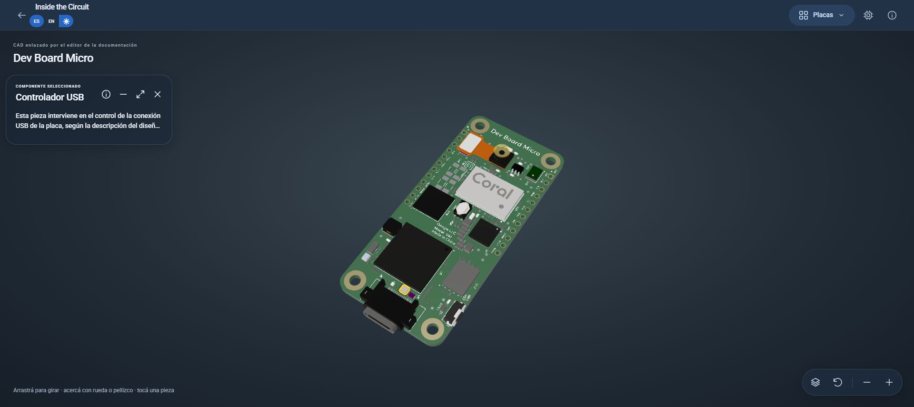
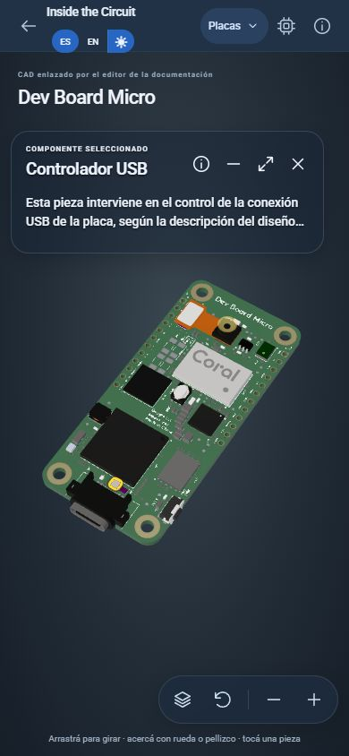

# Publicación v4 — comprobación de entrega

Revisión: 25/11/2026, Uruguay. Paquete recibido: `Inside_the_Circuit_README_v4.zip`, SHA-256 `60b6f349021053c37d6d49e179a62fa8cd7e7e0607e3ac88705e32317dd38b88`.

## Acceso y estado de publicación

- **Código público:** [cafka/inside-the-circuit-demo](https://github.com/cafka/inside-the-circuit-demo). Historia nueva e independiente; el repositorio de investigación permanece privado y su `main` no se modifica.
- **Vista HTTPS temporal:** [abrir Inside the Circuit](https://8080-cs-582373947824-default.cs-us-east1-pkhd.cloudshell.dev/). Requiere la misma cuenta Google de Cloud Shell. No es alojamiento permanente ni una URL anónima para jueces.
- Código de la prueba real: publicación `6c85131` y anteriores de este repositorio nuevo. El commit posterior de documentación conserva los resultados; `release/evidence/public-v4-remote.json` registra la comprobación de publicación sin inventar un SHA autorreferente.
- Devpost no fue enviado: lo presenta la autora.

Para revisar: enlace HTTPS → Cámara → Modelos 3D → Coral o Raspberry Pi 5. No hace falta cámara para el catálogo. Seleccionar una pieza abre su ficha sin mover la cámara. Biblioteca abre la publicación independiente fijada. Cámara y uso táctil en teléfono físico siguen pendientes.

La vista previa se inició aproximadamente a las 23:42 de Uruguay, con máximo de dos horas. Cloud Shell puede suspenderse antes por inactividad. `node scripts/start-cloudshell-preview.mjs` vuelve a imprimir la URL al reiniciarlo. No se promete disponibilidad permanente. [Cloud Shell documenta el acceso HTTPS limitado a la cuenta autenticada](https://docs.cloud.google.com/shell/docs/using-web-preview).

## Documentación y código

Se preservan los diez diagramas bilingües, las fuentes reproducibles, estructura narrativa y tablas v4, incluida la distinción entre CAD original de Coral y enriquecimiento. `python docs/readme-assets/generate_diagrams.py` reprodujo los diez SVG byte a byte. Solo se actualizó la leyenda del relieve ilustrativo de Motor. `review-only/` no se publicó.

Se incluyen frontend, backend Node, generadores CAD/ECAD y sin CAD, adaptador Firebase AI Logic, políticas, dependencias fijadas, pruebas, MIT y avisos de terceros. `experiments/board-library` contiene el motor integrado: se conserva el nombre para evitar refactorizar durante la entrega. La localización fotográfica histórica requiere tres recursos privados excluidos y declara su indisponibilidad.

La [captura Pi](readme-assets/pi5-explorer.jpg) procede de la aplicación actual. Nano volvió a abrir localmente con su ficha USB-C, pero la captura automática falló por timeout. Su modelo y captura no se publican porque el STEP separado carece de licencia explícita; no se creó una imagen sustitutiva. Las capturas Coral siguientes son reales del HTTPS:

## Firebase y App Check: prueba real

Proyecto `itc-nano-lab-20261121`, número `970731928304`. Nueva aplicación web de vista previa, reCAPTCHA Enterprise con dominios explícitos y puntuación mínima 0,5; sin token debug. App Check de Firebase AI Logic consultado como **ENFORCED**. Configuración activa fuera de Git.

La ruta `/release-check/` ejecuta una prueba explícita sin selector de archivos Windows. Usa el adaptador/enrutador reales y nombre de archivo neutral. **La entrada es una captura CAD Pi, no una fotografía física ni una evaluación independiente de precisión.** Contiene texto de interfaz: acertar un nombre tampoco demostraría reconocimiento autónomo.

Una solicitud real Firebase AI Logic, modelo configurado `gemini-3.5-flash-lite`, devolvió `inferenceSource: in_cloud`. El SDK no informó `modelVersion`. Propuso Raspberry Pi 5 y simultáneamente `status: partial` con modelo no nulo. El validador rechazó `partial_must_abstain_from_model_and_revision`: **inferencia real comprobada; identidad aceptada: ninguna**. No se relajó el contrato ni se repitió la llamada para buscar un acierto.

Un token App Check deliberadamente inválido recibió **HTTP 401**, `Firebase App Check token is invalid`: rechazo del servidor comprobado. [Respuesta original completa, uso y tiempos](../release/evidence/firebase-v4-real.json).

| Etapa de la misma solicitud | Tiempo |
|---|---:|
| Transferencia de imagen de prueba al navegador | 438,7 ms |
| Preparación | 11,4 ms |
| Inicialización, incluida Firebase/App Check | 2.030,6 ms |
| Inferencia Cloud | 19.928,2 ms |
| Total del enrutador, sin transferencia previa | 21.972,1 ms |
| Petición separada con token inválido | 607,0 ms |

Uso: 1.456 tokens de entrada (1.100 imagen/356 texto), 199 de salida, 1.655 total. `costUSD:null`: el SDK no comunica precio facturado. Última consulta autenticada: `billingEnabled:false`, cuenta de facturación desvinculada y cero VM/discos/IP Compute Engine. No se activó facturación ni creó VM; se utilizó la ruta gratuita disponible. No se obtuvo importe final de consola ni se afirma que la estimación sea una factura. [Condiciones de Firebase AI Logic](https://firebase.google.com/docs/ai-logic/pricing).

La consulta de cierre de las 23:48 de Uruguay falló: gcloud ya no tenía cuenta activa. El recibo conserva ese fallo y no lo presenta como nueva verificación exitosa; backend y Firebase web continuaban funcionando. Alertas presupuestarias y límites de sesión no son un tope global de gasto.

## Instalación limpia y mediciones

Windows, directorio público nuevo: npm ci, 128 paquetes/129 auditados, cero vulnerabilidades conocidas; build correcto y **33/33 pruebas**, 772,24 ms. El catálogo Windows conserva los cuatro modelos aprobados.

Cloud Shell: clonación anónima, Node 26.13.0, Python 3.12.3 y entorno Python nuevo. **No es la antigua e2-standard-8**. No había VM que reutilizar y no se creó otra; las mediciones de VM solicitadas quedan pendientes.

| Operación en Cloud Shell | Tiempo de proceso | Resultado |
|---|---:|---|
| Clonación anónima | 14.390,74 ms | Correcta |
| npm ci | 9.259,38 ms | 129 paquetes/130 auditados, cero vulnerabilidades conocidas |
| Compilación | 465,68 ms | Correcta |
| Pruebas | 677,89 ms | 33 aprobadas |
| Biblioteca, descarga/verificación | 1.191,91 ms | 36 archivos |
| Primera restauración completa | 8.155,86 ms | Detenida en Nano por hash distinto |
| Restauración de modelos incluidos en caché | 1.194,90 ms | Pi y Coral verificados |

`npm run catalog:restore -- --bundled` restaura Pi y Coral sin Python. **Nano y Motor fallan en Linux** con `generated_model_differs_review_required`; no instalan registros no verificados. Nano conserva posiciones/estructura JSON, pero cambian triangulación y normales: la equivalencia no está establecida. Motor permanece sin clasificar. No se omiten hashes ni se declara reproducible el catálogo Linux completo. [Recibo](../release/evidence/public-v4-linux.json) y [comandos](INSTALLATION.md).

Coral HTTPS, Chrome escritorio, GLB de 3.593.520 bytes: carga+parseo 399,7 ms; primer cuadro 4.496,7 ms; trabajo de selección 18,4 ms; dos cuadros posteriores 103,5 ms. Carga+parseo **no** es transferencia aislada; requestAnimationFrame no mide latencia física de pantalla. No hubo regeneración: modelo verificado reutilizado. [Estado completo](../release/evidence/coral-v4-https-state.json). Viewport y documento 390 × 844 sin desbordamiento; emulación escritorio, no teléfono. Estos tiempos no se suman a la generación histórica ni se confunden con inferencia.

## Biblioteca independiente

Publicación `cafka/interactive-electronics-books@3b77d06dcb899d922be0afa0cfad8d95557bd87a`. `npm run library:sync` verifica 36 archivos por hash Git/tamaño y los guarda fuera de Git. Actualización reproducible: `node scripts/sync-library.mjs --revision <SHA-completo-revisado>`, revisar el lock. Kiro permanece en su repositorio sin cambios.

Primera descarga Windows: 3.033,70 ms. Cuatro capítulos Pi y uno ESP32-DevKitC, sin Coral ni Nano compatible. Se observaron apertura Pi, lectura de lección 1 y regreso. Transición superior a los 10 s de la comprobación previa, sin medición exacta. Otros capítulos no verificados; idioma y tema independientes.

## Seguridad y licencias

Exportación por lista explícita: excluye historia privada, fotos/videos de investigación, archivos personales, configuración activa y experimentos descartados. [Auditoría de objetos Git](../release/evidence/public-v4-security.json) registra recuentos/alcance sin valores secretos. Un escáner por patrones no garantiza ausencia absoluta de secretos.

- Código propio MIT; atribuciones Kiro conservadas.
- Pi CAD/gráficos MIT: modelo y captura incluidos.
- Coral CAD/ECAD Apache-2.0; derivados identificados; capturas aportadas para publicación o tomadas del modelo autorizado.
- Nano: arte eléctrico CC BY-SA 4.0 atribuido; STEP sin aviso explícito, GLB/captura retenidos; adquisición oficial local documentada.
- Motor: fotos/texturas/capturas excluidas por derechos no confirmados; diagrama conceptual y restauración local conservados.
- Biblioteca Kiro: sin licencia abierta elegida en la publicación revisada; consumo por versión, código no incorporado bajo MIT.
- PyMuPDF AGPL/comercial: opcional para extracción documental, no instalado en Cloud Shell. El servicio público que lo use necesita resolver sus obligaciones.

## Pendientes concretos

1. Hosting permanente, autenticación y almacenamiento multiusuario; Cloud Shell no resuelve esa entrega.
2. Teléfono físico y una identidad fotográfica aceptada; esta prueba CAD solo verificó transporte y rechazo.
3. Portabilidad Nano/Motor, captura Nano actual y derechos del STEP/Motor.
4. Generación y recursos medidos en una VM autorizada: la anterior ya no existe; crear otra requiere autorización de recurso pago.
5. Biblioteca Coral publicada por Kiro, otros capítulos y obligaciones de PyMuPDF si se habilita extracción documental pública.

No se iniciaron investigaciones de reconocimiento ni se alteraron geometrías, umbrales o selección para la publicación.
