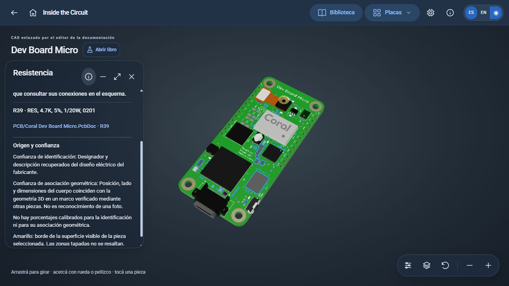
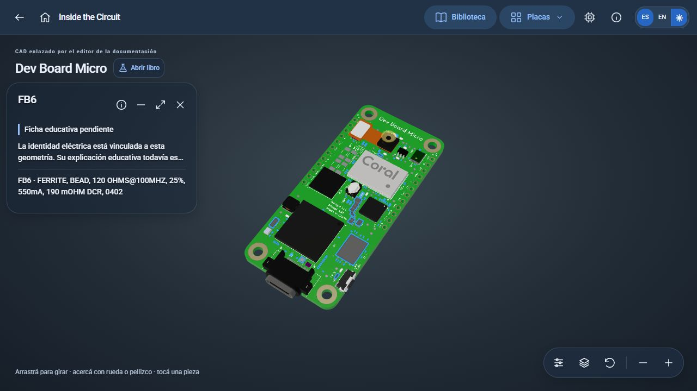
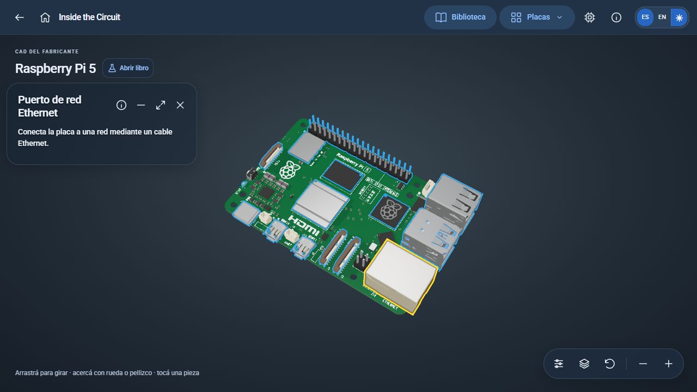

# Recuperación de métodos basados en evidencia

26/11/2026 · `integration/recovered-evidence-methods`. Base privada: `b79bfbc6e720d8ad654ecb0f3dc9f43475078f71`. Implementación inicial: `6148816`; el commit que contiene este informe incorpora la comprobación final. Código público en la rama del mismo nombre de `cafka/inside-the-circuit-demo`. No se fusionó `main` ni se redesplegó la aplicación del jurado.

Se recuperaron asociaciones eléctricas que el alta desaprovechaba y se conectaron con fichas bilingües. También se ejecutó **una comparación real de fotografías mediante Firebase AI Logic**: la elección del reverso de Motor pasó el verificador existente y se aplicó sin una selección humana nueva. Esto no resuelve el reconocimiento general de piezas anónimas ni demuestra precisión semántica para cualquier placa.

## Por qué los resultados históricos parecían mejores

| Caso | Trabajo algorítmico existente | Inferencia y decisiones manuales | Diferencia con el alta actual |
|---|---|---|---|
| Pi 5, 16 fichas | Conversión STEP y partición por intervalos de triángulos de piezas originales; extracción de gráficos STEP alineados | Asociación de sólidos anónimos `OBJ…` a identidades y redacción revisadas usando fotografías/documentación oficiales | Las 16 asociaciones estaban curadas y fijadas al hash del modelo. No eran 16 detecciones automáticas en fotografías. Las respuestas fotográficas tampoco aprovechaban bien el vocabulario de esas fichas |
| Nano ESP32 | Lectura Altium, grupos CAD con designadores, registro rígido con piezas reservadas, contactos y serigrafía en ambas caras | Selección inicial de variante, referencias visuales y revisión de materiales. La fotografía no prueba composición química | `prepareBoard` aplicaba superficies, pero no completaba piezas con ese registro; `namedPairs` de los grupos no se consumía como `bindings` |
| Coral | Registro ECAD/MCAD por dimensiones, posición y lado: 229 asociaciones físicas | Ficha USB revisada; reglas educativas limitadas | 229 asociaciones no equivalían a 229 fichas: solo 8 clases documentadas más la ficha USB revisada |
| Motor, sin CAD | Reconstrucción educativa desde observaciones, ajuste del reverso por contorno y comprobación con agujeros | Frente/componentes propuestos históricamente por Gemini; selección inicial de foto/cara/orientación del reverso por una persona | El control geométrico ya existía. En el ensayo Cloud posterior, Gemini devolvió `selected` junto con alternativas y el contrato rechazó correctamente esa contradicción |

Revisión realizada sobre los informes `NANO_APPEARANCE_EDUCATIONAL_CARDS.md`, `PHOTO_TO_EDUCATIONAL_BOARD.md`, `LOCAL_EDUCATIONAL_DISCOVERY_REVIEW.md`, `GENERAL_BOARD_ENRICHMENT.md`, `PRESERVED_ENRICHMENT_PATHS.md`, `AUTOMATIC_BACKSIDE_SELECTION.md`, `JURY_HTTPS_RESULTS.md`, y sus implementaciones. Para ESP32 se pudo reconstruir la procedencia de **Nano ESP32**; no se atribuyen resultados a otras variantes sin expediente.

Las mejoras anteriores de Kiro por NCC/anclas no proporcionaban una identidad genérica para sólidos CAD anónimos. No se reintrodujeron NCC, SIFT, AKAZE, cuatro agujeros obligatorios para localizar placas, ni un nuevo detector. El verificador específico de fotos del reverso conserva sus capacidades declaradas; no se lo presenta como registro universal.

## Qué quedó integrado

1. `documented-components.mjs::completeDocumentedComponents` es compartido por `pipeline.mjs::prepareBoard` y `onboard-name.mjs::onboardName`. Aprovecha un registro ya verificado, tanto cuerpos individuales como grupos de mallas. Conserva asociaciones revisadas, rechaza propiedad duplicada y registra añadidos y conflictos.
2. `physical-binding.mjs::bindRegisteredBodies` conserva todas las mallas del grupo. Exige identidad eléctrica única, geometría existente y exclusividad de asociación. No modifica el registro ni sus tolerancias.
3. `education-rules.json` v2 reconoce clases explícitas en descripciones del fabricante —resistencia, condensador, inductor, MOSFET, entre otras— y aporta explicación/ejemplo ES/EN. Debe coincidir una sola regla. **Explica la clase documentada, no infiere el papel de esa pieza en las redes del circuito.** El designador, descripción, fuente y evidencia física siguen separados. Clases desconocidas quedan como referencia pendiente.
4. `component-terms.mjs` aprovecha los nombres, traducciones y referencias técnicas existentes para asociar propuestas fotográficas a fichas. Normaliza equivalentes textuales como Type-C/USB-C y PCI Express/PCIe; conserva la ambigüedad de puertos repetidos o de nombre/marcado contradictorios. No cambia cajas ni confirma visualmente una identidad por su nombre.
5. `source-image-captions.mjs` relaciona URL exacta y leyenda del editor en `img`, `picture/srcset`, una figura con una única imagen y JSON-LD `ImageObject`. No usa nombres de archivo ni orden de galería como prueba de cara.
6. `backside-contract.mjs` v2 aclara que `alternatives` contiene competidores **sin resolver**. Una elección debe tener la lista vacía; no se relajó el rechazo. La propuesta pasa al mismo verificador, que recalcula el ajuste. Sin elección o registro suficiente, el reverso sigue pendiente.
7. `catalog-enrichment.mjs` impide que la nueva asociación automática y una ficha revisada fijada al modelo sean dos identidades seleccionables sobre la misma malla. Prevalece la revisada; dos revisadas incompatibles producen error.

No se añadieron condiciones por fabricante, modelo o coordenadas de las placas. La taxonomía documental es genérica y versionada; no es una lista de piezas esperadas en una fotografía. Los perfiles históricos revisados siguen existiendo y **no se cuentan como automatización nueva**.

## Resultados medidos

[Datos por placa, fuentes, hashes y tiempos](../experiments/recovered-methods/results/boards.json) · [conteos efectivos del visor](../experiments/recovered-methods/results/display-counts.json).

| Caso | Procedimiento real | Fichas antes → después | Asociaciones después | Tiempo de esta generación |
|---|---|---:|---:|---:|
| Nano ESP32 | Descarga, conversión y enriquecimiento en carpeta nueva mediante el alta de perfil | 9 → 52 | 52 | 22,395 s |
| Coral | Alta por nombre con respuestas HTTP históricas verificadas; nueva conversión y enriquecimiento, sin leer el GLB guardado | 9 → 223 | 229; 6 referencias pendientes | 29,141 s |
| Pi 5 | Reapertura de una copia del modelo histórico: regresión, no generación | 16 → 16 | 16 | No se usa como tiempo de alta |
| Motor | Generación nueva desde frente histórico y propuesta nueva de reverso | 13 → 13, todas propuestas pendientes de revisión | 13 regiones; 0 asociaciones eléctricas verificadas | 6,613 s locales, separados de la inferencia |
| Nano RP2040 Connect, caso nuevo | Nombre solamente; búsqueda y descarga reales, sin perfil nuevo ni cambio de código | 0 → 0 | 0 | 49,523 s hasta resultado parcial |

Nano genera 48 explicaciones por clase y conserva 4 fichas del perfil; al aplicar la revisión histórica, cinco asociaciones automáticas son sustituidas por sus fichas revisadas, sin duplicaciones. Coral genera 222 explicaciones por clase; su USB revisado completa las 223 del visor. Son cantidades de **fichas documentales asociadas**, no detecciones visuales nuevas ni comprensión automática de las conexiones eléctricas.

Nano: 26 cuerpos para ajuste y 26 reservados, error máximo reservado 0,000124 mm. Coral: 119 para ajuste y 110 reservados, máximo 0,000350 mm. Estos son residuos entre diseños digitales, no una precisión física de fabricación ni de cámara. Los dos GLB conservan exactamente su SHA-256 anterior. Se mantienen las cuatro capas compatibles de cada caso. La exclusión documentada de dos caras degeneradas de Coral no se ocultó ni se alteró.

El primer ensayo de Nano produjo 44 asociaciones por la ruta textual y no aprovechó los grupos registrados. Ese fallo mostró la pérdida de `namedPairs`; se corrigió y se regeneró desde cero. No se eligió simplemente el mejor resultado entre parámetros.

El caso nuevo encontró 24 recursos descargados, incluidos el ZIP eléctrico oficial, esquemas, pinout y fotografías. Los recursos examinados no aportaron un STEP/GLB utilizable. La reconstrucción fotográfica se detuvo en `reconstruction_gemini_session_not_configured`. No se activó una sesión automática nueva ni se afirma que no exista CAD en ninguna otra fuente. El fabricante/revisión no quedaron completamente resueltos. Esta prueba demuestra descubrimiento parcial y abstención; **no demuestra una tercera placa reconstruida de extremo a extremo**.

## Reconocimiento sobre fotografías: comparación controlada

[Tres respuestas reales conservadas, sin otra llamada](../experiments/recovered-methods/results/photo-replay.json). Se comparó el asociador anterior congelado con el nuevo sobre las mismas propuestas, cajas, catálogo y resultados del verificador de píxeles. El fichero de referencia `baseline-photo-scene.mjs` no se importa en la app.

| Respuesta conservada | Correspondencias textuales antes → después | Correspondencias con ubicación aceptada por el verificador anterior → después |
|---|---:|---:|
| `pi5-final-response` | 3 → 6 | 1 → 4 |
| `pi5-public-response` | 3 → 6 | 1 → 4 |
| `pi5-verified-response` | 4 → 4 | 2 → 2 |

En el primer caso ahora llegan a las fichas RP1, Ethernet, USB-C y PCIe. Los rechazos geométricos de GPIO/USB se conservan. En el tercero no se promueve la propuesta de SoC mal ubicada. Cada fila conserva caja, aceptación geométrica y razón de asociación. El asociador tardó 5,66 / 2,21 / 6,15 ms, respectivamente; son muestras individuales locales, no latencia completa de reconocimiento.

**No son nuevas inferencias ni una medición de precisión semántica.** Se corrigió pérdida de correspondencia documental, no se entrenó un detector mejor. La comprobación de límites en píxeles no prueba por sí sola qué circuito integrado es. La salida conserva `probable` y `notIndependentSemanticVerification`. No se amplían automáticamente fabricantes/modelos en placas desconocidas.

## Reverso: una inferencia real y verificación independiente del ajuste

[Respuesta literal de Firebase](../experiments/recovered-methods/results/motor-real-response.json) · [generación y auditoría](../experiments/recovered-methods/results/motor-regeneration.json).

Se enviaron las mismas seis fotos oficiales, con hashes comprobados, a `gemini-3.5-flash-lite` mediante Firebase AI Logic en Chrome/Cloud Shell. `inferenceSource: in_cloud`. La respuesta no expuso `modelVersion`; no se inventa una versión más precisa.

- Inicialización: 2,477 s; inferencia: 18,926 s; total del cliente: 21,407 s.
- Una llamada; 7.803 tokens de entrada y 176 de salida.
- Resultado auténtico: `selected`, `source-4`, giro 0°, sin espejo, sin alternativas sin resolver.
- El alta recalculó el contorno a partir de píxeles, comprobó proporciones y cuatro centros de agujeros. Error de proporción: 0,6255 %. Residuos: 0,318 / 0,173 / 0,348 / 0,277 mm. No se ajustaron umbrales.
- Resultado: `applied`, `selectionOrigin: gemini_proposal`, `automaticFaceIdentification: true`. No se leyó `backside-review.json` ni se atribuyó una revisión humana a la IA.
- [Posiciones, normales, índices y transformaciones del modelo anterior y nuevo son idénticos](../experiments/recovered-methods/results/motor-geometry-preservation.json). Cambia la evidencia fotográfica aplicada al reverso; espesor y relieve siguen siendo ilustrativos.

El verificador necesita una foto aproximadamente cenital, separación de fondo, proporciones y suficientes rasgos geométricos. Aquí usa referencias del frente histórico, no medidas físicas nuevas. No verifica cada letra, altura, material, licencia ni identidad semántica. Una foto de otra placa con geometría muy similar todavía es un riesgo para la clasificación por IA. Los controles sintéticos comprueban matemáticas, no eliminan ese riesgo.

La extracción ampliada de leyendas produjo **cero candidatos directos en las fuentes reales de Motor**. Por eso se utilizó Gemini. Sus ramas `picture/figure/ImageObject` tienen pruebas sintéticas; no se inventa un éxito real de metadatos.

Antes del ensayo, la consola filtrada al laboratorio mostraba USD 0,52 acumulados. La llamada nueva se estima en **USD 0,0027809** según [las tarifas oficiales consultadas el 26/11/2026](https://ai.google.dev/gemini-api/docs/pricing): USD 0,30/M entrada y 2,50/M salida. No es un recibo de facturación. Se mantiene margen por demoras y servicios de la demo anterior; no se reinicia el presupuesto de USD 20. El operador temporal se detuvo y verificó terminado. No se creó VM, Build, despliegue ni recurso persistente adicional.

## Pruebas, aislamiento y evidencia visual

35 pruebas de entrega, 27 de enriquecimiento/asociación y build pasaron. Los controles Python mantienen dos disposiciones sintéticas; el reverso acepta ocho giros válidos y rechaza seis controles. [Resultados geométricos](../experiments/recovered-methods/results/geometric-controls.json). No se sustituyen pruebas reales por esos controles.

[334 archivos originales comprobados: cero modificados y cero añadidos](../experiments/recovered-methods/results/isolation.json). Datos nuevos en `.local/recovered-methods/`; catálogo del visor en `.local/recovered-methods/demo/catalog`. Kiro, los modelos guardados de la usuaria y los verificadores geométricos anteriores se conservaron.

[Comprobaciones de navegador](../experiments/recovered-methods/results/browser-checks.json): Nano C2 desde menú y clic directo; Coral R39 con fuente, FB6 pendiente; giro manual de Motor para observar su reverso legible; Pi 5 con su ficha Ethernet. Escritorio 1280 × 720. No se presenta como ensayo de teléfono, cámara física, 229 clics directos ni sesión Google anónima.







Capturas locales adicionales: `.local/recovered-methods/screenshots/nano-capacitor.jpg`, `nano-provenance.jpg`, `motor-auto-rear.jpg`. Se excluyen del repositorio público junto con sus fotos/modelos por las restricciones de redistribución pendientes. Las capturas Coral conservan atribución a los diseños Google Coral Apache-2.0; Pi al CAD oficial con aviso MIT. No se publican tokens, configuración de sesión ni fotografías privadas.

## Reproducción y continuación

```powershell
npm ci
npm run build
npm run test:release
node --test tests/recovered-methods.test.mjs tests/catalogue-enrichment.test.mjs tests/automatic-backside.test.mjs tests/preserved-enrichment.test.mjs tests/general-enrichment.test.mjs
node scripts/measure-recovered-methods.mjs .local/recovered-replay-new

# Alta nueva de perfil; usar una carpeta que no exista.
$env:ITC_BOARD_STORE = "$PWD/.local/nano-new-catalog"
node experiments/board-library/pipeline.mjs arduino-nano-esp32

# Caso nuevo, entrada solo por nombre; no configura inferencias pagas.
$env:ITC_BOARD_STORE = "$PWD/.local/new-board-catalog"
$env:ITC_GITHUB_CLI = '1'
node experiments/board-library/onboard-name.mjs 'Arduino Nano RP2040 Connect'

# Reproducción local de Motor con observaciones conservadas y respuesta real.
# SOURCE_DOSSIER contiene el frente histórico y sus fuentes hash-verificadas.
node scripts/regenerate-photo-evidence.mjs SOURCE_DOSSIER .local/motor-new-catalog --backside-result=experiments/recovered-methods/results/motor-real-response.json

# Abrir el catálogo aislado ya generado en esta máquina.
$env:ITC_BOARD_STORE = "$PWD/.local/recovered-methods/demo/catalog"
$env:PORT = '4212'
npm start
```

Para regenerar Coral desde las fuentes conservadas: `node scripts/regenerate-source-dossier.mjs SOURCE_CORAL_DOSSIER NEW_CATALOG`. Los expedientes con fotos no redistribuibles no se incluyen en Git. El runner de comparación fotográfica funciona con los JSON públicos; omite mediciones de carpetas privadas ausentes y declara ese límite. No repetir una llamada paga solo para reproducir sus métricas.

Demo local: `http://127.0.0.1:4212` → Explorar placas → Elegir del catálogo. La configuración Cloud local está desactivada para esta revisión del catálogo. El flujo público de incorporación y su sesión de reconstrucción siguen siendo un trabajo separado: esta rama no pretende haber corregido el backend desplegado.

Queda automático: completar mallas registradas con clases documentadas, preservar revisiones, asociar nombres conservadores a fichas, y proponer/verificar el reverso con las fuentes adecuadas. Sigue dependiendo de IA: identidad fotográfica, propuestas de regiones, clasificación de cara cuando no hay metadatos. Sigue manual o pendiente: piezas CAD anónimas sin vínculo documental, función exacta en las redes eléctricas, revisión de propuestas, fotos difíciles sin anclas suficientes y altas sin CAD o sesión válida. Esas son las siguientes brechas; no se resolvieron mediante excepciones por placa.
