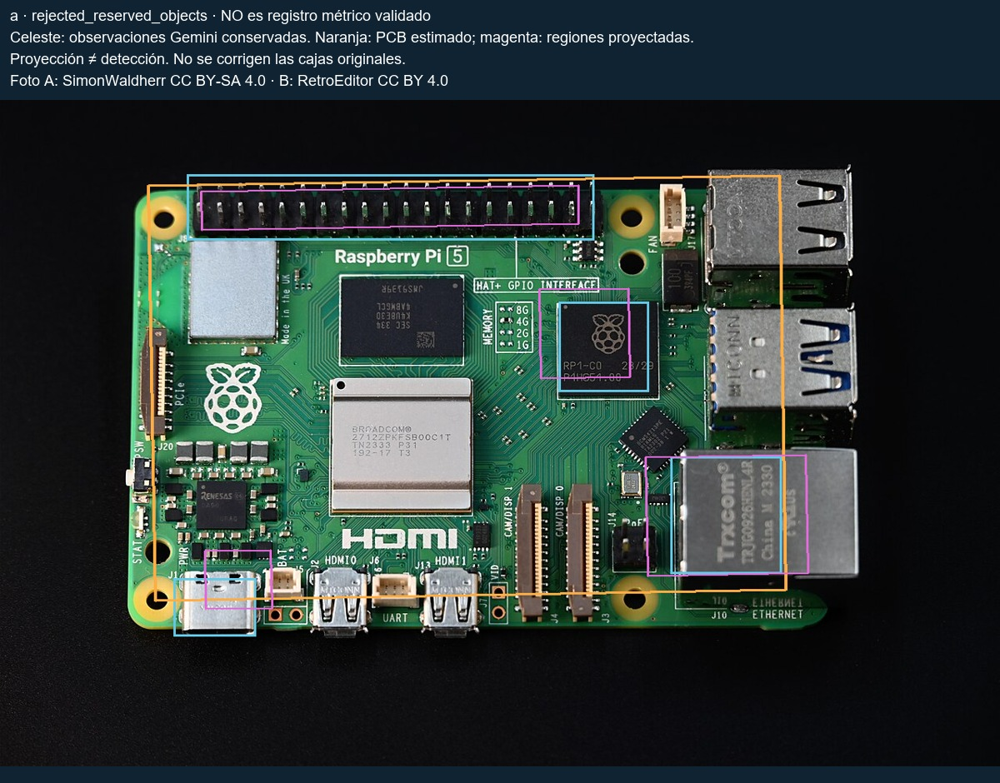
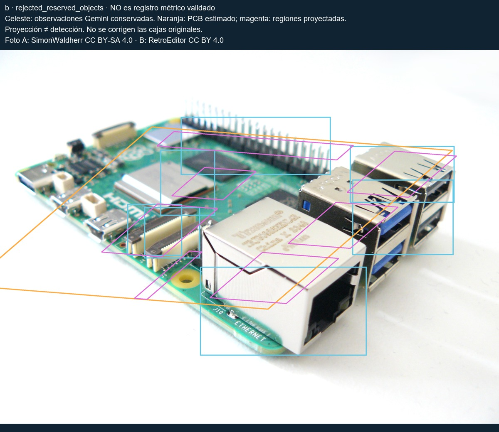

# Recuperación de anclas grandes, dimensiones físicas y vecindarios

26/11/2026 · Rama `experiment/multimodal-cad-association`. Base: `ce7f57c711ded88ba362c982eac9ea7eb4c26b75`. Código inicial congelado antes de probar: `608511d`; corrección genérica de cara visible, aislamiento y pruebas: `4590d6a`.

**Se recuperó y ejecutó el algoritmo existente, pero no se demostró una mejora que permita integrarlo.** Ahora se calculan transformaciones estructurales usando dimensiones CAD y referencias grandes, y se comparan todos los vecinos disponibles. Las piezas reservadas contradicen ambas transformaciones reales. Resultado: cero asociaciones foto→CAD verificadas, cero fichas nuevas. Main, el flujo estable, Kiro y la demo pública permanecen intactos.

Las fotografías son reales; las propuestas Gemini son **replay de las respuestas reales conservadas**, sin nuevas llamadas. Esta elección permite comparar dos verificadores sobre las mismas observaciones y hashes, sin atribuir al algoritmo cambios de respuesta del modelo. Gasto Cloud adicional: **USD 0**.

## 1. Implementaciones recuperadas, no una nueva búsqueda desde cero

| Implementación anterior | Entrada y operación | Resultado/límite histórico | Uso en esta prueba |
|---|---|---|---|
| Kiro R+GV, importado desde `cafka/rpi5-explorer@c0bd399` | Observaciones previas, mapa y textura; reajuste afín/H, RMS y LOO | No era un detector autónomo sin observaciones. El modo sin agujeros logró un ajuste afín estructural; error de borde 7,13 px frente a 2,65 px histórico con agujeros, sin certificar PCB | Se revisa el contrato y la evidencia; no se reactiva NCC ni se toca el original |
| `src/pcb-perimeter/engine.py`, commits `300bbdf`, `faa632c` | `priorities`: tamaño, singularidad, calidad y fiabilidad; `geometry`: dimensiones físicas, separación, modelos por complejidad y reserva | La búsqueda real era NCC; el borde usaba cromaticidad aprendida. Contorno estimado no equivalía a físico validado | Se recuperan los pesos de prioridad y el esquema de referencias distribuidas. Se sustituyen las entradas NCC por observaciones Gemini conservadas; no se importa el detector cromático |
| `src/visual-anchors/engine.py::estimate_model`, última revisión `3fa9b60` | Puntos físicos↔imagen; similitud, afinidad o H con RANSAC y control de degeneración | La estimación matemática no confirma identidad ni coplanaridad | **Se llama a la función original sin modificarla**. No se llaman `search`, `correlation`, `register` ni descriptores fotométricos |
| `experiments/dynamic-neighborhood/engine.py`, código ejecutado histórico `3b4c806`, informe `de1b077` | `geometry`, `terms`, `solve`, `associate`: posiciones, separaciones, orden, tamaños y asignación global inyectiva; vecindario variable | Siete etiquetas continuas no fueron siete aciertos: O8 derivó a dedo/fondo; cero planos certificados | **Se llama a `associate` original**, incluyendo alternativa desconocida y margen al prohibir cada vínculo. No se llama al tracker ni se usan sus posiciones guardadas |

Fuentes anteriores: [recuperación R+GV](RECUPERACION_RGV_KIRO.md), [vecindarios dinámicos](DYNAMIC_NEIGHBORHOOD_CONTINUITY.md), [refinamiento rígido](RIGID_GLOBAL_REFINEMENT.md). El experimento previo de AKAZE de Codex tuvo 0/11 poses; la revisión histórica no encontró una prohibición universal explícita en Kiro. Aquí no se reejecutan AKAZE, SIFT ni NCC.

La adaptación está en `experiments/recovered-spatial-cad/engine.py`. Reutiliza matemáticas y optimizador; añade el adaptador CAD anónimo→mapa físico, prioridad basada en proporciones geométricas, elección de observaciones y comprobación de contornos. La sustitución de la singularidad NCC por singularidad de proporciones es explícita: permite ensayar geometría sin recuperar la búsqueda de textura descartada. No identifica por sí sola la pieza.

## 2. Qué significaba realmente «control de píxeles»

Recorrido estable: `experiments/board-library/verify-photo-proposals.py` → `src/component-parallax/engine.py::visible_region`.

1. Reorienta EXIF y prepara una copia de análisis de lado máximo 640. La fotografía enviada a Gemini y la visualización permanecen separadas de esa copia.
2. Usa la caja de Gemini para inicializar **GrabCut** con dos tamaños de semilla. GrabCut modela apariencia/color dentro de la propia foto.
3. Conserva la región conectada dominante; mide IoU entre semillas, área relativa y fragmentación.
4. Compara su contorno con bordes Canny, soporte distribuido, límites de búsqueda y solapamientos entre propuestas.

**No compara RGB entre el CAD y la fotografía, no reconoce un material y no confirma una identidad.** Puede estabilizar una región impresa dentro de una carcasa y aceptar sus bordes, aunque esa región no sea el componente completo. «Pasa píxeles» no significa «la caja de ese sólido es correcta».

En este experimento no se usa GrabCut ni coincidencia cromática para aceptar/rechazar anclas. Se conserva una comprobación de bordes en luminancia de la propia foto, contra el contorno físico aproximado proyectado desde CAD. Se usan soporte total, distribución por lados y margen frente a contornos desplazados. Los colores son irrelevantes como identidad; el contraste local sí influye en la posibilidad de observar un borde. No se ha cambiado todavía el verificador estable, porque el sustituto no demostró una mejora.

## 3. Entradas y procedimiento automático

Entradas comunes con el ensayo anterior: 25 grupos anónimos del GLB nativo, dimensiones/alturas CAD, vistas frontal/reverso, fotografía oficial completa y las dos respuestas multimodales guardadas. La foto oficial participó en aquellas llamadas Gemini; **en esta nueva corrida no se vuelven a comparar sus píxeles**. No se representa la recuperación documental como una detección nueva.

El sustrato CAD aporta aproximadamente 85×56 mm. El motor obtiene esos valores de sus límites y ejes; no contiene ese número ni el nombre de placa como regla. Las etiquetas P001…P025 son identificadores automáticos de grupos, no nombres eléctricos. Las 16 asociaciones históricas solo se leen en `evaluate.py`, después de guardar resultados; un audit hook rechaza `historical-16.json`, `catalog-enrichment.json`, `oracle.json` y el archivo de curación durante `run.py`. Es una restricción de Python, no un sandbox integral del sistema operativo.

Pasos ejecutados:

1. Conservar cajas y puntos Gemini originales. Rechazar duplicados y retirar del ajuste las identidades con alternativas. Las observaciones ambiguas siguen disponibles como alternativas para el optimizador.
2. Priorizar referencias por área física relativa, singularidad de relación de aspecto, soporte de borde de la observación, procedencia y separación respecto de referencias ya elegidas. No hay lista ni número fijo de componentes. Los pesos se importan del experimento de perímetro.
3. Elegir el modelo más sencillo que tenga soporte **de ajuste**: similitud (dos puntos distintos), afinidad (tres no colineales), H (cuatro no degenerados). Se conservan los mínimos históricos de objetos reservados: 1/2/3 respectivamente, y tolerancias 0,006/0,012 de diagonal. La reserva no elige focal, transformación ni complejidad.
4. Proyectar el mapa físico completo y resolver la asociación uno a uno con el optimizador anterior. Considerar todos los vecinos que aporten información, sin K fijo. La fiabilidad de entrada 1 significa que la observación está disponible, **no una probabilidad semántica**.
5. Medir bordes proyectados en la foto a resolución nativa. Se conservan Canny 50/140, soporte 0,65, soporte distribuido 0,4 y tolerancia equivalente a 2 px/640 del control anterior. Se registra competencia por desplazamiento y margen 0,1 del experimento de perímetro. Ningún parámetro se ajustó después de mirar estas fotos.
6. Mantener separados ajuste, consistencia reservada, contorno, identidad y ficha. Las anclas son superficies elevadas: una transformación 2D de esas superficies sigue siendo **aproximación estructural**, no homografía certificada del sustrato. No se inventa calibración ni se aplana la altura CAD.

Una comprobación por lados de una caja CAD es conservadora y aproximada: no es una máscara exacta de silueta 3D. Un lado puede quedar oculto legítimamente. Su rechazo no demuestra por sí solo que la identidad sea falsa. En estos casos hay además contradicción independiente de posiciones reservadas.

El adaptador es un experimento de registro: no implementa aún un verificador documental capaz de promover automáticamente una identidad a ficha. Por eso distingue `structurallySupported` de `visualIdentityConfirmed` y conserva cero fichas verificadas. En las entradas reales tampoco se alcanza el primer estado. Los controles sintéticos pueden respaldar estructura, pero no inventan confirmación semántica.

## 4. Resultados sobre las mismas fotografías

| Medición | A nítida | B oblicua |
|---|---:|---:|
| Propuestas Gemini conservadas | 4 | 7 |
| Anclas no ambiguas | 4 | 5 |
| Antes: pasan GrabCut/bordes | 3 | 1 |
| Antes: pose | No determinada: insuficientes puntos PnP | No determinada: insuficientes puntos PnP |
| Ahora: transformación calculada | Similitud | Afín |
| Ajuste / reserva | 2 / 2 | 3 / 2 |
| Error de objetos reservados | 44,93 y 31,21 px | 340,37 y 364,63 px |
| Vecinos por objeto asociado | 3 | 6 |
| Asignaciones globales tentativas | 4 | 7 |
| Contornos que superan comprobaciones | 0 | 0 |
| Asociaciones foto→CAD verificadas | 0 | 0 |
| Fichas verificadas nuevas | 0 | 0 |

Se obtiene una transformación matemática, **no una placa alineada y validada**. En A se eligieron GPIO/P012 y Ethernet/P016 por tamaño/separación. Encajan con error numérico casi cero, pero USB-C/P023 y RP1/P017, reservados, no encajan. En B se ajustaron P012/P016/P011; los reservados P005/P010 no coinciden. La geometría no soluciona los puntos aproximados de Gemini ni el paralaje por el solo hecho de usar milímetros.

En A se conservan las cuatro asignaciones originales y sus clases gruesas coinciden con la tabla CAD histórica, sin certificar las cajas. En B se conservan cuatro pares y aparecen tres reasignaciones de bajo margen, todas ambiguas: P005←región P008, P008←región P007 y P020←región P005. No son correcciones confirmadas. La observación P005 original ya confundía BCM2712 con RP1; el optimizador no la convierte en evidencia semántica fiable.

**Falsos positivos aceptados: cero, porque no se acepta ningún vínculo. Precisión visual: no estimable.** No hay máscaras objetivo independientes que permitan medir IoU o contar todas las regiones correctas. El evaluador registra el nombre histórico del sólido por separado del nombre propuesto; no usa esa información para localizar o escoger la transformación. La línea base previa de tres fichas fotográficas sigue sin superarse y no se vuelven a contar las 16 fichas CAD como detecciones.

### Rechazos por región en A

| Grupo | Soporte del borde | Margen frente a competidor | Motivo adicional |
|---|---:|---:|---|
| P012 | 0,36 | −0,21 | Lados sin respaldo suficiente |
| P016 | 0,48 | −0,02 | Lados sin respaldo suficiente |
| P017 | 0,67 | −0,23 | Un lado sin respaldo y desplazamiento rival mejor |
| P023 | 0,67 | −0,09 | Desplazamiento rival mejor |

Todos conservan también `independent_geometry_failed`. En B el soporte oscila aproximadamente entre 0,04 y 0,40; ninguno tiene contorno respaldado. Los números exactos, polígonos, vecinos, márgenes y cada razón están en [evaluación por asociación](../experiments/recovered-spatial-cad/results/run-v2/evaluation.json) y los JSON completos A/B.





Naranja: contorno CAD estimado, rechazado. Celeste: observaciones Gemini sin corregir. Magenta: regiones proyectadas; **no nuevas detecciones**. La comparación previa está en [el informe multimodal](MULTIMODAL_CAD_ASSOCIATION.md).

## 5. Controles y otra placa

- A girada 180°: se gira la imagen y se transforma su observación normalizada. Orientación −0,949° → 179,051°; se conservan errores de reserva y rechazo. Es una prueba de equivariancia, **no una nueva identificación Gemini de una foto girada**.
- Imagen uniforme con las mismas propuestas: cero contornos y cero vínculos aceptados. Muestra por qué las coordenadas de una propuesta no bastan aunque se pueda calcular una transformación.
- Dos distribuciones sintéticas distintas: mismo código, sin nombres de placa; se recupera transformación estructural y se conserva estado no métrico. Alterar solo las observaciones reservadas hace fallar la comprobación sin cambiar la matriz de ajuste.
- Reverso sintético: se reutilizan las referencias visibles de la cara indicada en los datos. Se corrigió una selección inicialmente fija de vista frontal del adaptador; no cambió los casos reales, que son frontales. No es validación fotográfica de un reverso real.
- **Nano ESP32, CAD real:** se ejecutó el extractor genérico existente sin perfil semántico. Rechazó la capacidad: la pieza plana mayor mide 43,18×17,78×1,606 mm y ocupa 97,49 % de la huella; espesor/ancho = 0,090326 frente al máximo 0,08 de la política anterior. El bloqueo es esa hipótesis de delgadez, no ausencia de CAD. [Recibo real](../experiments/recovered-spatial-cad/results/nano-capability.json). No se ajustó el umbral para Nano ni se afirma reconocimiento visual de otra placa.

## 6. Tiempo, costo y conservación

| Etapa nueva, local | A | B | A 180° |
|---|---:|---:|---:|
| Preparación de mapa de bordes | 31,6 ms | 92,2 ms | 16,5 ms |
| Estimación geométrica | 26,5 ms | 8,2 ms | 0,5 ms |
| Asociación global y alternativas | 88,8 ms | 4406,3 ms | 84,2 ms |
| Total del motor | 164,9 ms | 4531,1 ms | 114,1 ms |

Total excluye lectura/escritura de archivos, inferencia histórica y conversión CAD ya conservada. El optimizador B sigue siendo caro; no se presenta una abstención más rápida como reconocimiento más eficiente. Hardware y dependencias son los del [entorno anterior](../experiments/multimodal-cad/results/environment.json), OpenCV un hilo. Son mediciones únicas, sin distribución de rendimiento.

Inferencias nuevas: 0. Costo nuevo: USD 0. No se iniciaron servicios ni recursos de nube. Se reutilizaron los bytes de A/B y las respuestas originales con sus hashes. `run-v1` conserva la primera ejecución; `run-v2`, desde `4590d6a`, añade la guarda de datos de evaluación y el tratamiento genérico de cara visible. Las matrices, asignaciones y rechazos reales se conservaron.

Pruebas: seis contratos nuevos, ocho del optimizador recuperado y 35 de release, todos aprobados. Se comprueban relaciones variables, exclusión uno a uno, alternativa desconocida, reserva independiente, ausencia de aceptación sobre fondo uniforme y flujo estable. Una prueba adicional impide ejecutar búsqueda/correlación NCC o seguimiento durante el adaptador. Los 334 archivos del inventario original se compararon nuevamente por SHA256; no se escribe en sus catálogos. Fotografías públicas con atribución, ninguna fotografía privada ni modelo Nano redistribuido.

## 7. Reproducir y decisión de integración

```sh
# Requiere las dependencias Python/OpenCV/NumPy/Pillow ya usadas por el proyecto.
python experiments/recovered-spatial-cad/test_adapter.py
python -m unittest discover -s experiments/dynamic-neighborhood -p test_dynamic.py -v
python experiments/recovered-spatial-cad/run.py .local/recovered-spatial-reproduction
# Solo DESPUÉS de guardar las salidas:
python experiments/recovered-spatial-cad/evaluate.py .local/recovered-spatial-reproduction
npm run test:release
```

El destino de `run.py` debe ser nuevo. Fotos/observaciones y políticas están versionadas; no requiere cuentas ni conexiones. `probe-cad.mjs` acepta un GLB de otro diseño y registra el rechazo de capacidad sin consultar las fichas. El código de los motores originales permanece intacto.

**No se integra en la aplicación:** el resultado no mejora sus tres fichas en foto nítida y la alineación no pasa verificación independiente. Se recuperó una herramienta de registro y diagnóstico reproducible, no una funcionalidad nueva de identificación confirmada.

El siguiente paso justificado no es bajar tolerancias: hacen falta correspondencias del mismo punto físico, mejor localizadas y distribuidas, y separar anclas elevadas de referencias del sustrato. Si se investiga otra propuesta multimodal, debe pedir esquinas/rasgos físicamente identificables y fuentes precisas, no centros de cajas o rótulos. Para admitir otras placas, la capacidad de soporte debe derivarse de superficies/normales CAD o de evidencia dimensional explícita, sin un límite de delgadez elegido para una placa. Esas mejoras quedan pendientes; no se anuncian como implementadas ni validadas.
