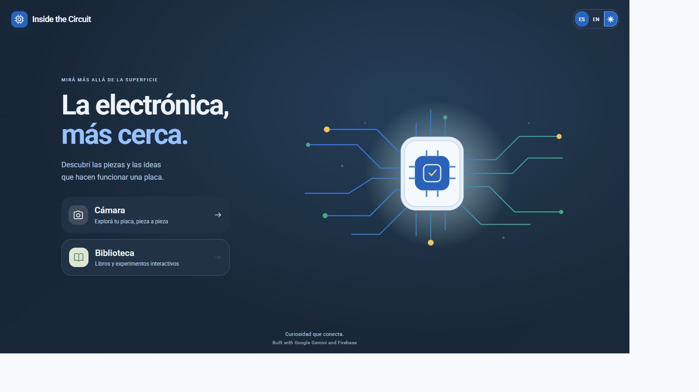
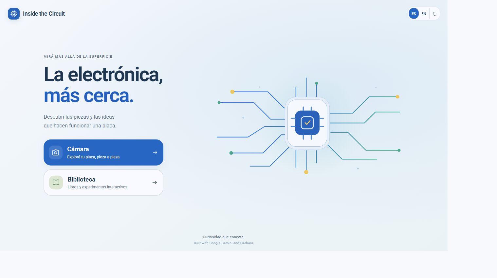
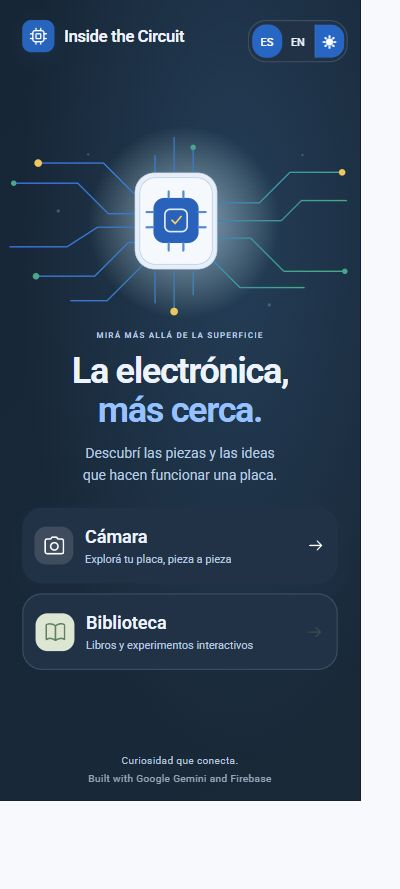
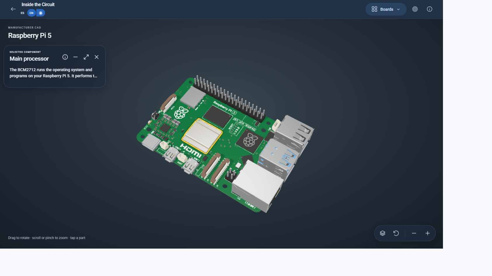
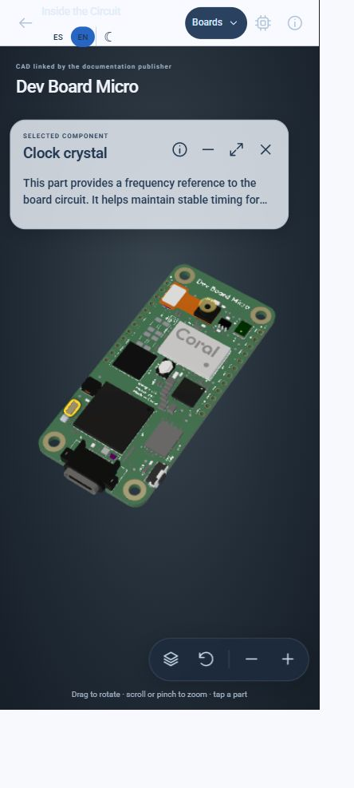

# Inside the Circuit — candidata integrada RC1

Preparada el 25/11/2026 (algunas trazas UTC son del 26/11). Rama **release/hackathon-rc1**, base `c745e1ef5852439292b07f6a67b0e249d69f6d0a`. `main` se conserva en `2633677fda6c538f695760238ce47a23f048cf67`. Repositorio privado: https://github.com/cafka/inside-the-circuit . El SHA final está en el historial de esta rama y en el recibo de entrega; no se inserta un SHA autorreferente ficticio en este archivo.

## Resultado

Una instancia en **http://127.0.0.1:4188/** abre la portada y contiene las cuatro placas. Se unificaron copias verificadas de los catálogos, preservando originales. No se repitieron inferencias ni búsquedas de incorporación. Quedan integrados entrada por nombre, carga/captura y su selección automática de ruta, catálogo persistente, visor, fichas, temas y biblioteca. **No se declara completado el recorrido real foto→identidad→contornos para cualquier placa:** faltan configuración activa de IA y localizadores compatibles adicionales.

### Motor 2040

- Apariencia frontal, posiciones y polígonos preservados; sustrato aproximado 1,6 mm y relieve educativo de 0,6 mm para las 13 regiones sin cota documentada. Cero alturas de piezas respaldadas; 13 relieves ilustrativos, no mediciones.
- Restricción total documentada: 7,7 mm. La visualización suma 2,2 mm en esas regiones, no utiliza 7,7 como espesor.
- Foto posterior oficial previamente adquirida: `source-4`, PNG decodificado SHA-256 `68c8083d30ac509a665dc928b4734c20c87ad759e57a95345d7ef387ad1f105d`. Clasificación de cara mediante revisión humana; límites y registro determinados por el procedimiento genérico. Error de proporción 0,00625; comprobación independiente de orificios: 0,318 / 0,173 / 0,348 / 0,277 mm en la escala de la imagen. Son errores de registro fotográfico aproximado, no metrología física.
- GLB nuevo `afe56b2a475a8b30fdc3dab780f3238446881e29465d041f0a08b18b443be2c8`; 31 nodos de malla. No se añade geometría de soldadura inventada.
- Capturas frontal/posterior/ficha están localmente en `.local/release/evidence/motor-*.jpg`. Sus píxeles proceden de fotos sin licencia de redistribución aclarada; no se incluyen en la publicación limpia.

### Interfaz y selección

Temas centralizados, oscuro predeterminado, persistencia, ES/EN y selector junto al idioma. Sin cambios a materiales/luces al alternar tema. Se conservaron cámara manual, contorno amarillo, emisión temporal, ficha transparente y proximidad. El catálogo distingue **piezas seleccionables** de fichas educativas completas.

Abrieron las cuatro placas. Selecciones de menú observadas: Motor USB-C, Nano USB-C, Coral controlador USB y cristal consecutivos, Pi BCM2712. Clic directo sobre BCM2712 seleccionó correctamente su ficha. La comparación de estados conservó exactamente cámara, selección y modelo al abrir y volver de la biblioteca. Tres intentos directos sobre otras geometrías de Coral devolvieron falta de asociación; no se contaron como aciertos ni se convirtió esta revisión en una nueva batería de precisión. Debe completarse una revisión táctil física antes de la demo pública.

Resoluciones CSS reales comprobadas: **360×800, 390×844 y 1366×768**, sin desplazamiento global. El navegador tenía zoom 90%; se compensó la emulación y se guardaron dimensiones leídas del DOM, en vez de confundir el tamaño solicitado con el efectivo. Las primeras capturas móviles no compensadas quedan locales; los archivos con sufijo `-360`/`-390` documentan la prueba correcta.

### Biblioteca

Operativa en `/library/`, cuatro capítulos Pi y uno DevKitC. Comparación de 31 archivos JS/CSS/HTML/JSON entre los commits públicos/fuente revisados: cero diferencias. Prueba real: libro Pi, `led.on()`, HIGH/ON y 3,9 mA. Wrapper móvil visible; regreso conserva exploración. Pi ofrece acceso compatible; Nano no hereda el pinout DevKitC. Inglés/tema propio se explican. No se modificaron libros ni repositorios Kiro. Una comprobación adicional de lectura no logró mostrar el control «Read page» tras abrir el libro (timeout de 10 s; también falló la captura). Volver a la portada funcionó. No se conoce la causa y la lectura queda pendiente de revisión manual; no se invalida ni se amplía la prueba previa de simulación. [Traza de lectura](../release/evidence/library-reading.json). [Detalles](LIBRARY_INTEGRATION.md).

## Mediciones y evidencia

| Prueba | Resultado real |
|---|---|
| Pruebas focalizadas | 30/30 (véase recibo final); dobles de IA etiquetados |
| Asociaciones de catálogo | 247 resolvieron nodos existentes sin doble propietario; no significa 247 identidades visuales verificadas |
| Catálogo unificado | 4 placas, 0 descargas, 0 inferencias |
| Restauración Nano desde directorio vacío | 15.426 ms, conversión STEP, hash exacto |
| Restauración Motor | 4.972 ms, generación local, hash exacto |
| Restauración Coral | 318 ms, copia verificada |
| Restauración Pi | 1.484 ms, copia verificada |
| Entradas de restauración | 3 recursos oficiales cacheados; adquisición remota nueva no medida |
| Apertura Pi desde catálogo | carga GLB 445,6 ms; primer render medido 2.083,9 ms en esta sesión |
| Pi GLB | 47.466.068 bytes; 1.639.324 triángulos. No se asegura fluidez en teléfonos por una medición de escritorio |
| Bundle de la app | aproximadamente 959 kB sin comprimir; modelos se cargan aparte |
| Nueva facturación / VM / inferencias | 0 acciones / 0 VM creadas / 0 llamadas |

Las cifras no son una batería estadística ni FPS sostenidos. Preparación, carga e inferencia se reportan por separado. [Restauración](../release/evidence/restoration.json), [pruebas](../release/evidence/tests.json), [dimensiones responsive](../release/evidence/responsive-dimensions.json), [selección y regreso](../release/evidence/library-return-state.json), [clic BCM2712](../release/evidence/pi5-direct-state.json).

Tras reiniciar la instancia final, la portada, `/library/` y los cuatro modelos respondieron HTTP 200. Los cuatro nombres se resolvieron contra el catálogo persistente, sin inferencia ni nueva incorporación. [Comprobación HTTP](../release/evidence/http-smoke.json).

## Gemini, Firebase y cámara: estado exacto

La comprobación real en Chrome 146 encontró `promptAPIPresent:false`, `imageAvailability:api_not_exposed`, 8 CPU lógicas y 4 GiB de memoria reportada por navegador. `configurationPresent:false`, `cloudEnabled:false`, cero descargas/calls. [Registro real](../release/evidence/ai-environment.json).

El cliente de producción implementa Nano primero, fallback Cloud autorizado, esquema estricto, fuente real de inferencia, App Check y uso. Esas transiciones se probaron con dobles controlados, no con una respuesta real nueva. Se conserva evidencia histórica real Nano/Cloud y el último experimento Motor. El cierre previo registró facturación desactivada y credenciales temporales revocadas; esta iteración no reactivó nada ni reinició el presupuesto de US$20.

El equipo no expuso cámara física. La automatización de selección de archivos de Chrome fue rechazada por el permiso de URLs de archivo de la extensión. No se fingió una carga ni se sustituyó por un nombre predecido. La usuaria puede comprobar la carga manual; la prueba automática queda pendiente en un entorno que lo permita. No debe interpretarse esta limitación de control del navegador como ausencia del manejador de carga implementado.

La imagen se conserva en el canvas mientras se procesa identidad/geometría. La ruta fotográfica histórica solo reconoce Pi 5 con referencias locales; otras placas muestran honestamente localización no disponible. Los archivos de referencia no están autorizados para la distribución pública limpia.

## Cobertura educativa

Pi 1 y Nano 4 fichas revisadas; Coral 229 asociaciones, 8 descripciones bilingües generadas por reglas documentales y restantes registros parciales; Motor 13 propuestas bilingües. No se llamó a Gemini para rellenar funciones desconocidas. Una descripción de clase no prueba la función específica en el circuito, y ninguna ficha convierte una asociación geométrica en probabilidad calibrada.

## Instalación, seguridad y publicación

Código/dependencias fijadas, `npm ci`, `npm run build`, `npm run catalog:restore`, `npm start`; [instalación completa](INSTALLATION.md). La restauración reproduce cuatro hashes con recursos externos autorizados, sin archivos fotográficos privados ni Cloud. La instalación limpia Node instaló 128 paquetes, compiló y pasó 30 pruebas en 832,36 ms; npm audit informó cero vulnerabilidades. El primer empaquetado omitía tres módulos compartidos de materiales; se corrigió y se repitió la compilación. Se ejecutaron además 27 pruebas históricas del adaptador/controlador con dobles controlados (331,59 ms). No se instaló un entorno Python desde cero: la restauración utilizó el runtime fijado ya existente. [Recibo](../release/evidence/clean-install.json).

[Auditoría y licencias](RELEASE_SECURITY_LICENSES.md): historia completa alcanzable examinada; no publicar el repositorio privado indiscriminadamente. Se prepara un candidato sin historia mediante allowlist, con manifiesto y sin medios no autorizados. Fotos Motor, STEP Nano y referencias fotográficas históricas tienen límites diferentes, documentados individualmente. PyMuPDF y libros conservan licencias separadas. MIT permanece para el código propio.

## Revisión manual y siguiente paso

1. Abrir la dirección local y revisar Motor por delante y detrás, seleccionando piezas y confirmando que el relieve educativo es adecuado.
2. Probar cámara/subida con un archivo de nombre neutral en un entorno con capacidad real. Autorizar y configurar una sesión supervisada si se requiere Cloud; comprobar App Check aceptado/rechazado, fuente, latencia y gasto. No aprobar capacidades por tests simulados.
3. Revisar las cuatro placas en un teléfono físico, selección directa/proximidad, ambas caras y fichas, sin mover automáticamente la cámara.
4. Revisar licencias pendientes y el candidato limpio antes de aprobar visibilidad pública, merge o despliegue. El servidor actual no es un backend público multiusuario.
5. Para Devpost: publicar el candidato aprobado con licencia e instalación, adjuntar arquitectura, video de funciones realmente ejecutadas y límites, enlazar el repositorio público y completar los campos oficiales. No se presentó el formulario ni se publicó un servicio durante esta tarea.

La RC consolida la aplicación y sus resultados; los bloqueos anteriores impiden describirla todavía como un recorrido genérico de foto a componentes completamente validado o como un despliegue público listo sin intervención.
